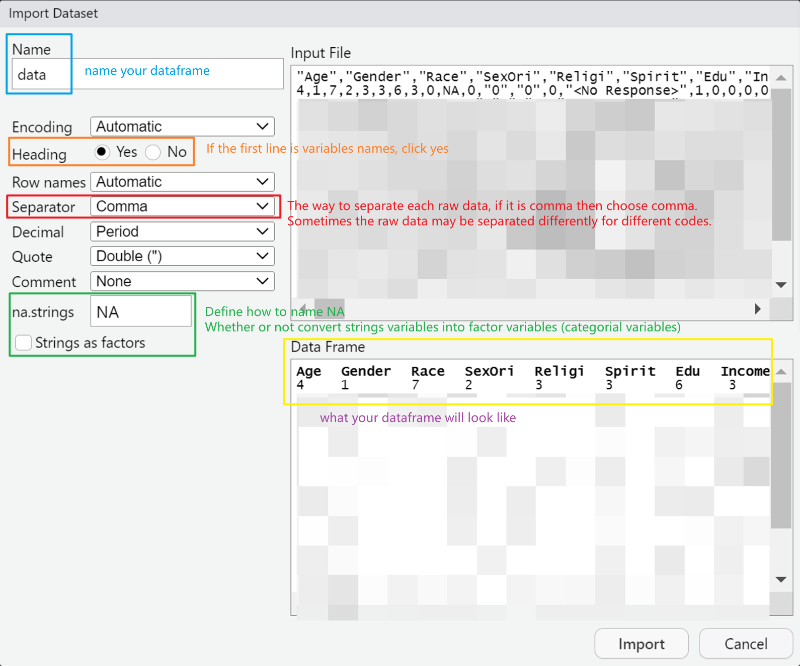

# R Basic Operations

## Before You Start

1. How do I import and export data? What if I have multiple data files to read?
2. How do I add or remove a column or row?
3. How do I convert variables from numeric to factor?

## Basic Procedure

### Import Dataset

From the menu, **File > Import Dataset**:


Or from the Environment pane, **Import Dataset**:



### Useful Packages: [Tidyverse](https://www.tidyverse.org/)

Tidyverse makes R much less painful. It is a collection of packages with utility functions that we will use a lot for data processing.

- [**readr**](https://readr.tidyverse.org/articles/readr.html): Read and import data based on specific conditions. You can read more in [R for Data Science: Data import](https://r4ds.hadley.nz/data-import).
- [**dplyr**](https://dplyr.tidyverse.org/articles/dplyr.html): Process rows or columns, for example selecting specific columns or renaming a column.
- [**tibble**](https://tibble.tidyverse.org/articles/tibble.html): A modern way of creating data frames.
- [**stringr**](https://stringr.tidyverse.org/articles/stringr.html): Handle character variables (everything you can imagine). For example: calculating the length of a string; adding, removing, and modifying spaces; sorting; counting; case conversion; and detecting, locating, extracting, matching, replacing, and splitting. It is very useful for batch processing variable names in quantitative research.
- [**purrr**](https://purrr.tidyverse.org/): Mainly provides the `map()` functions, which are more concise and effective than a `for` loop. They are useful when you repeat the same operation many times, but we will leave them for the Statement section.
- [**forcats**](https://forcats.tidyverse.org/articles/forcats.html): Sort, filter, and combine factors (categorical variables).

## Summary and Practice

### Find Path

#### Find a file path

- **When to use:** You want to import a data file. `file.choose()` opens a file browser and gives you the path, which you can copy into a read function.
- **Functions:**
  - Run it and it gives you the path: `file.choose()`
  - Combine them together: `read_sav(file.choose())`
- **Comment:** Use `/` instead of `\` when you type a path by hand.
- **Resources:** [RDocumentation: file.choose](https://www.rdocumentation.org/packages/base/versions/3.6.2/topics/file.choose)

#### Build a file path with here

- **When to use:** You know a file's name and where it sits inside your project folder, and want a path that works on any computer.
- **Functions:** here package: `here("data", "file.csv")`
- **Comment:** `here()` does not search for the file. It joins your project root (the folder with your `.Rproj` file) with the names you give it, so the same script runs on any computer without changing paths.
- **Resources:** [here: Introduction](https://here.r-lib.org/articles/here.html)

#### Get or set the working directory

- **When to use:** The working directory is where R reads and saves files by default.
- **Functions:** `getwd()`, `setwd()`
- **Comment:** This is very useful when you combine it with statements, such as reading multiple files.
- **Resources:** [R-bloggers: Get and set working directory (setwd / getwd) in R](https://www.r-bloggers.com/2021/12/get-and-set-working-directory-setwd-getwd-in-r/)

### Import and Export Dataset

#### Import a dataset

- **When to use:** Read data (or multiple datasets), data from a remote path, specific columns, etc.
- **Functions:**
  - haven package: `read_sav()`
  - Base R: `read.csv()`
  - readr package: `read_csv()`; to specify variable types, use the `col_*()` functions, e.g. `read_csv("data.csv", col_types = cols(ID = col_character()))`
- **Comment:** I recommend importing a csv file instead of a sav file to avoid possible errors: haven reads the SPSS labels, which can cause issues. `read_csv()` is faster and does not convert strings to factors. It also gives you many ways to read specific files.
- **Resources:** [haven: read_spss](https://haven.tidyverse.org/reference/read_spss.html), [readr: read_delim](https://readr.tidyverse.org/reference/read_delim.html), [R for Data Science: Data import](https://r4ds.hadley.nz/data-import)

#### Read multiple datasets

- **When to use:** Read several files and stack them vertically into one data frame, with the file name stored in a first column called `Name`. If you want to keep the result in the environment, remember to assign it to an object.
- **Functions:**
  - readr package: `data <- read_csv(c("A.csv", "B.csv"), id = "Name")`
  - Base R: `lapply()` or a `for` loop (see [Syntax Sample](#syntax-sample))
  - purrr package: `combined_data <- map_dfr(c("A.csv", "B.csv"), ~ read_csv(.x) %>% mutate(file = .x))`
- **Comment:** I don't suggest `lapply()` or `for` statements if you are a beginner. Their logic is to go through the whole folder, reading each path and file name in turn.
- **Resources:** [Stack Overflow: Add filename column to table as multiple files are read and bound](https://stackoverflow.com/questions/46299777/add-filename-column-to-table-as-multiple-files-are-read-and-bound)

#### Export data

- **Variable types:** All
- **When to use:** Export your data. Here I only list csv files, but you can also export an Excel file with the writexl package: `library(writexl)`, then `write_xlsx(df, "data.xlsx")`.
- **Functions:**
  - Base R: `write.csv(data, file = "data.csv", row.names = FALSE)`
  - readr package: `write_csv(data, "data.csv")`
- **Comment:** As with importing, you have a number of options when you export (check the function documentation for details). `write_csv()` runs fast.
- **Resources:** [rdrr.io: write.table](https://rdrr.io/r/utils/write.table.html), [readr: write_delim](https://readr.tidyverse.org/reference/write_delim.html)

### Convert Variable Types

#### Check data types

- **Variable types:** All
- **When to use:** You want to see each variable's data type and decide whether to convert it.
- **Functions:** `str()`
- **Comment:** `str()` shows the type of a list, object, vector, or column.
- **Resources:** [Statology: How to use str() function in R](https://www.statology.org/str-function-in-r/)

#### Convert to numeric

- **Variable types:** All
- **When to use:** Create dummy variables, or convert factors to numbers after importing a csv file.
- **Functions:** `as.numeric(x, ...)`
- **Comment:** When you use `as.numeric()` on a factor, R returns the internal integer code of each level, not the level itself. Use `as.numeric(as.character(x))` instead (see [Syntax Sample](#syntax-sample)).
- **Resources:** [RDocumentation: numeric](https://www.rdocumentation.org/packages/base/versions/3.6.2/topics/numeric), [Data Wrangling Recipes in R: Numeric/integer variables](https://bookdown.org/hcwatt99/Data_Wrangling_Recipes_in_R/chNumeric.html)

#### Convert to character

- **Variable types:** All
- **When to use:** Convert numbers or logical values into text, e.g. participant IDs that should be treated as labels rather than numbers.
- **Functions:** `as.character()`
- **Resources:** [RDocumentation: character](https://www.rdocumentation.org/packages/base/versions/3.6.2/topics/character)

#### Convert to logical

- **Variable types:** All
- **When to use:** Convert numbers into `TRUE`/`FALSE`: 0 becomes `FALSE` and any non-zero number becomes `TRUE`. In the other direction, `as.numeric()` turns `TRUE` into 1 and `FALSE` into 0.
- **Functions:** `as.logical()`
- **Resources:** [RDocumentation: logical](https://www.rdocumentation.org/packages/base/versions/3.6.2/topics/logical), [Data Wrangling Recipes in R: Logical variables](https://bookdown.org/hcwatt99/Data_Wrangling_Recipes_in_R/chLogical.html)

#### Convert to factor

- **Variable types:** All
- **When to use:** Display levels instead of numbers in the value column.
- **Functions:** `as.factor()`
- **Resources:** [RDocumentation: factor](https://www.rdocumentation.org/packages/base/versions/3.6.2/topics/factor), [Data Wrangling Recipes in R: Factor/categorical variables](https://bookdown.org/hcwatt99/Data_Wrangling_Recipes_in_R/chFacts.html)

#### Convert to date

- **Variable types:** All
- **When to use:** Convert a string of numbers or characters into a date or time.
- **Functions:** `as.Date()`, `format()`, `as.POSIXct()`, `as.POSIXlt()`
- **Resources:** [Data Wrangling Recipes in R: Date/time variables](https://bookdown.org/hcwatt99/Data_Wrangling_Recipes_in_R/chDate.html), [Stat2Labs: Introduction to working with dates in R](https://www.stat2labs.sites.grinnell.edu/Handouts/rtutorials/IntroDates.html)

#### Convert a character vector into a more specific type

- **Variable types:** All
- **When to use:** You want to convert a character variable to the appropriate type (date, factor, logical, double, integer, etc.).
- **Functions:** readr package: the `parse_*()` functions, e.g. `parse_number()`, `parse_date()`
- **Comment:** These functions are very useful in data cleaning, as long as your data follows a specific pattern. `parse_number()` extracts the number from a string that contains non-numeric characters.
- **Resources:** [readr: Introduction](https://readr.tidyverse.org/articles/readr.html)

### Subset Selection and Modification

#### Remove rows

- **Variable types:** All
- **When to use:** You no longer need one participant's data.
- **Functions:**
  - Remove the second row: `data[-2, ]`
  - Base R: `subset()`
  - dplyr package: `filter()`
- **Comment:** `-` and `!` mean "delete". Inside `data[rows, columns]`, the `,` separates rows from columns, and leaving one side empty means all rows or all columns.
- **Resources:** [FavTutor: Remove row in R](https://favtutor.com/blogs/remove-row-in-r), [Displayr: How to remove a row or column from a table using R](https://help.displayr.com/hc/en-us/articles/360003863576-How-to-Remove-a-Row-or-Column-from-a-Table-Using-R)

#### Remove columns (variables)

- **Variable types:** All
- **When to use:** You no longer need a column.
- **Functions:**
  - By name: `data[, !names(data) %in% "variable"]`
  - Remove the first column: `data[, -1]`
  - Base R: `subset()`
  - dplyr package: `select(-variable)`
- **Comment:** As with rows, `-` and `!` mean "delete", and leaving one side of the `,` empty means all rows or all columns.
- **Resources:** [ListenData: Select or remove columns from data frame](https://www.listendata.com/2015/06/r-keep-drop-columns-from-data-frame.html), [Spark By Examples: How to remove column in R](https://sparkbyexamples.com/r-programming/remove-column-in-r/)

#### Subset selection

- **Variable types:** All
- **When to use:** Select part of the raw data frame.
- **Functions:**
  - Base R: `subset()`
  - Remove the second row and the first column: `data[-2, -1]`
- **Comment:** You can take subsets of vectors, matrices, data frames, and lists, but selecting rows and columns of data frames is what we do most. Mastering `filter()` and `select()` is enough.
- **Resources:** [Stack Overflow: How to subset rows and columns in R](https://stackoverflow.com/questions/65650497/how-to-subset-rows-and-columns-in-r), [RDocumentation: subset](https://www.rdocumentation.org/packages/base/versions/3.6.2/topics/subset), [Advanced R: Subsetting](https://adv-r.hadley.nz/subsetting.html)

#### Add, modify, or delete columns

- **When to use:** Add two columns holding the mean and the z-score. You can also delete a column by setting it to `NULL`.
- **Functions:** dplyr package: `mutate(data, new_column = ...)`
- **Comment:** You can add several columns in one `mutate()` call, and a new column can be a vector, the result of a function, or a single value. `mutate()` is useful together with statements or other functions.
- **Resources:** [dplyr: mutate](https://dplyr.tidyverse.org/reference/mutate.html)

#### Select specific columns

- **When to use:** `select()` can be combined with other functions, statements, or conditions to pick the columns you want.
- **Functions:** `select()`
- **Comment:** Combined with other conditions, you can also choose variables by naming pattern, such as variables whose names start with certain letters.
- **Resources:** [dplyr: select](https://dplyr.tidyverse.org/reference/select.html)

#### Select columns by name pattern

- **Variable types:** All
- **When to use:** Extract the variables that start with "A", end with "C", and contain "b".
- **Functions:**
  - dplyr package: `starts_with()`, `ends_with()`, `contains()`, `everything()`
  - Base R, keep only the leading letters of each column name: `gsub("[^A-Za-z]+.*", "", colnames(df))`
- **Comment:** These conditions can be combined with `&`, `|`, `!`, etc.
- **Resources:** [dplyr: select](https://dplyr.tidyverse.org/reference/select.html)

#### Select specific rows

- **Variable types:** All
- **When to use:** Choose rows based on column values, or split the data frame.
- **Functions:**
  - dplyr package: `filter()`
  - Index rows by their (integer) positions: `slice()`
- **Comment:** `filter()` keeps the rows that meet a condition written with `==`, `>`, etc. `slice()` can't delete or replace rows directly, but you can do it by selecting the rows you want and saving them as a new data frame. `slice()` works by position, while `filter()` works by content (conditions).
- **Resources:** [dplyr: filter](https://dplyr.tidyverse.org/reference/filter.html), [dplyr: slice](https://dplyr.tidyverse.org/reference/slice.html)

#### Keep only unique/distinct rows

- **Variable types:** All
- **When to use:** You only want unique participant data (removing duplicates), or you are looking for outliers.
- **Functions:** `distinct()`, `unique()`
- **Comment:** These two functions are very useful in data cleaning, especially `unique()`, which you can combine with a loop.
- **Resources:** [dplyr: distinct](https://dplyr.tidyverse.org/reference/distinct.html), [rdrr.io: unique](https://rdrr.io/r/base/unique.html)

#### Extract a specific variable or column

- **Variable types:** All
- **When to use:** You want only one variable (column) instead of the entire data frame.
- **Functions:**
  - Base R: `data$Variable`, or `` data$`Variable 1` `` if the name contains a space
  - dplyr package: `pull()`
- **Comment:** Be careful how you name variables: avoid spaces and special characters such as `-`. If a name has them, wrap it in backticks.
- **Resources:** [dplyr: pull](https://dplyr.tidyverse.org/reference/pull.html)

### Data Frames and Essential RStudio Operations

#### Create an object

- **Functions:** `<-`
- **Comment:** From the start, get into the good habit of saving the result of every processing step as an object in the environment.

#### Display an object

- **When to use:** You want to see your results, data, list, etc.
- **Functions:** `print()`, or just run the object's name (e.g. `data`)
- **Comment:** In RStudio you can run code line by line, and you can select just an object's name and run it to see its contents.

#### List all the variables

- **Variable types:** All
- **When to use:** Find out what variables your data frame contains.
- **Functions:**
  - Base R: `names(data)`, `colnames(data)`, `str(data)`, `ls(data)`
  - dplyr package: `glimpse(data)`
- **Resources:** [dplyr: glimpse](https://dplyr.tidyverse.org/reference/glimpse.html)

#### Pipe an object forward into a function

- **When to use:** In multi-step operations, pass the result of one step to the next function to keep the syntax concise.
- **Functions:** magrittr package (loaded with tidyverse): `%>%`
- **Comment:** The shortcut is `Ctrl + Shift + M` (`Cmd + Shift + M` on Mac). You will use it very often.
- **Resources:** [magrittr: pipe](https://magrittr.tidyverse.org/reference/pipe.html), [Pipe baking animation (GIF)](https://github.com/arthurwelle/VIS/blob/master/Pipe_Cake/Pipe_baking.gif)

#### Check the R version or cite R

- **When to use:** You want to cite R or RStudio in your paper.
- **Functions:**
  - Citation for R: `citation()`
  - R version: `R.version.string`
  - RStudio version: `RStudio.Version()`
- **Resources:** [Posit Support: Citing RStudio](https://support.posit.co/hc/en-us/articles/206212048-Citing-RStudio)

#### Save R objects

- **When to use:** Save objects, or the whole working environment, so that you can return to the same state later.
- **Functions:** `save()`, `save.image()`
- **Resources:** [RDocumentation: save](https://www.rdocumentation.org/packages/base/versions/3.6.2/topics/save)

#### Clean the environment

- **When to use:** Your memory is running low, or you no longer need the objects in the environment.
- **Functions:** Remove everything: `rm(list = ls())`
- **Comment:** Use `rm(list = ls())` carefully. You can also click the broom icon at the top of the Environment pane.

#### List or remove objects

- **Functions:**
  - Remove one object: `rm()`
  - List objects: `ls()`

#### Reduce function calls with do.call()

- **Variable types:** All
- **When to use:** Merge multiple data frames, or avoid writing out the same function call many times.
- **Functions:** `do.call()`
- **Comment:** `do.call()` calls another function dynamically and passes it a list of arguments, e.g. `do.call(rbind, data_list)` stacks every data frame in a list.
- **Resources:** [Stack Overflow: What's the difference between lapply and do.call?](https://stackoverflow.com/questions/10801750/whats-the-difference-between-lapply-and-do-call), [Steve's Data Tips and Tricks: The do.call() function in R](https://www.spsanderson.com/steveondata/posts/2023-06-01/index.html)

#### Another type of data frame: tibble

- **Variable types:** All
- **When to use:** You want a data frame that prints and behaves more nicely.
- **Functions:**
  - tibble package: `tibble()`
  - Coerce objects into tibbles: `as_tibble()`
- **Comment:** A tibble does not support row names and encourages using columns as unique identifiers. It also prints and displays better.
- **Resources:** [tibble: tibble](https://tibble.tidyverse.org/reference/tibble.html)

#### Reorder columns

- **Variable types:** All
- **When to use:** Put the participant ID in the first column.
- **Functions:** dplyr package: `relocate()`, `select()`
- **Comment:** `relocate()` is cleaner and simpler, and it doesn't change the structure of the data. `select()` has more functionality.
- **Resources:** [dplyr: relocate](https://dplyr.tidyverse.org/reference/relocate.html), [dplyr: select](https://dplyr.tidyverse.org/reference/select.html)

#### Reorder rows

- **Variable types:** Continuous
- **When to use:** Sort the rows of the data frame in ascending or descending order of one or more columns.
- **Functions:**
  - Base R: `data[order(data$age), ]`; `sort()` sorts a single vector
  - dplyr package: `arrange()`; descending order: `desc()`
- **Comment:** `sort()` handles only one vector, while `arrange()` reorders the rows of a data frame and accepts several conditions, e.g. age in ascending order and then depression level in descending order: `arrange(data, age, desc(depression))`.
- **Resources:** [rdrr.io: order](https://rdrr.io/r/base/order.html), [rdrr.io: sort](https://rdrr.io/r/base/sort.html), [dplyr: arrange](https://dplyr.tidyverse.org/reference/arrange.html), [dplyr: desc](https://dplyr.tidyverse.org/reference/desc.html)

### Data Cleaning Preparation

#### Detect, locate, extract, match, replace, and split characters

- **Variable types:** Character
- **When to use:** Pick the variables whose names share the same first three letters; replace specific letters.
- **Functions:**
  - stringr package: `str_detect()`, `str_extract()`, `str_replace()`, `str_split()`
  - Base R: `grep()`, `grepl()`, `sub()`, `gsub()`
- **Comment:** Processing characters is a big topic, so learn the functions when you actually clean or process data. Modern programming languages are very flexible at handling characters: don't handle them manually if you can; use statements or scripts instead.
- **Resources:** [stringr: Introduction](https://stringr.tidyverse.org/articles/stringr.html), [rdrr.io: grep](https://rdrr.io/r/base/grep.html), [R Programming for Data Science: Regular expressions](https://bookdown.org/rdpeng/rprogdatascience/regular-expressions.html), [R for Data Science (1st edition): Strings](https://r4ds.had.co.nz/strings.html)

#### Sort, filter, and combine factors

- **Variable types:** Categorical
- **When to use:** You are not satisfied with the order of factor levels: e.g. in a figure you want the frequencies ordered from largest to smallest, or in a logistic regression you want a specific level as the reference group.
- **Functions:** forcats package: the `fct_*()` functions, e.g. `fct_infreq()` (order by frequency) and `fct_relevel()` (set the reference level)
- **Resources:** [forcats: Introduction](https://forcats.tidyverse.org/articles/forcats.html), [R for Data Science (1st edition): Factors](https://r4ds.had.co.nz/factors.html), [R Programming: Zero to Pro: Character vectors, factors & ordered factors](https://r02pro.github.io/factors.html)

#### Check your data

- **When to use:** Check that data entry and import are correct.
- **Functions:**
  - Base R: `summary()`
  - dplyr package: `slice()`; randomly select rows: `slice_sample()`
  - First or last few rows: `head()`, `tail()`
- **Comment:** `summary()` gives detailed information about each variable: minimum, first quartile, median, mean, third quartile, and maximum for numeric variables, and frequencies for each factor level. `slice()`, `head()`, and `tail()` let you look at the raw data directly.
- **Resources:** [dplyr: slice](https://dplyr.tidyverse.org/reference/slice.html)

#### Rename variables

- **Variable types:** All
- **When to use:** Change a variable name from "score" to "total_score".
- **Functions:** dplyr package: `rename(data, total_score = score)`
- **Resources:** [dplyr: rename](https://dplyr.tidyverse.org/reference/rename.html)

#### Reshape data: wide to long, or long to wide

- **Variable types:** All
- **When to use:** Typically each column is one variable ("ID, Variable 1, Variable 2, ..."), but sometimes you need several variables stacked into one column and sorted by ID (e.g. for a figure).
- **Functions:**
  - tidyr package, long to wide: `pivot_wider()`
  - tidyr package, wide to long: `pivot_longer()`
- **Resources:** [tidyr: pivot_wider](https://tidyr.tidyverse.org/reference/pivot_wider.html), [tidyr: pivot_longer](https://tidyr.tidyverse.org/reference/pivot_longer.html)

### Combine Data Frames, Rows, and Columns

The join examples below use two data frames: `data1` with IDs 1, 2, 3, 4 and `data2` with IDs 1, 2, 3, 5.

#### Stack data frames vertically (add rows)

- **Variable types:** All
- **When to use:** Add more participants' data to the raw data frame.
- **Functions:** dplyr package: `bind_rows()`; Base R: `rbind()`
- **Resources:** [dplyr: bind_rows](https://dplyr.tidyverse.org/reference/bind_rows.html)

#### Combine data frames side by side (add columns)

- **Variable types:** All
- **When to use:** Add more columns or variables.
- **Functions:** dplyr package: `bind_cols()`; Base R: `cbind()`
- **Comment:** Rows are matched by position, not by ID, so both data frames must have the same participants in the same order. To match by ID, use a join (below).
- **Resources:** [dplyr: bind_cols](https://dplyr.tidyverse.org/reference/bind_cols.html)

#### Merge two data frames by ID, keeping one side

- **Variable types:** All
- **When to use:** Add more variables to the raw data frame. If data1 and data2 share (some) IDs, you can merge the remaining columns using the IDs of data1 or data2 as the baseline.
- **Functions:** dplyr package: `left_join(data1, data2, by = "ID")`, `right_join(data1, data2, by = "ID")`
- **Comment:** When the IDs do not fully match, left or right decides whose IDs you keep. With `left_join()`, the result keeps only IDs 1, 2, 3, 4, and for ID 4 the variables from data2 will be NA.
- **Resources:** [dplyr: Mutating joins](https://dplyr.tidyverse.org/reference/mutate-joins.html), [RDocumentation: plyr join](https://www.rdocumentation.org/packages/plyr/versions/1.8.9/topics/join), [R for Data Science: Joins](https://r4ds.hadley.nz/joins)

#### Merge all data from both data frames

- **Variable types:** All
- **When to use:** You want all data from both datasets and don't want to drop anything. The combined data frame will have IDs 1, 2, 3, 4, 5.
- **Functions:** `full_join()`
- **Comment:** This keeps all data, and any missing information is filled with NA.
- **Resources:** [dplyr: Mutating joins](https://dplyr.tidyverse.org/reference/mutate-joins.html), [RDocumentation: plyr join](https://www.rdocumentation.org/packages/plyr/versions/1.8.9/topics/join), [R for Data Science: Joins](https://r4ds.hadley.nz/joins)

#### Merge two data frames, keeping only the overlapping rows

- **Variable types:** All
- **When to use:** You want the participants whose IDs appear in both datasets. The combined data frame will have IDs 1, 2, 3.
- **Functions:** `inner_join()`
- **Comment:** Only keeps the observations that match in the reference column.
- **Resources:** [dplyr: Mutating joins](https://dplyr.tidyverse.org/reference/mutate-joins.html), [RDocumentation: plyr join](https://www.rdocumentation.org/packages/plyr/versions/1.8.9/topics/join), [R for Data Science: Joins](https://r4ds.hadley.nz/joins)

#### Filter one data frame by another

- **Variable types:** All
- **When to use:** Use data2 as a reference to keep or drop rows of data1. The result has only the columns of data1 and nothing from data2: `semi_join()` keeps IDs 1, 2, 3, and `anti_join()` keeps ID 4.
- **Functions:** `semi_join()`, `anti_join()`
- **Comment:** Similar to `filter()`: it filters your original data frame and does not add anything (columns or rows) from the reference data frame.
- **Resources:** [dplyr: Filtering joins](https://dplyr.tidyverse.org/reference/filter-joins.html), [RDocumentation: plyr join](https://www.rdocumentation.org/packages/plyr/versions/1.8.9/topics/join), [R for Data Science: Joins](https://r4ds.hadley.nz/joins)

#### Merge data frames in different ways

- **Variable types:** All
- **When to use:** Combine two different data frames.
- **Functions:** `merge()`
- **Comment:** `merge()` is more flexible but more complicated.
- **Resources:** [RDocumentation: merge](https://www.rdocumentation.org/packages/base/versions/3.6.2/topics/merge), [An Introduction to R for Research: Merge (join)](https://bookdown.org/rwnahhas/IntroToR/merge-join.html)

#### List all combinations of conditions

- **Variable types:** All
- **When to use:** In a multifactorial experimental design (e.g. 2x2), list all possible combinations of conditions.
- **Functions:** `cross_join()`
- **Comment:** It combines each row of one data frame with each row of another to produce all possible combinations of rows, which is handy when designing psychology experiments.
- **Resources:** [Statology: How to do a cross join in R](https://www.statology.org/cross-join-in-r/), [dplyr: cross_join](https://dplyr.tidyverse.org/reference/cross_join.html)

## Syntax Sample

```r
library(tidyverse)  # readr, dplyr, tidyr, stringr, forcats, purrr
library(haven)      # read_sav()

# Read an SPSS .sav file
dataraw <- read_sav("C:\\Users\\Desktop\\data.sav") # note: use \\ or / instead of \

# List all csv files
csv_files <- list.files(path = "put your path here", pattern = "\\.csv$", full.names = TRUE)

# Read multiple csv files in a folder
folder_path <- "path/to/your/folder"
file_list <- list.files(path = folder_path, pattern = "\\.csv$", full.names = TRUE) # create a file_list
data_list <- lapply(file_list, read.csv) # read all csv files on the file_list
combined_data <- do.call(rbind, data_list) # combine all data frames together

# Read multiple different files in a folder
library(readxl)  # Load the readxl package for reading .xlsx files

# Use the working directory as the folder path
folder_path <- getwd()

# List all files in the specified folder, including full paths
file_list <- list.files(path = folder_path, full.names = TRUE)

# Use lapply to read each file based on its extension
data_list <- lapply(file_list, function(file) {
  # Check if the file is a .csv file and read it as a data frame
  if (grepl("\\.csv$", file)) {
    read.csv(file)  # Read .csv file
  } else if (grepl("\\.txt$", file)) {
    read.table(file)  # Read .txt file
  } else if (grepl("\\.xlsx$", file)) {
    readxl::read_excel(file)  # Read .xlsx file
  # If the file extension is not recognized, return NULL
  } else {
    NULL
  }
})
# Optionally, remove NULL entries from the list
data_list <- Filter(Negate(is.null), data_list)

# Check data types
str(data)
# Check a specific variable in the data frame
str(data$score)

# Convert all values to numeric
dataraw <- as.data.frame(lapply(dataraw, as.numeric))
# Or
dataraw[] <- lapply(dataraw, as.numeric)

# For all columns whose names begin with 'A', subtract 1 from the value
dataraw <- dataraw %>%
  mutate(across(starts_with("A"), ~ . - 1))

# Note: converting a factor into numeric
as.numeric(factor(5:10)) # [1] 1 2 3 4 5 6
f <- factor(1:5)
## what you typically meant and want:
as.numeric(as.character(f))

# Choose all columns from CM onward
df_selected <- df[, which(colnames(df) == "CM"):ncol(df)]
# Or use select()
df_selected <- df %>%
  select(CM:last_col())

# Delete row 2 and row 3
df <- df[-c(2, 3), ]

# Delete column 2 and column 3
df <- df[, -c(2, 3)]

# Take the first three characters of each column name
prefixes <- substr(colnames(data), 1, 3)

# select()
# Select only Variable1 and Variable2 from the data frame
select(data, Variable1, Variable2) # select V1 & V2

# Exclude the column named 'Variable' from the data frame
select(data, -Variable) # delete Variable

# Exclude the column named 'Variable' with ! (negates a selection)
select(data, !Variable) # delete Variable

# Select columns from the 2nd to the 5th positions in the data frame
select(data, 2:5) # select columns from position 2 to 5

# Select columns that start with the letter 'A'
select(data, starts_with("A")) # select columns that start with 'A'

# Select columns that end with the letter 'A'
select(data, ends_with("A")) # select columns that end with 'A'

# Select participants whose age is more than 30, and only keep the Name and Height columns
df <- subset(df, Age > 30, select = c(Name, Height))

# Example character data
char_integer <- c("1", "2", "3")
char_double <- c("1.1", "2.2", "3.3")
char_date <- c("2024-08-22", "2024-09-01", "2024-10-15")
char_logical <- c("TRUE", "FALSE", "TRUE")

# Convert character data to integer
parsed_integer <- parse_integer(char_integer)
print(parsed_integer)  # Output: 1 2 3

# Convert character data to double (numeric)
parsed_double <- parse_double(char_double)
print(parsed_double)  # Output: 1.1 2.2 3.3

# Convert character data to date
parsed_date <- parse_date(char_date)
print(parsed_date)  # Output: 2024-08-22 2024-09-01 2024-10-15

# Convert character data to logical
parsed_logical <- parse_logical(char_logical)
print(parsed_logical)  # Output: TRUE FALSE TRUE

# Reorder columns or variables
df %>% select(ID, everything()) # if you don't want to type the rest of the columns
df %>% relocate(ID)

# Update the Age column by adding 1 to each value, and remove the Score column
df %>% mutate(Age = Age + 1, Score = NULL)
```

## Assignment

> *It doesn't matter if the code is neat and pretty, as long as you get there in the end!*

- Import data as a data frame or tibble. Export the dataset as a csv file.
- Combine multiple files into one big data frame.
- Convert the factor variable into numeric.
- Check the data frame; pull out the first 3 and last 5 rows as a data frame.
- Add a new column and name it "Mean"; add a new row and set its values to `NA`.
- Delete the first column, and remove the last row.

### Functions Required to Know How to Use

Write down what they can do and practice using them.

`file.choose()`, `here()`, `read_csv()`, `write_csv()`, `ls()`, `arrange()`, `summary()`, `<-`, `%>%`, `str()`, `mutate()`, `as.factor()`, `as.numeric()`, `filter()`, `select()`, `starts_with()`, `unique()`, `bind_rows()`, `bind_cols()`

## Resources & References

- [R for Data Science (1st edition): Import, Tidy, Transform, Visualize, and Model Data](https://r4ds.had.co.nz/)
- [R Cookbook, 2nd Edition: Data Structures](https://rc2e.com/datastructures)

### Further Study

Recommended classes or training
