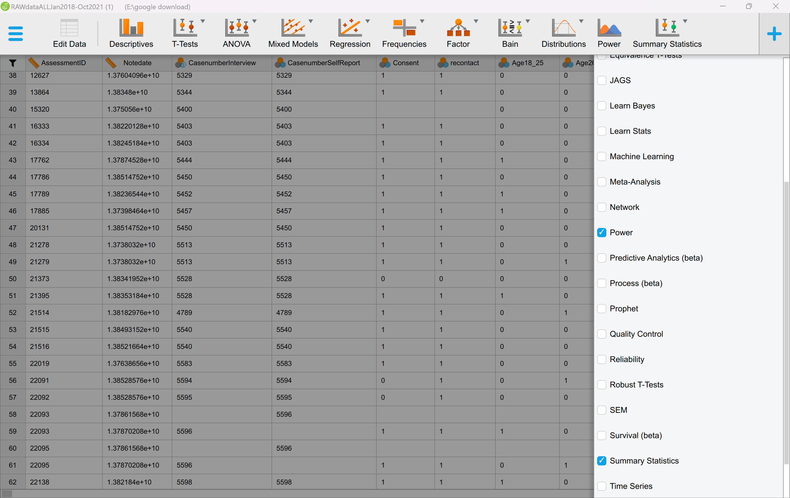

# [Internal] Applied Psychological Statistics and Data Analysis in R and Python

## About this Manual

For people who are not familiar with coding, I would suggest starting with [JASP](https://jasp-stats.org/): it can help you build up the workflow and reduce pain. When you feel familiar with it, you can transfer to R or Python. JASP is free, open-source software with a graphical interface, and it can do a lot of advanced statistics. Better than SPSS!

This document is intended for students who have a psychology, sociology, or neuroscience background, and who use R as their primary statistical tool; SEM-related modules use lavaan and also include Mplus syntax. It focuses on the **application** of statistics and programming to your projects, so it is more of a **toolkit**, and you may need to have some knowledge of statistics and programming. Statistical principles and formulas are kept in optional **Under the hood** sections that you can skip.

### Do I need a foundation in programming and statistics?

Yes, you need to have a slight foundation in statistics and programming. But it's okay if you don't have a firm grasp of the statistics: reading through the examples section of this document will help you solidify the knowledge. In the programming section, although I will not walk you through every step, I will list some necessary basic operations and some syntax samples.

### Do I need to understand the statistical principles and formulas?

Not necessarily. For students who major in social sciences, even if you don't understand statistical principles and mathematical formulas, you can still do data analysis, as long as you know the circumstances under which you should use a statistical method, the specific steps to follow, and how to interpret the results. Still, I recommend that you learn about them if you have the time, as this will deepen your understanding of statistics. That is why some modules include an optional **Under the hood** section: it explains the math behind the method and implements it by hand (for example, with matrix operations), so you can compare the result with the package output and see, for example, that the t-test, ANOVA, and regression are all the same linear model.

### How do I use this manual?

For example, when you get a set of data, after reviewing the literature, you may know how to analyze it (or not), so you try to use R for statistical analysis but find that you do not know what functions or packages to use. Here you can review this document to find which statistical methods, and which functions, are appropriate. However, note that the most cutting-edge algorithms or statistics may still require you to write code.

### What is included in this document?

Each module includes the name of the statistic, the type of variable, an example of the scenario in which it will be used, the packages and functions, useful resources (documentation, web pages, etc.), and a review of the package and the resource. Some modules also include an optional Under the hood section with the math and a hand-coded implementation.

### Why don't you give specific code or steps?

The process of learning programming is similar to riding a bicycle: just knowing the names of the operations is not enough, and you need to practice them over and over again. You can get started by reading a textbook or taking a lecture, but if you are doing a research project, these two methods may not be as effective, as they will take a lot of your time.

In the middle and later stages of programming, you will learn mainly by looking up web pages or reading official documentation, so it is necessary to develop the ability to learn on your own (especially by reading official documentation). Code is flexible: simple copy and paste may not achieve the desired effect if you do not understand what the code means.

## Learning Objectives

- Master the basic syntax and concepts of the R language.
- Be able to write simple scripts to process and analyze data.
- Get familiar with R's data structures, such as vectors, data frames, and lists, and be able to manipulate and process data.
- Import and export data efficiently, work with a variety of data formats, and perform preliminary data cleaning and preparation.
- Select and use appropriate R packages to extend the functionality of R.
- Perform basic statistical analysis and data visualization, and use R to create clear and informative charts.
- Develop problem-solving and self-study skills, applying the knowledge gained to real-world problems through example-based learning and project exercises.

## Outline & Topics

### Undergraduate Level (Version 1.0)

- Introduction: why choose R and how to use this document?
- [R Basic Operations](1_Undergraduate%20Level/R%20Basic%20Operations.md)
    - Importing and exporting data
        - Read and save data frames
        - Merging data, converting variable types, naming variables and labels, and selecting variables
        - Read data from several files and combine data (left and right)
        - Data format: from wide to long
- Exporting data analysis results
    - Plotting: ggplot2 package
    - Tables: gt package
- Data cleaning
    - Handling of missing values: direct deletion, multiple imputation, pros & cons
    - Outliers
- Questionnaires or cross-sectional research:
    - Reverse items, sum, average
- Descriptive statistics: M, SD, frequency, odds
- Assumption checks
    - Normality testing: univariate and multivariate normality tests
    - Homogeneity of variance
    - Residual diagnostics
- Basic statistics:
    - Correlation and linear regression
        - Correlation (Pearson, Spearman)
        - Simple linear regression
        - Multiple linear regression, multicollinearity test (VIF)
    - t-test, ANOVA (linear regression), chi-square test, etc.
        - Within-subject designs: paired t-test, repeated-measures ANOVA (sphericity)
        - Post hoc tests and multiple comparisons
    - Under the hood: the general linear model in matrix form (t-test, ANOVA, and regression as special cases)
    - Nonparametric tests: overview and lookup table
        - Under the hood: rank-based tests as linear models on ranks
    - Multivariate analysis of variance (MANOVA)
    - Effect sizes and confidence intervals
    - Power analysis (a priori)

### Junior Graduate Level (Version 2.0)

- Generalized linear model
    - Logistic regression
    - Ordinal regression
    - Count models: Poisson, negative binomial
- SEM
    - CFA & EFA
    - Mediation test, bootstrap
    - Moderation
    - Multiple group comparison
- Reliability and validity: Cronbach's α, McDonald's ω, convergent, discriminant, and criterion validity
- Longitudinal models
    - Longitudinal SEM
    - Latent growth curve model
    - Random intercept cross-lagged panel model (RI-CLPM)
    - Time series analysis
- Cluster and discriminant analysis: latent profile analysis (LPA), latent class analysis (LCA)
- Principal component analysis & factor analysis
- Bayesian statistics (introduction)
- Meta-analysis & systematic review
- Multilevel modeling (MLM)
- Control flow and defining functions
    - `for` loop
    - `if else`

### Senior Graduate Level (Version 3.0)

**This section will include Python.**

- Regularized regression (lasso, ridge) and cross-validation
- Psychological network analysis
    - Partial correlation networks (Gaussian graphical model, EBICglasso)
    - Accuracy and stability (bootstrap)
    - Network comparison between groups
    - Temporal networks (intensive longitudinal data)
- Extra
    - FDR control
    - Sensitivity analysis
    - Common method biases

### Structure

- Categories: nonparametric & parametric; cross-sectional & longitudinal; categorical & continuous
- Statistical method name (Chinese & English)
- Variable type (the categorization needs to be clear)
- Package & function (R; Mplus syntax for SEM-related modules)
- Nonparametric alternative (for each test module)
- Comment (your own comments, e.g. the difference between ANOVA and the chi-square test)
- Resource (URL, textbook, website, etc.)
- Under the hood (optional): math principles and a hand-coded implementation

## Reference

1. [Sara Emily Burke: Video Series: Brief Introduction to R](https://saraemilyburke.com/statistics.html#BriefIntroR)
2. [Hands-On Programming with R](https://rstudio-education.github.io/hopr/index.html)
3. [R Cookbook, 2nd Edition](https://rc2e.com/)
4. [R Cheat Sheet](https://hshids.github.io/tutorials/Rcheatsheet.html)
5. [PsyTeachR: data-skills-v2 (GitHub)](https://github.com/psyteachr/data-skills-v2)
6. [Research Methods in R (Andy Wills)](https://www.andywills.info/rminr/)
7. [Research Methods in R: source repository (GitHub)](https://github.com/ajwills72/rminr)
8. [The Epidemiologist R Handbook](https://epirhandbook.com/en/index.html)
9. [R for Data Science (2e)](https://r4ds.hadley.nz/)
10. [Advanced R (2e)](https://adv-r.hadley.nz/)
