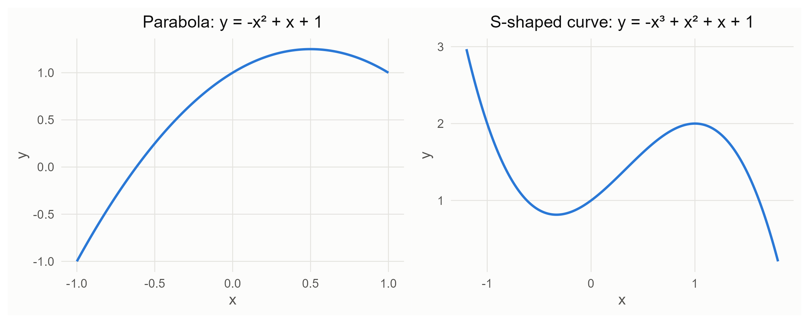
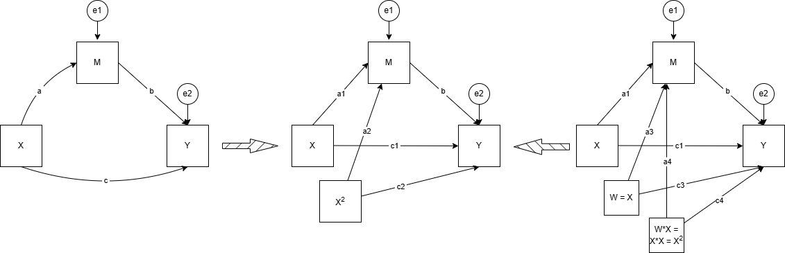



# Nonlinear Mediation

SEM is built on factor analysis and regression, and I'd recommend reviewing regression before you start. Of course it's fine if you don't have a lot of knowledge in this area: from an application standpoint, you just need to understand the indicators and interpret the results.

This chapter is about mediation models in which the paths between observed variables are curved, for example quadratic (Hayes & Preacher, 2010). In the SEM literature, "nonlinear SEM" often means something else: interactions and quadratic effects of latent variables (for example, latent moderated structural equations, LMS, or `XWITH` in Mplus). That is a different topic.

## Linear Mediation: Effects as Slopes

We use slopes to get the path effects and calculate the mediation effect, so these effects are simple to label. Let us start with the simple mediation model:

$$
\begin{aligned}
X \to M:&\quad M = i_1 + aX \\
X, M \to Y:&\quad Y = i_2 + c'X + bM
\end{aligned}
$$

Substituting the equation for $M$ into the equation for $Y$:

$$
Y = i_2 + c'X + b(i_1 + aX) = (i_2 + b\,i_1) + (ab + c')X
$$

So the total effect of $X$ on $Y$ is $c = ab + c'$, the slope you get when you regress $Y$ on $X$ alone ($Y = i_3 + cX$).

### What are the direct and indirect effects?

- Direct effect: a single arrow, such as X → Y, X → M, or M → Y. The direct effect of X on Y ($c'$) is the part of X's effect that does not pass through the mediator.
- Indirect effect: such as X → M → Y. X influences M, and M in turn affects Y. It is quantified as the product of $a$ (X → M) and $b$ (M → Y): when X changes by one unit, Y changes by $ab$ units through M.

Here, the slope is what we want: it quantifies the rate of change between the variables. We can get the slope by taking the derivative. Let's review two rules first:

$$
\begin{aligned}
&\text{Power rule:} && f(X) = X^n, \quad f'(X) = nX^{n-1} \\[6pt]
&\text{Natural log:} && Y = \ln X \;\Rightarrow\; e^Y = X \;\Rightarrow\; e^Y \frac{dY}{dX} = 1 \\[6pt]
& && \Rightarrow\; \frac{dY}{dX} = \frac{1}{e^Y} = \frac{1}{X}
\end{aligned}
$$

The derivative $dY/dX$ is the instantaneous rate of change: the slope of the curve at one point. Next, take the derivatives of the mediation model:

$$
\begin{aligned}
X \to M:&\quad \frac{dM}{dX} = a \\[6pt]
\text{Indirect } (X \to M \to Y):&\quad \frac{dM}{dX} \cdot \frac{\partial Y}{\partial M} = ab \\[6pt]
\text{Direct } (X \to Y):&\quad \frac{\partial Y}{\partial X} = c' \\[6pt]
\text{Total:}&\quad \frac{dY}{dX} = ab + c'
\end{aligned}
$$

Hence the indirect effect is $ab$, the direct effect is $c'$, and the total effect is $ab + c'$. Depending on your theory, your model will change, and so will the formula for each effect, but you can always derive it from the model equations in the same way.

Note that because X causes M, M is not independent of X, whereas X is not affected by any other variable in the model. So when you estimate the indirect effect of X on Y, M is not treated as a free predictor: it is written as a function of X, using the X → M equation.

## What Does "Nonlinear" Mean Here?

When we talk about nonlinear mediation, the paths may be quadratic or cubic, or look like $Y = e^X$. The curves look like this:



## Example in Research

## The Instantaneous Indirect Effect

We cannot just use $ab$ as the indirect effect, because the relationships between the variables are not linear. However, the derivative gives the slope of a curve at a point. Hayes and Preacher (2010) define the instantaneous indirect effect of X on Y through M as the product of the two slopes:

$$
\theta = \frac{\partial M}{\partial X} \cdot \frac{\partial Y}{\partial M}
$$

When a path is curved, $\theta$ depends on the value of X, so there is no single indirect effect: there is an indirect effect at each value of X.

### Quadratic curve

Let's start by assuming that X → M is quadratic and M → Y is linear, with a quadratic direct effect of X on Y:

$$
\begin{aligned}
X \to M:&\quad M = i_1 + a_1X + a_2X^2 \\
X, M \to Y:&\quad Y = i_2 + c_1X + c_2X^2 + bM \\
&\quad\phantom{Y} = (i_2 + b\,i_1) + (a_1b + c_1)X + (a_2b + c_2)X^2
\end{aligned}
$$

Next, take the derivatives:

$$
\begin{aligned}
X \to M:&\quad \frac{dM}{dX} = a_1 + 2a_2X \\[6pt]
\text{Indirect:}&\quad \theta = (a_1 + 2a_2X)\,b \\[6pt]
\text{Direct:}&\quad \frac{\partial Y}{\partial X} = c_1 + 2c_2X \\[6pt]
\text{Total:}&\quad \frac{dY}{dX} = (a_1b + c_1) + 2(a_2b + c_2)X
\end{aligned}
$$

### Cubic curve

The following derivation omits the constant terms.

$$
\begin{aligned}
X \to M:&\quad M = a_1X + a_2X^2 + a_3X^3 \\
X, M \to Y:&\quad Y = c_1X + c_2X^2 + c_3X^3 + bM \\
&\quad\phantom{Y} = (a_1b + c_1)X + (a_2b + c_2)X^2 + (a_3b + c_3)X^3
\end{aligned}
$$

Next, take the derivatives:

$$
\begin{aligned}
X \to M:&\quad \frac{dM}{dX} = a_1 + 2a_2X + 3a_3X^2 \\[6pt]
\text{Indirect:}&\quad \theta = (a_1 + 2a_2X + 3a_3X^2)\,b \\[6pt]
\text{Direct:}&\quad \frac{\partial Y}{\partial X} = c_1 + 2c_2X + 3c_3X^2 \\[6pt]
\text{Total:}&\quad \frac{dY}{dX} = (a_1b + c_1) + 2(a_2b + c_2)X + 3(a_3b + c_3)X^2
\end{aligned}
$$

### Adding a covariate W

When X → M and M → Y are both linear, a covariate W that you control for (for example, a confounder) does not change the indirect effect: W is a constant when you take the derivative with respect to X, so it drops out, and the indirect effect is the same at every value of W.

However, when M → Y is nonlinear, the indirect effect depends on W, because the slope of M → Y depends on the value of M, and M depends on W:

$$
\begin{aligned}
M &= i_1 + aX + d_1W \\
Y &= i_2 + b_1M + b_2M^2 + d_2W \\
\theta &= a\,(b_1 + 2b_2M) = a\,\big(b_1 + 2b_2(i_1 + aX + d_1W)\big) \\
&= ab_1 + 2ab_2\,i_1 + 2a^2b_2X + 2ab_2d_1W
\end{aligned}
$$

So you have to choose the value of W at which you report the indirect effect. Without a better reason from theory, Hayes and Preacher (2010) recommend the sample mean of W.

## Nonlinear Paths and Moderated Mediation

What is the relationship between moderated mediation and nonlinear mediation? A quadratic term is an interaction of X with itself ($X^2 = X \cdot X$): X moderates its own effect. In practice, a quadratic effect and an interaction can be hard to tell apart, so let theory decide which one you model (Hayes & Preacher, 2010).



For moderated mediation in lavaan, see the [EPSY 579 R Cookbook for SEM, Lab 4](https://gabriellajg.github.io/EPSY-579-R-Cookbook-for-SEM/lavaan-lab-4-mediated-moderation-moderated-mediation.html).

## Practice in R: Cross-sectional

### Centering and scaling

Centering and scaling change the intercept and the slopes, respectively, and the main purpose is to make the results easier to interpret. For example, we sometimes care more about the trend than the baseline level, so we subtract the baseline (here, the mean): this is centering. After centering, $a_1$ in the quadratic model is the slope of X → M at the mean of X. Moreover, centering X before you square it reduces nonessential multicollinearity between X and $X^2$. Scaling puts the variables on comparable units, similar to standardization.

### Simulated data

The manual's [example dataset](example-data.qmd) only has linear relationships, so this chapter simulates its own data, with a quadratic X → M path and a linear M → Y path. Because we know the true model, the true indirect effect is $\theta = (0.8 - 0.6(X - 5)) \times 0.6$: it shrinks as X increases and is about zero at $X = 6.3$.

The R code in this section runs in your browser and prints its output when the page loads. The first visit downloads lavaan, so the results take a while to appear. You can edit any cell and run it again.

```{webr}
#| autorun: true
set.seed(2024)
n <- 500
X <- rnorm(n, mean = 5, sd = 1.3)
M <- 3 + 0.8 * (X - 5) - 0.3 * (X - 5)^2 + rnorm(n)
Y <- 2 + 0.6 * M + 0.2 * (X - 5) + 0.1 * (X - 5)^2 + rnorm(n)
nl_data <- data.frame(X, M, Y)

# center X before squaring it
nl_data$Xc <- nl_data$X - mean(nl_data$X)
nl_data$Xc2 <- nl_data$Xc^2
sd(nl_data$X) # 1.26
```

### Syntax in R

Because the model is nonlinear, to interpret the slope we normally use "representative values" of X, as when probing an interaction: the mean and one SD below and above it. Alternatives are the 25th, 50th, and 75th percentiles (Hayes & Preacher, 2010). With the centered X, the mean is 0 and the SD is 1.26.

`Xc2` is the square of the centered X. lavaan model syntax does not accept `I(X^2)`, so compute the square in the data first, as above; Mplus needs it as a variable too.

```{webr}
#| autorun: true
library(lavaan)

nl_model <- '
Y ~ b * M + c1 * Xc + c2 * Xc2
M ~ a1 * Xc + a2 * Xc2

M ~ 1

# slope of X -> M at -1 SD, the mean, and +1 SD of X
aLow := a1 + 2 * a2 * (-1.26)
aMean := a1 + 2 * a2 * 0
aHigh := a1 + 2 * a2 * 1.26

# indirect effect at the same values
abLow := b * aLow
abMean := b * aMean
abHigh := b * aHigh
'

set.seed(100)
nl_fit <- sem(nl_model, data = nl_data,
              fixed.x = FALSE, meanstructure = TRUE,
              se = "bootstrap", bootstrap = 200)
summary(nl_fit)
parameterEstimates(nl_fit, boot.ci.type = "perc",
                   level = 0.95)
```

::: {.callout-note}
The browser version uses only 200 bootstrap draws so that it finishes quickly. For a real analysis, use 5,000 draws or more. In R on a laptop, 5,000 draws of this model take about a minute; in the browser they take much longer.
:::

- Write the representative values into the model as numbers. Defining them as constants (`Low := -1.26`) makes the bootstrap fail in lavaan.
- Bootstrap standard errors in lavaan need the ML estimator (the default), so `estimator = "MLR"` cannot be combined with `se = "bootstrap"`.
- The model is saturated (df = 0), so its fit indices carry no information.

The estimated indirect effects (`abLow`, `abMean`, `abHigh`) are 1.03, 0.52, and 0.00, close to the true values of 0.91, 0.46, and 0.00. Their confidence intervals are above zero at low and average X and include zero at high X: the indirect effect is positive at low and average X and disappears at high X.

You can also compute the predicted value of M at the representative values, to check that it stays within the range of your measure:

```{webr}
#| autorun: true
# extract parameters
params <- parameterEstimates(nl_fit)

i1 <- params[params$lhs == "M" & params$op == "~1", "est"]
a1 <- params[params$label == "a1", "est"]
a2 <- params[params$label == "a2", "est"]

# predicted M at -1 SD, the mean, and +1 SD of X
x_values <- c(low = -1.26, mean = 0, high = 1.26)
i1 + a1 * x_values + a2 * x_values^2
```

### Syntax in Mplus

This follows the Mplus code in Hayes and Preacher (2010, Appendix A). This part runs in R on your computer, not in the browser. First, write the data in Mplus format; `prepareMplusData()` also returns the matching `DATA` and `VARIABLE` lines.

```r
library(MplusAutomation)
mplus_syntax <- prepareMplusData(nl_data, "nl_data.dat")
mplus_syntax
```

```text
TITLE: Quadratic X -> M, linear M -> Y;
DATA: FILE = nl_data.dat;
VARIABLE: NAMES = x m y xc xc2;
  USEVARIABLES = m y xc xc2;
ANALYSIS: BOOTSTRAP = 5000;
MODEL:
  m ON xc (a1)
       xc2 (a2);
  y ON xc (c1)
       xc2 (c2)
       m (b);
  [m] (i1);
MODEL CONSTRAINT:
  NEW (low high theta1 theta2 theta3 predm1 predm2 predm3);
  low = -1.26;
  high = 1.26;
  theta1 = (a1 + 2*a2*low)*b;
  theta2 = a1*b;
  theta3 = (a1 + 2*a2*high)*b;
  predm1 = i1 + a1*low + a2*low*low;
  predm2 = i1;
  predm3 = i1 + a1*high + a2*high*high;
OUTPUT: CINTERVAL(BOOTSTRAP);
! CINTERVAL(BCBOOTSTRAP) gives bias-corrected intervals instead
```

## Binary Variables

### If X is dichotomous

First, dummy code (0, 1) or effect code (-0.5, 0.5) X. Second, "quantify the indirect effect of X on Y via M as the instantaneous indirect effect when X is at its lowest coded value" (Hayes & Preacher, 2010, p. 650). Which group is coded low only changes the sign, so with bootstrapping the inference does not change.

### If M or Y is binary

The method above assumes a continuous M and Y; Hayes and Preacher (2010) caution against applying it directly when M or Y is dichotomous. A binary outcome needs a logistic or probit model, whose coefficients change scale when M is added to the model, so the indirect effect is not simply the difference between the total and the direct effect (Blood & Cheng, 2012). For this case, look into causal mediation analysis (Imai et al., 2010), implemented in the R package [mediation](https://CRAN.R-project.org/package=mediation).

## Which Model Fits My Theory Best?

There are several ways to decide which model to use. The model you build is never 100% correct or perfect, so state your reasons when you choose a model. A complex model is not necessarily the best one.

- Based on your theory or experience.
- Based on the previous literature.
- Data driven: exploratory analysis. Build several models and check the model fit, R², and plots, or compare the models.

## Resources & References

- [EPSY 579 R Cookbook for SEM, Lab 4: Mediated moderation and moderated mediation](https://gabriellajg.github.io/EPSY-579-R-Cookbook-for-SEM/lavaan-lab-4-mediated-moderation-moderated-mediation.html)
- [mediation package (CRAN)](https://CRAN.R-project.org/package=mediation)

Blood, E. A., & Cheng, D. M. (2012). Non-linear mixed models in the analysis of mediated longitudinal data with binary outcomes. *BMC Medical Research Methodology*, *12*, 5. https://doi.org/10.1186/1471-2288-12-5

Hayes, A. F., & Preacher, K. J. (2010). Quantifying and testing indirect effects in simple mediation models when the constituent paths are nonlinear. *Multivariate Behavioral Research*, *45*(4), 627-660. https://doi.org/10.1080/00273171.2010.498290

Imai, K., Keele, L., & Tingley, D. (2010). A general approach to causal mediation analysis. *Psychological Methods*, *15*(4), 309-334. https://doi.org/10.1037/a0020761
