# R Introduction: Installation, Interface, Data Structure

## Advantages of R and Why We Choose R

- First, R is free and open-source, with extensive community support and a large package library, making it particularly suitable for research with limited budgets.
- R is easy to use and especially well-suited for the data analysis needs of psychological research.
- R has a vast collection of packages that can meet almost any type of data analysis requirement.
- R excels in data visualization, with powerful tools like ggplot2 that simplify the presentation of complex data.
- Additionally, R has an active community that provides rich tutorials, discussions, and support, making it easy to learn and resolve any issues.
- Lastly, R can handle datasets of various sizes and integrates well with other software and programming languages, demonstrating a high level of flexibility.

## Download & Install R and RStudio

R is a programming language; RStudio is an integrated development environment (IDE), a graphical interface for writing and running R code.

1. The first step is to find the official website: [CRAN](https://cran.r-project.org/)
2. On the CRAN website, you will see download links for different operating systems such as Windows, macOS, and Linux. Choose the link that matches your operating system:
    - macOS: [https://cran.r-project.org/bin/macosx/](https://cran.r-project.org/bin/macosx/)
    - Windows: [https://cran.r-project.org/bin/windows/base/](https://cran.r-project.org/bin/windows/base/)
    - Linux: [https://cran.r-project.org/bin/linux/](https://cran.r-project.org/bin/linux/)
3. After downloading, run the downloaded file and follow the installation instructions to complete the installation.
4. Install RStudio: This step is not mandatory, but you can choose to install RStudio, a popular IDE for R, which is the interface we will be demonstrating. It makes R programming more convenient. You can download it from the official website: [RStudio Desktop](https://posit.co/download/rstudio-desktop/)

## Interface Operations

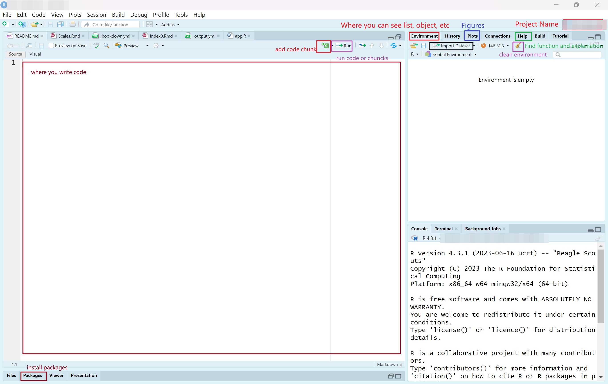

### Where you can change settings

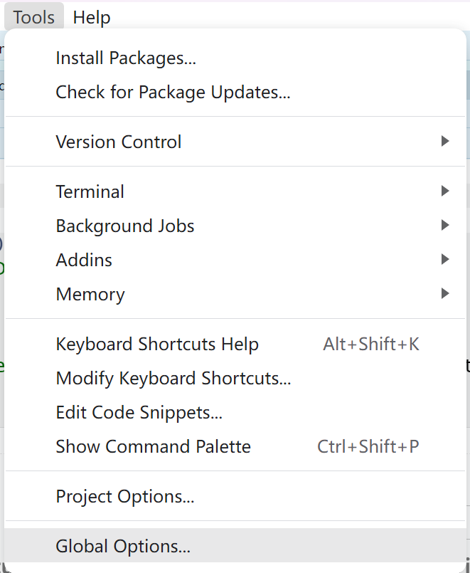

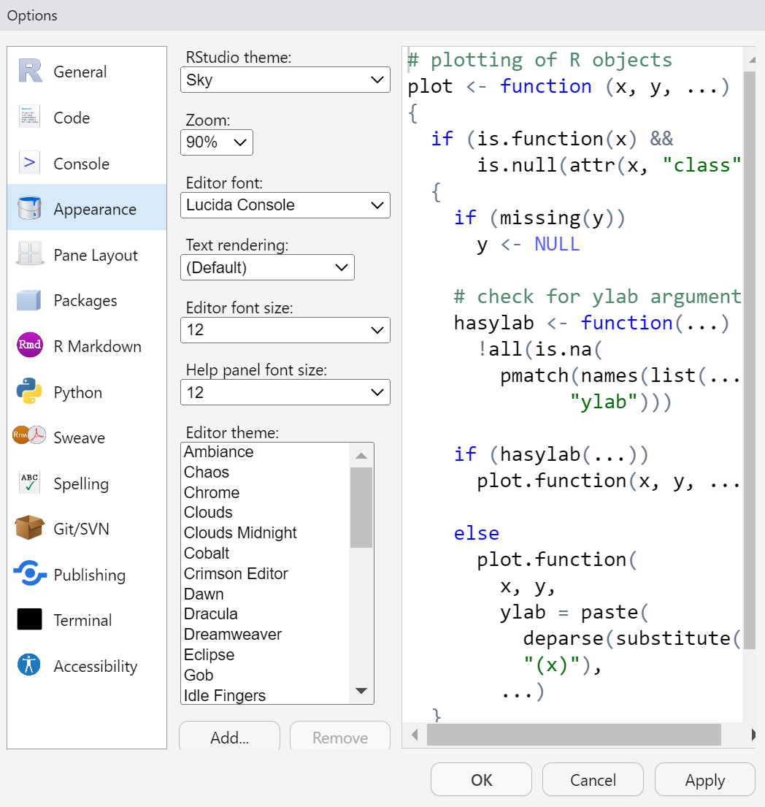

### Cheat Sheets

RStudio provides cheat sheets under **Help > Cheat Sheets**, and there are many more [cheat sheets on GitHub](https://github.com/rstudio/cheatsheets). But ChatGPT is my best cheat sheet.

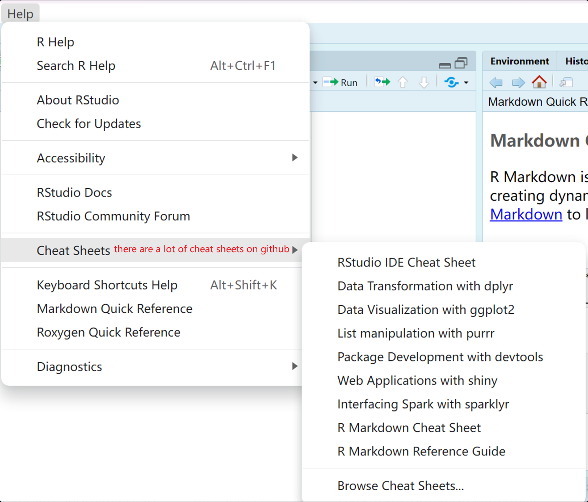

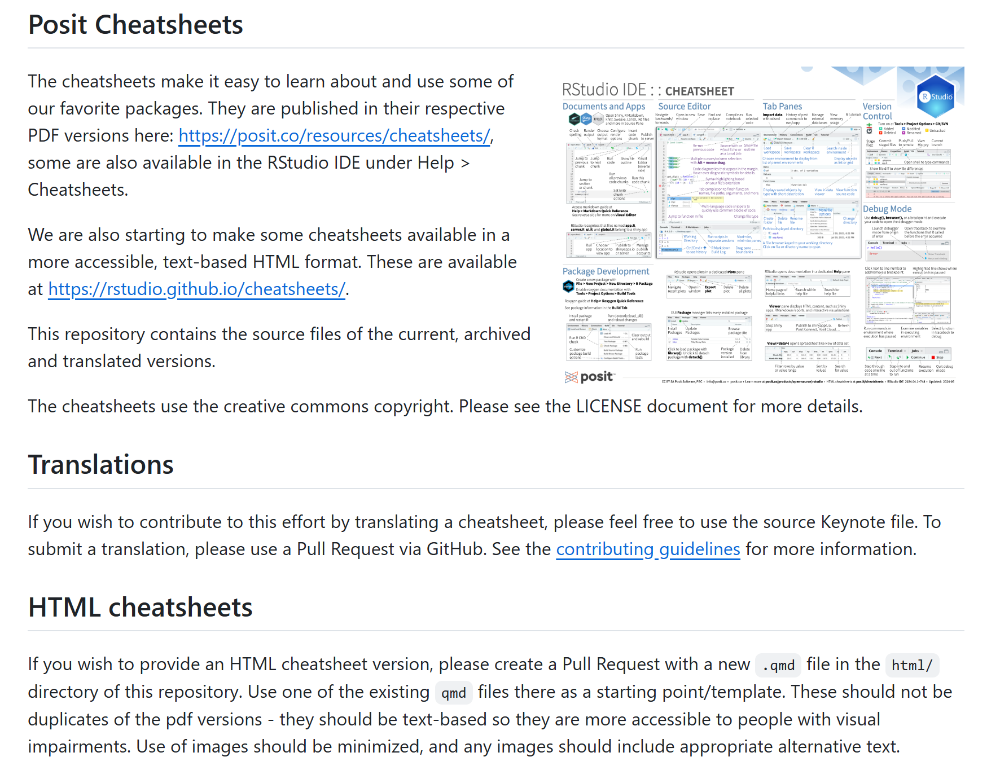

## Create Your First Script or Project

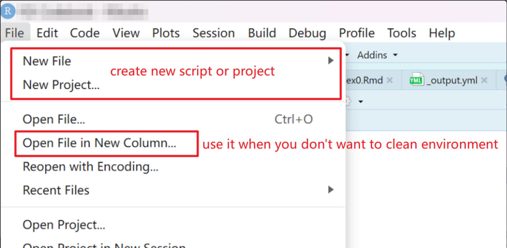

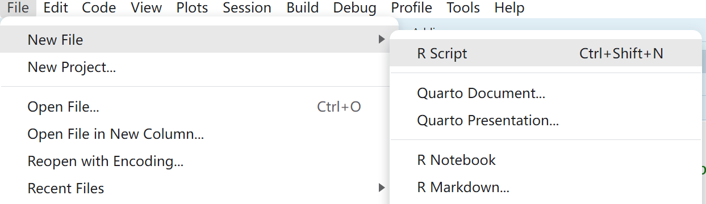

### Project

When you need to work on a project (like a thesis) rather than write a simple script, I recommend using an R Project. You choose a folder and create multiple scripts in it. These scripts share the same working directory (the project folder), so you can use relative paths, and each project keeps its own environment and history separate from your other projects.

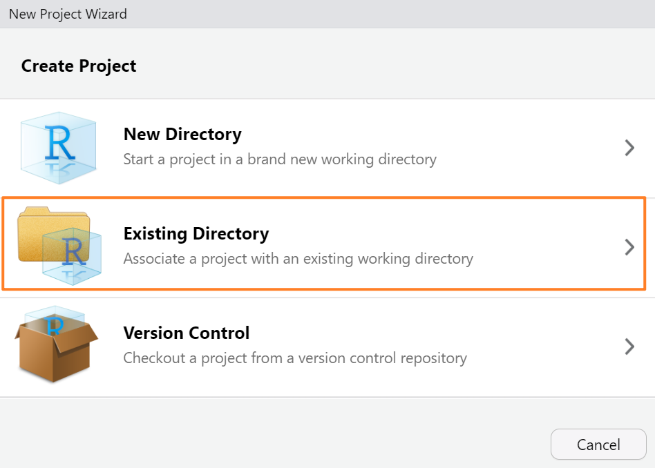

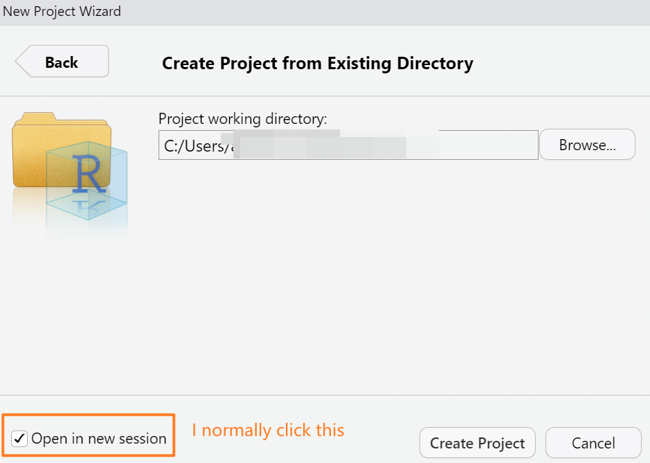

### R Markdown

#### What is R Markdown Format?

**Interactive document**: R Markdown lets you run code in chunks and view the results in real time, right below each chunk, making it convenient for debugging and adjusting code. R Notebooks can also achieve this functionality.

#### Advantages of R Markdown

1. You can run code chunks individually and view the results, which can also be collapsed.
2. You can insert charts, websites, LaTeX-formatted mathematical formulas, and more, allowing you to create rich, well-formatted documents that are visually appealing.
3. Commenting is more convenient (it's good practice to add comments while coding! Otherwise, after some time, you might forget what your own code does).
4. You can even generate Bookdown format and publish the books you've written. Markdown syntax is very simple!

> Format: create an R Markdown file, then add code chunks through the menu at the upper right. A code chunk looks like this:
>
> ````markdown
> ```{r}
>
> ```
> ````

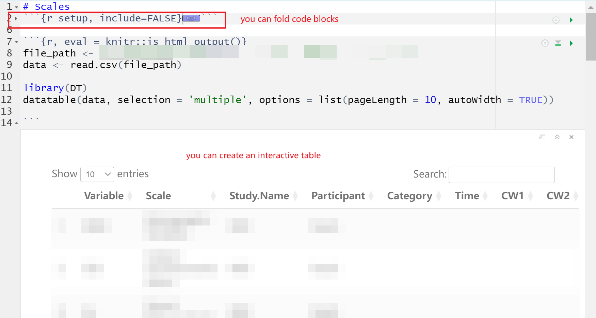

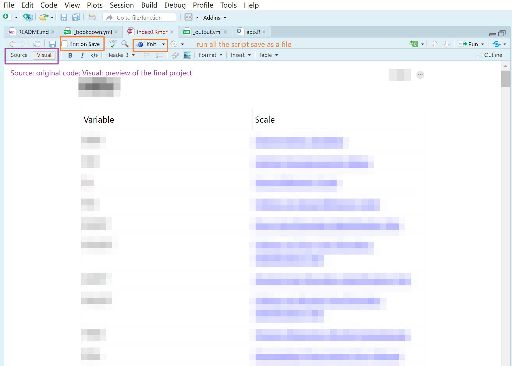

#### Reference Resources

- [R Markdown documentation](https://rmarkdown.rstudio.com/)
- [R Markdown: How It Works](https://rmarkdown.rstudio.com/lesson-2.html)

## What is a Package and Function?

In R, a package is a collection of functions, data, and compiled code that are bundled together for a specific task or area of data analysis. You can install different packages as needed to extend the functionality of R, making it easier to handle specific data.

### Install a package

```r
# Install and load packages
install.packages("dplyr")
library(dplyr)

# Update packages
update.packages()
# Remove packages
remove.packages("dplyr")
```

You can also install a package from the Packages pane: **Packages > Install**.

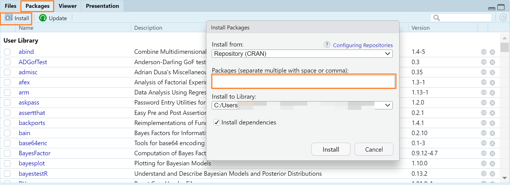

#### Check if a Package is Successfully Installed

You can use `require()` or `library()` to check if a package is successfully installed by attempting to load it. These two functions behave slightly differently when the package is not installed:

- `require(packageName)` will return `FALSE` and give a warning.
- `library(packageName)` will produce an error.

#### Some Common/Classic Packages

You can practice downloading and loading the following packages, as they are likely to be used frequently ([tidyverse](https://www.tidyverse.org/)):

1. [**ggplot2**](https://ggplot2.tidyverse.org/): A powerful data visualization package based on the grammar of graphics, which allows the creation of complex and beautiful plots.
2. [**dplyr**](https://dplyr.tidyverse.org/): A package for data manipulation that provides a series of convenient functions for filtering, sorting, summarizing, and more.
3. [**tidyr**](https://tidyr.tidyverse.org/): A package focused on tidying data, making it easier to analyze and visualize.
4. **readr, readxl, haven**: These packages are used to read various data formats, such as CSV, Excel, SPSS, etc.

#### How to Find Help for a Package

To find help for any installed package, you can use the `help()` function or the `?` operator. For example, if you want to view the help documentation for the ggplot2 package, you can use either of the following commands:

```r
help(package = "ggplot2")
?ggplot2
```

### How to Read a Function Document

Generally, the official package or function documentation is very thorough, maybe too detailed, as it is the instruction manual, which may make newbies feel overwhelmed. In fact, I sometimes lose my patience when reading huge official documentation. I would recommend focusing on **problem-solving** first, i.e. finding what you can do best to implement your ideas at the moment (go to the "Examples" section), rather than trying to master or read everything.

#### For Example: Read a delimited file (including CSV and TSV) into a tibble

- **Description:** Introduction to the function.

  > `read_csv()` and `read_tsv()` are special cases of the more general `read_delim()`. ...

- **Usage:** A detailed demonstration of how a function is used, including the syntax of the function name and its arguments.

  ```r
  read_delim(
    file,
    delim = NULL,
    quote = "\"",
    ...
  ```

- **Arguments:** Lists all the parameters of the function and explains in detail what each parameter does, the acceptable values, the data type, and the default value. For example:

  > `file`: Either a path to a file, a connection, or literal data (either a single string or a raw vector). Files ending in `.gz`, `.bz2`, `.xz`, or `.zip` will be automatically uncompressed. Files starting with `http://`, `https://`, `ftp://`, or `ftps://` will be automatically downloaded. Remote gz files can also be automatically downloaded and decompressed. Literal data is most useful for examples and tests. To be recognised as literal data, the input must be either wrapped with `I()`, be a string containing at least one new line, or be a vector containing at least one string with a new line. ...

- **Value:** The output of the function and its type, e.g. a returned data frame, object, length, etc.

  > A [`tibble()`](https://tibble.tidyverse.org/reference/tibble.html). If there are parsing problems, a warning will alert you. ...

- **Examples:** Examples of using this function.

  ```r
  # Read from a path
  read_csv(readr_example("mtcars.csv"))
  read_csv(readr_example("mtcars.csv.zip"))
  read_csv(readr_example("mtcars.csv.bz2"))
  ## Not run:
  # Including remote paths
  read_csv("https://github.com/tidyverse/readr/raw/main/inst/extdata/mtcars.csv")
  ```

## Variables & Data Types

In R, variables are used to store data values. R is a dynamically-typed language, so you do not need to declare a variable's type beforehand. The type of the variable is automatically determined at runtime based on the value assigned to it.

| Type | Example | Output |
|---|---|---|
| numeric | `c(1, 0.5, 3, 7)` | `[1] 1.0 0.5 3.0 7.0` |
| character | `c("Alice", "love", "30", "dog")` | `[1] "Alice" "love" "30" "dog"` |
| logical | `c(TRUE, FALSE, TRUE, FALSE)` | `[1] TRUE FALSE TRUE FALSE` |
| factor | `factor(c("a", "c", "c", "b"))` | `[1] a c c b`, `Levels: a b c` |

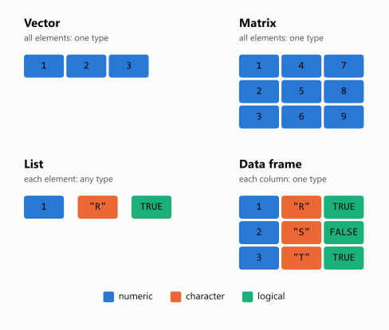

### Variable Naming Rules

Variable names in R must follow these rules:

- **Character set**: Variable names can contain letters, numbers, underscores (`_`), and periods (`.`), but must start with a letter (or a period not followed by a number).
- **Case sensitivity**: Variable names are case-sensitive. For example, `Variable` and `variable` will be treated as two different variables.
- **Reserved words**: You cannot use R's reserved words as variable names, such as `if`, `else`, `for`, `TRUE`, etc.
- **Recommended practices**: **Although using periods (`.`) in variable names is allowed, this practice is discouraged in coding conventions. Underscores (`_`) or camelCase (e.g., the first word is all lowercase, and each subsequent word starts with an uppercase letter) are more common choices.**

### Variable Data Types

Data types in R can be categorized into the following:

**Atomic Types:**

- **Numeric**: The default numeric type is double, which can store both decimal and integer values, e.g., `3.14`.
- **Integer**: Integer type, specified by appending `L` to a number, e.g., `5L`.
- **Complex**: Stores complex numbers.
- **Logical**: Boolean values, which can be either `TRUE` or `FALSE`.
- **Character**: Text strings.

**Advanced Data Structures:**

**Vector**: A one-dimensional array that contains elements of the same type.

```r
c(1, 2, 3, 4, 5)
#> [1] 1 2 3 4 5
```

**List**: A one-dimensional array that can contain elements of different types.

```r
list1 <- list(name = "Alice", age = 30, height = 5.5)
list1
#> $name
#> [1] "Alice"
#>
#> $age
#> [1] 30
#>
#> $height
#> [1] 5.5
```

**Matrix**: A two-dimensional array where all elements must be of the same type.

```r
matrix(1:9, nrow = 3)
#>      [,1] [,2] [,3]
#> [1,]    1    4    7
#> [2,]    2    5    8
#> [3,]    3    6    9
```

**Array**: Similar to a matrix but can have more than two dimensions. All elements must be of the same type. It can be thought of as multiple sets of similarly structured data.

```r
array(1:8, dim = c(2, 2, 2))
#> , , 1
#>
#>      [,1] [,2]
#> [1,]    1    3
#> [2,]    2    4
#>
#> , , 2
#>
#>      [,1] [,2]
#> [1,]    5    7
#> [2,]    6    8
```

**Data Frame**: Used to store tabular data. Each column can have a different data type, but all data within a single column must be of the same type. It is the most widely used data structure.

```r
data.frame(names = c("Alice", "Bob", "Cathy"), ages = c(25, 32, 19), weights = c(55.5, 85.5, 64.2))
#>   names ages weights
#> 1 Alice   25    55.5
#> 2   Bob   32    85.5
#> 3 Cathy   19    64.2
```

**Factor**: Used to store categorical data, which is useful for model analysis.

```r
factor(c("male", "female", "female", "male"))
#> [1] male   female female male
#> Levels: female male
```

#### Summary

- **Difference between data frames and matrices**:
    - **Column and row names**: In data frames, each column can have its own name, which is often used to reference data in the column. In matrices, you can also specify row and column names, but this is not always necessary and is not as convenient as in data frames.
    - **Data type flexibility**: Data frames are more flexible than matrices because each column in a data frame can have a different data type, whereas all elements in a matrix must have the same data type.
- **Flexibility of arrays**: Arrays are more flexible in terms of dimensions compared to matrices because arrays can be multidimensional. They can store any one data type, but arrays may not be as intuitive as data frames when it comes to data analysis and processing.

#### Creating Variables and Checking Types

```r
# Create variables
num <- 3.14  # Numeric
flag <- TRUE  # Logical
name <- "Height"  # Character

# Create a vector
vec <- c(1, 2, 3, 4)

# Create a data frame
df <- data.frame(Name = c("Alice", "Bob"), Age = c(24, 25))

# Function to check the type
class(num)
```

## Object

The special thing about R is the ability to store and view objects (i.e., data, results, lists, etc.) in the environment.

If your results can't be exported or viewed, then it's probably because you didn't create the object. Beginners often get R errors because they forget to create objects.

**When naming objects, try to start with a letter, avoid symbols or spaces, and use `_` instead of spaces or `-`.**

```r
# The left side is the object name, `<-` works like `=`, and the right side is the value
# The value can be anything: a data frame, a single value, a list, etc.

x <- 5
name <- "Alice"
df <- data.frame(id = 1:3, name = c("Alice", "Bob", "Charlie"))
```

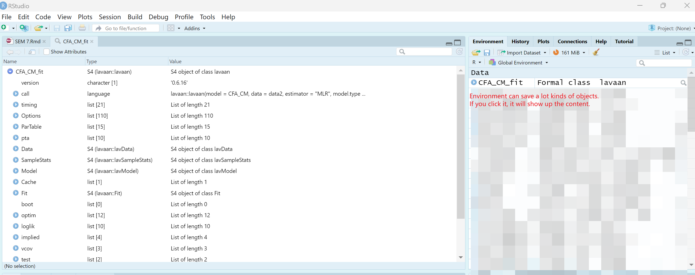

## Common Shortcuts

- Show all keyboard shortcuts: `Alt + Shift + K`
- Assignment operator `<-`: `Alt + -` (Windows)
- Pipe operator `%>%`: `Ctrl + Shift + M`
- Comment/uncomment the selected lines: `Ctrl + Shift + C`
- Run the current line or selection: `Ctrl + Enter`
- Run all code: `Ctrl + Alt + R`
- Insert a code chunk: `Ctrl + Alt + I`
- Column select code block: `Alt + Shift + Left Click`

### More Shortcuts

- Clear console: `Ctrl + L`
- Scroll screen up/down: `Ctrl + Up/Down Arrow`
- Delete line: `Ctrl + D`
- Duplicate current line/block: `Shift + Alt + Up/Down Arrow`
- Show help for the function at the cursor: `F1` (`F2` shows its source code)
- Set working directory: `Ctrl + Shift + H`
- Insert a code section (a foldable comment header): `Ctrl + Shift + R`

## How to Debug

### Common Errors

- Errors at the beginning are most often caused by forgetting to create the object, having the wrong name for the variable (the variable name needs to be exactly the same as the one you entered), or having an incomplete statement (e.g., missing half of the parentheses). Other errors include incorrectly written functions or statements, variable naming errors, and so on.
- Sometimes the environment is not cleaned up, which can also cause errors: your code may run multiple times on the same data frame, resulting in an incorrect result in the end.
- For example, the code below subtracts 1 from column `a`. If you run it again without realizing it has already run, 1 is subtracted twice, and you end up with the wrong values.

```r
df <- df %>%
  mutate(a = a - 1)
```

### Troubleshooting

- Read the error messages in the console; some packages give error messages as well as explanations. Check the official website or use a search engine, AI, etc. to find the cause of the error.
- Check the variable names and everything else related to the name for consistency, misspellings, and omissions.
- Check if the statement or function name is correct or complete and if the function is used correctly.
- Clean up the environment.
- Restart R.
- Ask your peers or ask for help on the forums.

### Example of Debugging

## Assignment

- Install R and RStudio.
- Install the tidyverse package.
- Create a new project.
- What is the difference between the different data types? Give examples.
