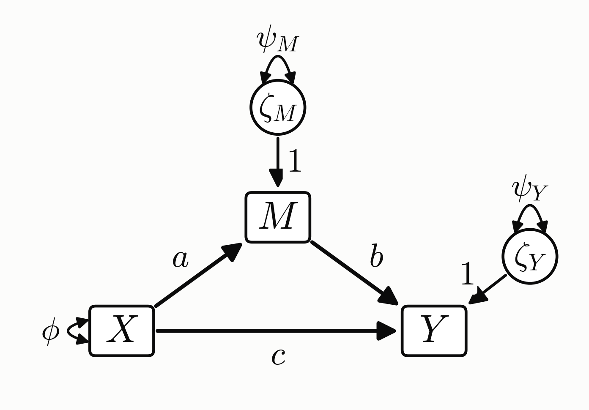
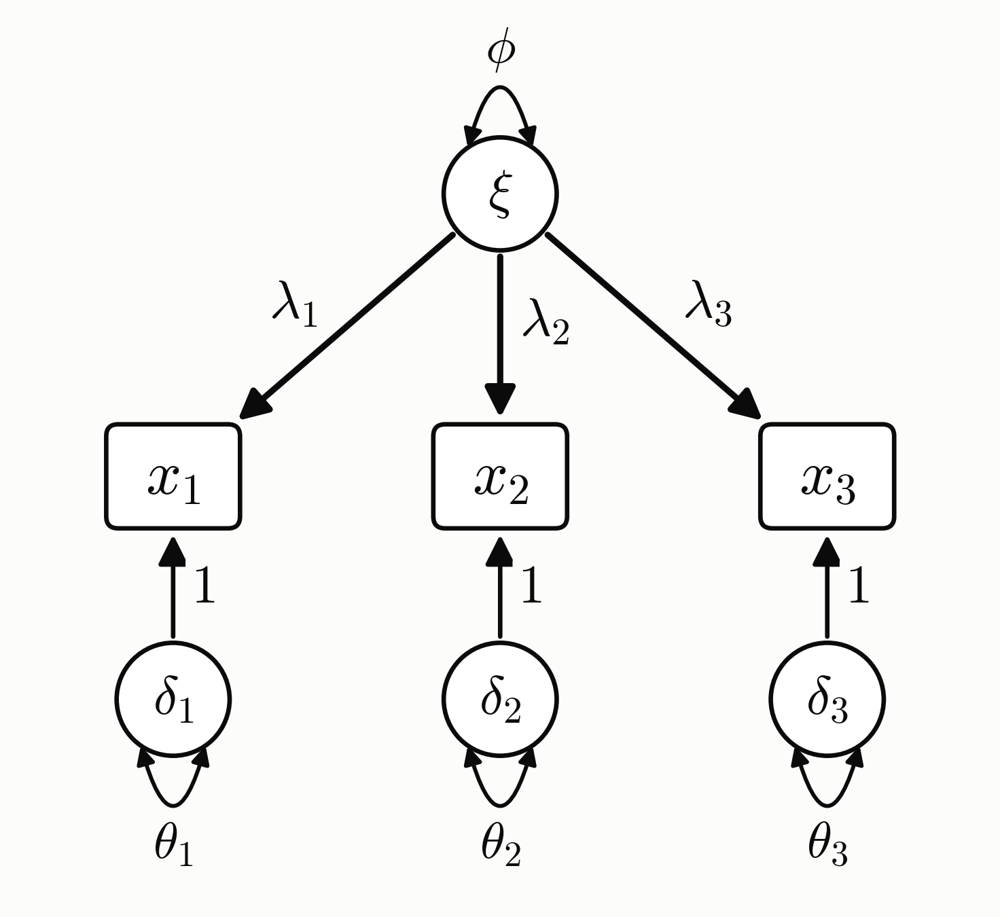



# SEM by Hand

This chapter derives the covariance matrix that a path model, a CFA, and a full SEM imply, then estimates the models step by step in R and Python and checks the results against lavaan. It is an optional **Under the hood** chapter: the [SEM chapter](structural-equation-modeling.qmd) only uses its results, such as $\operatorname{cov}(x_i, x_j) = \lambda_i \lambda_j \psi$ in [How CFA Estimates the Model](structural-equation-modeling.qmd#how-cfa-estimates-the-model).

The derivations use the LISREL notation. φ is the variance of an exogenous variable; in the CFA, that is the factor variance, which the [parameter table](structural-equation-modeling.qmd#parameters-of-a-cfa-model) calls ψ. ψ is the variance of a disturbance. In the full SEM, every factor is an η, so the variance of the exogenous factor is a ψ too, as in lavaan. c is the direct effect of X on Y, called c' in [Mediation Analysis](mediation-analysis.qmd) and `cp` in the code.

## Setup

**Goal.** Write the covariance matrix of the observed variables in terms of the parameters, so the parameters can be estimated from the data's $\mathbf S$. The CFA follows the same steps as the path model.

**Known.** The observed variables (the data), from which $\mathbf S$ is computed, and the model structure (which arrows exist).

**Preconditions.**

- All variables are centered, so every mean is 0. Then a covariance is the average of a product, $\text{Cov}(U,V)=E[UV]$, and for a vector $\text{Cov}(\mathbf v)=E[\mathbf v\mathbf v^{\top}]$.
- X is uncorrelated with the disturbances, and the disturbances with each other. In the CFA, the factor is uncorrelated with the errors, and the errors with each other.

## Path Analysis

{width=70%}

| Symbol | Meaning |
|---|---|
| $\boldsymbol\eta$ (eta) | endogenous variables, here $M$ and $Y$ |
| $\mathbf x$ | exogenous observed variable, here $X$ |
| $\boldsymbol\zeta$ (zeta) | disturbances $\zeta_M,\zeta_Y$: the part of each endogenous variable not explained by its predictors |
| $\mathbf B$ | coefficients of endogenous on endogenous (here $b$) |
| $\boldsymbol\Gamma$ (Gamma) | coefficients of exogenous on endogenous (here $a$, $c$) |
| $\phi$ (phi) | variance of $X$ |
| $\psi$ (psi) | covariance matrix of $\boldsymbol\zeta$ (residual variances $\psi_M,\psi_Y$ on the diagonal) |

$X$, $M$, $Y$ are observed. Path analysis: the covariance of all observed variables.

$$
\begin{aligned}
M&=aX+0+\zeta_M\\
Y&=cX+bM+\zeta_Y
\end{aligned}
$$

$$
\boldsymbol\eta=\begin{bmatrix}M\\Y\end{bmatrix}\qquad\text{(endogenous / outcome variables)}
$$

$$
\boldsymbol\eta=\mathbf B\boldsymbol\eta+\boldsymbol\Gamma\mathbf x+\boldsymbol\zeta,
\qquad
\mathbf B=\begin{bmatrix}0&0\\b&0\end{bmatrix},\quad
\boldsymbol\Gamma=\begin{bmatrix}a\\c\end{bmatrix},\quad
\boldsymbol\zeta=\begin{bmatrix}\zeta_M\\\zeta_Y\end{bmatrix}
$$

The right side also contains $M$ and $Y$: $M$ predicts $Y$, and that endogenous-on-endogenous part is $\mathbf B\boldsymbol\eta$. Reading row by row gives back the two equations above.

$$
\text{Cov}(\mathbf x)=\phi,\qquad\text{Cov}(\boldsymbol\zeta)=\psi,\qquad\text{Cov}(\mathbf x,\boldsymbol\zeta)=0
$$

Solve for $\boldsymbol\eta$, so that $M$ and $Y$ contain only exogenous variables (their covariances are the ones we know):

$$
\begin{aligned}
(\mathbf I-\mathbf B)\,\boldsymbol\eta&=\boldsymbol\Gamma\mathbf x+\boldsymbol\zeta\\
\boldsymbol\eta&=(\mathbf I-\mathbf B)^{-1}(\boldsymbol\Gamma\mathbf x+\boldsymbol\zeta)\qquad\text{let }\mathbf A=(\mathbf I-\mathbf B)^{-1}\\
&=\mathbf A(\boldsymbol\Gamma\mathbf x+\boldsymbol\zeta)=\mathbf A\boldsymbol\Gamma\mathbf x+\mathbf A\boldsymbol\zeta\\
\mathbf x&=\mathbf I\cdot\mathbf x+\mathbf 0\cdot\boldsymbol\zeta
\end{aligned}
$$

Stack all observed variables into $\mathbf v$ ($\mathbf x$ is included because $\mathbf S$ covers $X$, $M$, $Y$):

$$
\mathbf v=\begin{bmatrix}\mathbf x\\\boldsymbol\eta\end{bmatrix}=\begin{bmatrix}\mathbf I&\mathbf 0\\\mathbf A\boldsymbol\Gamma&\mathbf A\end{bmatrix}\begin{bmatrix}\mathbf x\\\boldsymbol\zeta\end{bmatrix}
$$

Let $\mathbf T=\begin{bmatrix}\mathbf I&\mathbf 0\\\mathbf A\boldsymbol\Gamma&\mathbf A\end{bmatrix}$, $\mathbf u=\begin{bmatrix}\mathbf x\\\boldsymbol\zeta\end{bmatrix}$. ($\mathbf u$ holds the exogenous variables, whose covariances are known.)

$$
\mathbf u\cdot\mathbf u^{\top}=\begin{bmatrix}\mathbf x\\\boldsymbol\zeta\end{bmatrix}\cdot\begin{bmatrix}\mathbf x^{\top}&\boldsymbol\zeta^{\top}\end{bmatrix}=\begin{bmatrix}\mathbf x\mathbf x^{\top}&\mathbf x\boldsymbol\zeta^{\top}\\\boldsymbol\zeta\mathbf x^{\top}&\boldsymbol\zeta\boldsymbol\zeta^{\top}\end{bmatrix}
$$

$$
\mathbf S_u=\text{Cov}(\mathbf u)=E[\mathbf u\mathbf u^{\top}]=\begin{bmatrix}\text{Cov}(\mathbf x)&0\\0&\text{Cov}(\boldsymbol\zeta)\end{bmatrix}=\begin{bmatrix}\phi&0\\0&\psi\end{bmatrix}
$$

$$
\begin{aligned}
\text{Cov}(\mathbf v)&=E\big[(\mathbf T\cdot\mathbf u)(\mathbf T\cdot\mathbf u)^{\top}\big]\\
&=E\big[\mathbf T(\mathbf u\mathbf u^{\top})\mathbf T^{\top}\big] && (\mathbf T\mathbf u)^{\top}=\mathbf u^{\top}\mathbf T^{\top}\\
&=\mathbf T\cdot\mathbf S_u\cdot\mathbf T^{\top} && \mathbf T\text{ is a constant here}\\
&=\begin{bmatrix}\phi&0\\\mathbf A\boldsymbol\Gamma\phi&\mathbf A\psi\end{bmatrix}\begin{bmatrix}\mathbf I&\boldsymbol\Gamma^{\top}\mathbf A^{\top}\\0&\mathbf A^{\top}\end{bmatrix}\\
&=\begin{bmatrix}\phi&\phi\boldsymbol\Gamma^{\top}\mathbf A^{\top}\\\mathbf A\boldsymbol\Gamma\phi&\mathbf A(\boldsymbol\Gamma\phi\boldsymbol\Gamma^{\top}+\psi)\mathbf A^{\top}\end{bmatrix}
\end{aligned}
$$

## One-Factor CFA

{width=45%}

Compute the covariance for $\mathbf x$. Same route as the [path model](#path-analysis); here the observed variables are the indicators, and the exogenous ones are the factor and the errors.

- $\phi$: factor variance
- $\xi$: factor; $\lambda$: factor loading
- $x$: observed (endogenous) variable
- $\theta$: variance of the measurement error
- $\delta$: measurement error

$$
\begin{aligned}
x_1&=\lambda_1\xi+\delta_1\\
x_2&=\lambda_2\xi+\delta_2\\
&\ \,\vdots\\
x_n&=\lambda_n\xi+\delta_n
\end{aligned}
\qquad\longrightarrow\qquad
\mathbf x=\begin{bmatrix}\lambda_1\\\lambda_2\\\vdots\\\lambda_n\end{bmatrix}\xi+\begin{bmatrix}\delta_1\\\delta_2\\\vdots\\\delta_n\end{bmatrix}
$$

Let $\boldsymbol\Lambda=\begin{bmatrix}\lambda_1\\\lambda_2\\\vdots\\\lambda_n\end{bmatrix}$, $\boldsymbol\delta=\begin{bmatrix}\delta_1\\\delta_2\\\vdots\\\delta_n\end{bmatrix}$.

$$
\therefore\ \mathbf x=\boldsymbol\Lambda\xi+\boldsymbol\delta=\boldsymbol\Lambda\xi+\mathbf I\cdot\boldsymbol\delta=\begin{bmatrix}\boldsymbol\Lambda&\mathbf I\end{bmatrix}\begin{bmatrix}\xi\\\boldsymbol\delta\end{bmatrix}
$$

Let $\mathbf T=\begin{bmatrix}\boldsymbol\Lambda&\mathbf I\end{bmatrix}$, $\mathbf u=\begin{bmatrix}\xi\\\boldsymbol\delta\end{bmatrix}$. Unlike the path model, nothing needs to be substituted: the right side contains only $\xi$ and $\delta$, both exogenous.

$$
\mathbf x=\begin{bmatrix}\lambda_1&1&&\\\lambda_2&&\ddots&\\\vdots&&&\\\lambda_n&&&1\end{bmatrix}\begin{bmatrix}\xi\\\delta_1\\\vdots\\\delta_n\end{bmatrix}
$$

$$
\begin{aligned}
\text{Cov}(\mathbf x)&=E\big[\mathbf T\mathbf u\cdot(\mathbf T\mathbf u)^{\top}\big]\\
&=E\big[\mathbf T\cdot(\mathbf u\cdot\mathbf u^{\top})\cdot\mathbf T^{\top}\big]
\end{aligned}
$$

$$
\mathbf u\cdot\mathbf u^{\top}=\begin{bmatrix}\xi\\\delta_1\\\vdots\\\delta_n\end{bmatrix}\cdot\begin{bmatrix}\xi&\delta_1&\cdots&\delta_n\end{bmatrix}=\begin{bmatrix}\xi^2&\xi\delta_1&\cdots&\xi\delta_n\\\xi\delta_1&\delta_1^2&\cdots&\delta_1\delta_n\\\vdots&&\ddots&\vdots\\\xi\delta_n&\delta_1\delta_n&\cdots&\delta_n^2\end{bmatrix}
$$

Let $\text{Cov}(\boldsymbol\delta,\xi)=0$ and $\text{Cov}(\delta_i,\delta_j)=0$ for $i\neq j$ (by assumption), so every off-diagonal expectation is 0; the diagonal gives the variances.

$$
\text{Cov}(\mathbf u)=E[\mathbf u\mathbf u^{\top}]=\begin{bmatrix}\phi&&&\\&\theta_1&&\\&&\ddots&\\&&&\theta_n\end{bmatrix}=\begin{bmatrix}\phi&0\\0&\boldsymbol\Theta\end{bmatrix}
$$

$$
\begin{aligned}
\text{Cov}(\mathbf x)&=\mathbf T\cdot\begin{bmatrix}\phi&0\\0&\boldsymbol\Theta\end{bmatrix}\cdot\mathbf T^{\top}\\
&=\begin{bmatrix}\boldsymbol\Lambda&\mathbf I\end{bmatrix}\begin{bmatrix}\phi&0\\0&\boldsymbol\Theta\end{bmatrix}\begin{bmatrix}\boldsymbol\Lambda^{\top}\\\mathbf I\end{bmatrix}\\
&=\begin{bmatrix}\boldsymbol\Lambda\phi&\boldsymbol\Theta\end{bmatrix}\begin{bmatrix}\boldsymbol\Lambda^{\top}\\\mathbf I\end{bmatrix}\\
&=\boldsymbol\Lambda\phi\boldsymbol\Lambda^{\top}+\boldsymbol\Theta
\end{aligned}
$$

Cell by cell: $\text{Cov}(x_j,x_k)=\lambda_j\lambda_k\phi$ for $j\neq k$, and $\text{Var}(x_j)=\lambda_j^2\phi+\theta_j$.

## Full SEM

The structural model of the [SEM chapter](structural-equation-modeling.qmd#full-sem-syntax): FA1 predicts FB1 (path $a$), and FB1 and FA1 predict FB2 (paths $b$ and $c$). FA1 is put in $\boldsymbol\eta$ as well, with no predictors, so its "disturbance" is FA1 itself. All variables are centered, so $\text{Cov}(\mathbf v)=E[\mathbf v\mathbf v^{\top}]$.

$$
\begin{aligned}
\text{FA1}&=0+0+\zeta_{\text{FA1}}\\
\text{FB1}&=a\,\text{FA1}+0+\zeta_{\text{FB1}}\\
\text{FB2}&=c\,\text{FA1}+b\,\text{FB1}+\zeta_{\text{FB2}}
\end{aligned}
\qquad\longrightarrow\qquad
\boldsymbol\eta=\mathbf B\boldsymbol\eta+\boldsymbol\zeta,\quad
\boldsymbol\eta=\begin{bmatrix}\text{FA1}\\\text{FB1}\\\text{FB2}\end{bmatrix},\quad
\mathbf B=\begin{bmatrix}0&0&0\\a&0&0\\c&b&0\end{bmatrix}
$$

The disturbances are uncorrelated with each other, and their variances are estimated:

$$
\text{Cov}(\boldsymbol\zeta)=\boldsymbol\Psi
=\begin{bmatrix}\psi_{\text{FA1}}&0&0\\0&\psi_{\text{FB1}}&0\\0&0&\psi_{\text{FB2}}\end{bmatrix}
$$

Solve for $\boldsymbol\eta$, so that the right side contains only $\boldsymbol\zeta$ (whose covariance is known):

$$
\begin{aligned}
(\mathbf I-\mathbf B)\,\boldsymbol\eta&=\boldsymbol\zeta\\
\boldsymbol\eta&=(\mathbf I-\mathbf B)^{-1}\boldsymbol\zeta\qquad\text{let }\mathbf A=(\mathbf I-\mathbf B)^{-1}\\
&=\mathbf A\boldsymbol\zeta
\end{aligned}
$$

$$
\therefore\ \text{Cov}(\boldsymbol\eta)=\mathbf A\,\boldsymbol\Psi\,\mathbf A^{\top}
$$

The measurement part is the same as in the [one-factor CFA](#one-factor-cfa), with three factors instead of one and the first loading of each factor fixed at 1:

$$
\mathbf x=\boldsymbol\Lambda\boldsymbol\eta+\boldsymbol\delta,\qquad
\boldsymbol\Lambda=\begin{bmatrix}\boldsymbol\lambda_{\text{FA1}}&\mathbf 0&\mathbf 0\\\mathbf 0&\boldsymbol\lambda_{\text{FB1}}&\mathbf 0\\\mathbf 0&\mathbf 0&\boldsymbol\lambda_{\text{FB2}}\end{bmatrix}\ (18\times3)
$$

$$
\therefore\ \boldsymbol\Sigma(\boldsymbol\theta)=\text{Cov}(\mathbf x)=\boldsymbol\Lambda\,\text{Cov}(\boldsymbol\eta)\,\boldsymbol\Lambda^{\top}+\boldsymbol\Theta
$$

## Estimating a CFA by Hand

The code below estimates the one-factor model of B1 to B5 (FB1 in the SEM chapter). Choose R or Python in the tabs; all tabs on the page switch together. The first run downloads R (webR) and Python (Pyodide) with their packages, so the first results take a while to appear.

Estimating by hand needs a complete data matrix, so this chapter uses `mydata_imputed.csv`, the first of five datasets imputed with mice (see [Example Data](example-data.qmd)). This is for the demonstration only: in a real analysis, fit the model on every imputed dataset and pool the results, or use FIML ([Missing Values](missing-values.qmd)). The estimates therefore differ slightly from those in the SEM chapter.

### Sample Covariance Matrix

$$
\mathbf S=\frac1N\,\mathbf Y_c^{\top}\mathbf Y_c
$$

where $\mathbf Y_c$ is the data with each column centered. ML divides by $N$, not $N-1$.

::: {.panel-tabset group="language"}
#### R

```{webr}
#| autorun: true
mydata <- read.csv("data/mydata_imputed.csv")
Y <- as.matrix(mydata[, paste0("B", 1:5)])

N <- nrow(Y)
p <- ncol(Y)
Yc <- sweep(Y, 2, colMeans(Y))
S <- t(Yc) %*% Yc / N
S
```

#### Python

```{pyodide}
#| autorun: true
import numpy as np
import pandas as pd
from scipy.optimize import minimize
from scipy.stats import chi2

mydata = pd.read_csv("data/mydata_imputed.csv")
Y = mydata[["B1", "B2", "B3", "B4", "B5"]].to_numpy(dtype=float)

N, p = Y.shape
Yc = Y - Y.mean(axis=0)
S = (1/N) * Yc.T @ Yc
S
```

:::

### Model-Implied Covariance Matrix

Each indicator is $x_j=\lambda_j\xi+\delta_j$ with $\lambda_1=1$ and $\operatorname{Var}(\xi)=\phi$, so

$$
\boldsymbol\Sigma(\boldsymbol\theta)=\phi\,\boldsymbol\lambda\boldsymbol\lambda^{\top}+\boldsymbol\Theta,
\qquad
\sigma_{jj}=\lambda_j^2\phi+\theta_j,\quad \sigma_{ij}=\lambda_i\lambda_j\phi .
$$

Here $\sigma_{jj}$, the $j$-th diagonal element of $\boldsymbol\Sigma$, is the model-implied variance of indicator $j$: the part explained by the latent variable ($\lambda_j^2\phi$) plus the residual variance ($\theta_j$). The off-diagonal $\sigma_{ij}$ is the covariance between indicators $i$ and $j$. Fixing $\lambda_1=1$ gives $\xi$ the unit of the first indicator.

::: {.panel-tabset group="language"}
#### R

```{webr}
#| autorun: true
implied_cov <- function(loadings, phi, resid_vars) {
  # covariance matrix the one-factor model predicts for given parameter values
  phi * loadings %*% t(loadings) + diag(resid_vars)
}
```

#### Python

```{pyodide}
#| autorun: true
def implied_cov(loadings, phi, resid_vars):
    # covariance matrix the one-factor model predicts for given parameter values
    lam = loadings.reshape(-1, 1)
    return phi * lam @ lam.T + np.diag(resid_vars)
```

:::

### ML Fit Function

$$
F_{ML}=\ln|\boldsymbol\Sigma|+\operatorname{tr}(\mathbf S\boldsymbol\Sigma^{-1})-\ln|\mathbf S|-p
$$

It is 0 when $\boldsymbol\Sigma=\mathbf S$ and grows as $\boldsymbol\Sigma$ moves away from $\mathbf S$. So minimizing $F_{ML}$ means searching, among all matrices the model can produce, for the $\boldsymbol\Sigma(\boldsymbol\theta)$ closest to $\mathbf S$.

::: {.panel-tabset group="language"}
#### R

```{webr}
#| autorun: true
f_ml <- function(S, Sigma) {
  # distance between the data (S) and the model (Sigma); 0 when they are equal
  p <- nrow(S)
  logdet_Sigma <- determinant(Sigma)$modulus
  logdet_S <- determinant(S)$modulus
  tr <- sum(diag(S %*% solve(Sigma)))
  as.numeric(logdet_Sigma + tr - logdet_S - p)
}
```

#### Python

```{pyodide}
#| autorun: true
def f_ml(S, Sigma):
    # distance between the data (S) and the model (Sigma); 0 when they are equal
    p = S.shape[0]
    logdet_Sigma = np.linalg.slogdet(Sigma)[1]
    logdet_S = np.linalg.slogdet(S)[1]
    tr = np.trace(S @ np.linalg.inv(Sigma))
    return logdet_Sigma + tr - logdet_S - p
```

:::

### Parameter Estimation

The ML estimates are the free loadings, the factor variance and the residual variances that minimize $F_{ML}$, found numerically:

$$
\hat{\boldsymbol\theta}=\arg\min_{\boldsymbol\theta}F_{ML}\big(\mathbf S,\boldsymbol\Sigma(\boldsymbol\theta)\big),
\qquad
\boldsymbol\theta=(\lambda_2,\dots,\lambda_p,\ \phi,\ \theta_1,\dots,\theta_p)
$$

::: {.panel-tabset group="language"}
#### R

```{webr}
#| autorun: true
unpack <- function(theta, p) {
  # free vector -> loadings with lambda_1 = 1, factor variance, residual variances
  list(loadings = c(1, theta[1:(p - 1)]),
       phi = theta[p],
       resid_vars = theta[(p + 1):(2 * p)])
}

objective <- function(theta, S) {
  par <- unpack(theta, nrow(S))
  f_ml(S, implied_cov(par$loadings, par$phi, par$resid_vars))
}

# starting values; variances must stay positive
x0 <- c(rep(0.8, p - 1), 1, rep(0.3, p))
lower <- c(rep(-Inf, p - 1), rep(1e-6, p + 1))
res <- optim(x0, objective, S = S, method = "L-BFGS-B", lower = lower)
par <- unpack(res$par, p)
res$convergence
par
```

`res$convergence` is 0 when the search converged.

#### Python

```{pyodide}
#| autorun: true
def unpack(theta, p):
    # free vector -> loadings with lambda_1 = 1, factor variance, residual variances
    loadings = np.concatenate([[1.0], theta[:p - 1]])
    return loadings, theta[p - 1], theta[p:]

def objective(theta, S):
    p = S.shape[0]
    loadings, phi, resid_vars = unpack(theta, p)
    return f_ml(S, implied_cov(loadings, phi, resid_vars))

# starting values; variances must stay positive
x0 = np.concatenate([np.full(p - 1, 0.8), [1.0], np.full(p, 0.3)])
bounds = [(None, None)] * (p - 1) + [(1e-6, None)] * (p + 1)
res = minimize(objective, x0, args=(S,), method="L-BFGS-B", bounds=bounds)
loadings, phi, resid_vars = unpack(res.x, p)
res.success, loadings, phi, resid_vars
```

:::

### Chi-Square Test

$$
T=N\cdot F_{ML}(\hat{\boldsymbol\theta}),\qquad df=\frac{p(p+1)}{2}-(\text{number of free parameters})
$$

Because the data are centered, the means and the intercepts drop out of both counts. [How CFA Estimates the Model](structural-equation-modeling.qmd#how-cfa-estimates-the-model) counts $p$ means and $p$ intercepts as well, which gives the same df.

::: {.panel-tabset group="language"}
#### R

```{webr}
#| autorun: true
T_stat <- N * res$value
df <- p * (p + 1) / 2 - length(res$par)
pvalue <- pchisq(T_stat, df, lower.tail = FALSE)
c(T = T_stat, df = df, pvalue = pvalue)
```

#### Python

```{pyodide}
#| autorun: true
T = N * res.fun
df = p * (p + 1) // 2 - len(res.x)
pvalue = chi2.sf(T, df)
T, df, pvalue
```

:::

### Standardized Loadings and $R^2$

$$
\text{standardized loading}=\frac{\lambda_j\sqrt{\phi}}{\sqrt{\hat\sigma_{jj}}},\qquad R^2=\frac{\lambda_j^2\phi}{\hat\sigma_{jj}}
$$

$\sqrt{\phi}$ is the standard deviation of the latent variable and $\sqrt{\hat\sigma_{jj}}$ is the model-implied standard deviation of indicator $j$.

::: {.panel-tabset group="language"}
#### R

```{webr}
#| autorun: true
Sigma_hat <- implied_cov(par$loadings, par$phi, par$resid_vars)
std_loadings <- par$loadings * sqrt(par$phi) / sqrt(diag(Sigma_hat))
r2 <- std_loadings^2
rbind(std_loadings, r2)
```

#### Python

```{pyodide}
#| autorun: true
Sigma_hat = implied_cov(loadings, phi, resid_vars)
std_loadings = loadings * np.sqrt(phi) / np.sqrt(np.diag(Sigma_hat))
r2 = std_loadings**2
std_loadings, r2
```

:::

### Check with lavaan

With complete data, `cfa()` uses ML and divides by $N$, like the code above, so it gives the same χ² and df. `coef()` lists the free parameters: the loadings of B2 to B5, the residual variances, and the factor variance.

```{webr}
#| autorun: true
library(lavaan)
fit_b <- cfa('FB1 =~ B1 + B2 + B3 + B4 + B5', data = mydata)
fitMeasures(fit_b, c("chisq", "df", "pvalue"))
coef(fit_b)
standardizedSolution(fit_b)[1:5, c("lhs", "op", "rhs", "est.std")]
```

## Estimating the Structural Model by Hand

The same steps for the [full SEM](#full-sem), with `f_ml()` from above.

### Implied Covariance Matrix

::: {.panel-tabset group="language"}
#### R

```{webr}
#| autorun: true
latent_cov <- function(a, b, cp, psi) {
  # covariance matrix of (FA1, FB1, FB2) implied by the paths and psi
  B <- matrix(c(0, 0, 0,     # FA1
                a, 0, 0,     # FB1 = a*FA1
                cp, b, 0),   # FB2 = cp*FA1 + b*FB1
              nrow = 3, byrow = TRUE)
  A <- solve(diag(3) - B)    # A = (I - B)^-1
  A %*% diag(psi) %*% t(A)
}

items <- c(paste0("A", 1:6), paste0("B", 1:12))
X <- as.matrix(mydata[, items])
Xc <- sweep(X, 2, colMeans(X))
S_all <- t(Xc) %*% Xc / N

sem_implied_cov <- function(free_loadings, resid_vars, a, b, cp, psi) {
  # covariance matrix the structural model predicts for given parameter values
  L <- matrix(0, 18, 3)
  L[1:6, 1] <- c(1, free_loadings[1:5])       # A1 fixed at 1
  L[7:11, 2] <- c(1, free_loadings[6:9])      # B1 fixed at 1
  L[12:18, 3] <- c(1, free_loadings[10:15])   # B6 fixed at 1
  L %*% latent_cov(a, b, cp, psi) %*% t(L) + diag(resid_vars)
}
```

#### Python

```{pyodide}
#| autorun: true
def latent_cov(a, b, cp, psi):
    # covariance matrix of (FA1, FB1, FB2) implied by the paths and psi
    B = np.array([[0, 0, 0],      # FA1
                  [a, 0, 0],      # FB1 = a*FA1
                  [cp, b, 0]],    # FB2 = cp*FA1 + b*FB1
                 dtype=float)
    A = np.linalg.inv(np.eye(3) - B)    # A = (I - B)^-1
    return A @ np.diag(psi) @ A.T

items = [f"A{i}" for i in range(1, 7)] + [f"B{i}" for i in range(1, 13)]
X = mydata[items].to_numpy(dtype=float)
Xc = X - X.mean(axis=0)
S_all = Xc.T @ Xc / N

def sem_implied_cov(free_loadings, resid_vars, a, b, cp, psi):
    # covariance matrix the structural model predicts for given parameter values
    L = np.zeros((18, 3))
    L[0:6, 0] = np.r_[1, free_loadings[0:5]]      # A1 fixed at 1
    L[6:11, 1] = np.r_[1, free_loadings[5:9]]     # B1 fixed at 1
    L[11:18, 2] = np.r_[1, free_loadings[9:15]]   # B6 fixed at 1
    return L @ latent_cov(a, b, cp, psi) @ L.T + np.diag(resid_vars)
```

:::

### Estimation and Chi-Square Test

Same as for the CFA, now with 39 free parameters: 15 loadings (the first loading of each factor is fixed), 18 residual variances, the paths $a$, $b$, $c$, and $\psi_{\text{FA1}}$, $\psi_{\text{FB1}}$, $\psi_{\text{FB2}}$, so $df=171-39=132$.

::: {.panel-tabset group="language"}
#### R

```{webr}
#| autorun: true
sem_objective <- function(theta, S) {
  # all 39 parameters in one vector -> F_ML
  f_ml(S, sem_implied_cov(free_loadings = theta[1:15],
                          resid_vars = theta[16:33],
                          a = theta[34], b = theta[35], cp = theta[36],
                          psi = theta[37:39]))
}

# paths start at 0; variances must stay positive
x0_sem <- c(rep(0.8, 15), rep(0.3, 18), rep(0, 3), rep(1, 3))
lower_sem <- c(rep(-Inf, 15), rep(1e-6, 18), rep(-Inf, 3), rep(1e-6, 3))
res_sem <- optim(x0_sem, sem_objective, S = S_all, method = "L-BFGS-B",
                 lower = lower_sem, control = list(maxit = 1000))

T_sem <- N * res_sem$value
df_sem <- 18 * 19 / 2 - length(res_sem$par)
pvalue_sem <- pchisq(T_sem, df_sem, lower.tail = FALSE)
round(c(convergence = res_sem$convergence, T = T_sem, df = df_sem,
        pvalue = pvalue_sem), 3)
```

#### Python

```{pyodide}
#| autorun: true
def sem_objective(theta, S):
    # all 39 parameters in one vector -> F_ML
    free_loadings = theta[0:15]
    resid_vars = theta[15:33]
    a, b, cp = theta[33:36]
    psi = theta[36:39]
    return f_ml(S, sem_implied_cov(free_loadings, resid_vars, a, b, cp, psi))

# paths start at 0; variances must stay positive
x0_sem = np.concatenate([np.full(15, 0.8), np.full(18, 0.3),
                         np.zeros(3), np.ones(3)])
free, pos = (None, None), (1e-6, None)
bounds_sem = [free] * 15 + [pos] * 18 + [free] * 3 + [pos] * 3
# a tighter tolerance than the default, so the estimates match lavaan
res_sem = minimize(sem_objective, x0_sem, args=(S_all,),
                   method="L-BFGS-B", bounds=bounds_sem,
                   options={"ftol": 1e-12})

T_sem = N * res_sem.fun
df_sem = 18 * 19 // 2 - len(res_sem.x)
pvalue_sem = chi2.sf(T_sem, df_sem)
res_sem.success, T_sem, df_sem, pvalue_sem
```

:::

### Paths, Indirect Effect, and Standardized Estimates

$$
\text{indirect}=a\cdot b,\qquad \text{total}=c+a\cdot b,\qquad
a^*=a\cdot\frac{\operatorname{sd}(\text{FA1})}{\operatorname{sd}(\text{FB1})}\ \ (\text{same for } b^*, c^*),\qquad
R^2=1-\frac{\psi}{\operatorname{Var}(\eta)}
$$

::: {.panel-tabset group="language"}
#### R

```{webr}
#| autorun: true
a <- res_sem$par[34]
b <- res_sem$par[35]
cp <- res_sem$par[36]
psi <- res_sem$par[37:39]
indirect <- a * b
total <- cp + a * b

var_eta <- diag(latent_cov(a, b, cp, psi))   # total variance of FA1, FB1, FB2
sd_eta <- sqrt(var_eta)
a_std <- a * sd_eta[1] / sd_eta[2]           # predictor sd / outcome sd
b_std <- b * sd_eta[2] / sd_eta[3]
cp_std <- cp * sd_eta[1] / sd_eta[3]
r2_fb1 <- 1 - psi[2] / var_eta[2]
r2_fb2 <- 1 - psi[3] / var_eta[3]

round(c(a = a, b = b, cp = cp, indirect = indirect, total = total), 3)
round(c(FA1 = psi[1], FB1 = psi[2], FB2 = psi[3]), 3)
round(c(a = a_std, b = b_std, cp = cp_std, indirect = a_std * b_std,
        total = cp_std + a_std * b_std), 3)
round(c(FB1 = r2_fb1, FB2 = r2_fb2), 3)
```

#### Python

```{pyodide}
#| autorun: true
a, b, cp = res_sem.x[33:36]
psi = res_sem.x[36:39]
indirect = a * b
total = cp + a * b

var_eta = np.diag(latent_cov(a, b, cp, psi))   # total variance of FA1, FB1, FB2
sd_eta = np.sqrt(var_eta)
a_std = a * sd_eta[0] / sd_eta[1]             # predictor sd / outcome sd
b_std = b * sd_eta[1] / sd_eta[2]
cp_std = cp * sd_eta[0] / sd_eta[2]
r2_fb1 = 1 - psi[1] / var_eta[1]
r2_fb2 = 1 - psi[2] / var_eta[2]

print("a, b, cp, indirect, total:", np.round([a, b, cp, indirect, total], 3))
print("psi (FA1, FB1, FB2):", np.round(psi, 3))
print("standardized:", np.round([a_std, b_std, cp_std, a_std * b_std,
                                 cp_std + a_std * b_std], 3))
print("R2 (FB1, FB2):", np.round([r2_fb1, r2_fb2], 3))
```

:::

### Check with lavaan

```{webr}
#| autorun: true
model_sem <- '
FA1 =~ A1 + A2 + A3 + A4 + A5 + A6
FB1 =~ B1 + B2 + B3 + B4 + B5
FB2 =~ B6 + B7 + B8 + B9 + B10 + B11 + B12
FB1 ~ a*FA1
FB2 ~ b*FB1 + cp*FA1
ind := a*b
total := cp + a*b
'
fit_sem <- sem(model_sem, data = mydata)
fitMeasures(fit_sem, c("chisq", "df", "pvalue"))
est <- parameterEstimates(fit_sem)
std <- standardizedSolution(fit_sem)
rows <- est$op %in% c("~", ":=")
data.frame(label = est$label[rows], est = round(est$est[rows], 3),
           std = round(std$est.std[rows], 3))
round(lavInspect(fit_sem, "rsquare")[c("FB1", "FB2")], 3)
```

The χ², the paths, the indirect and total effects, their standardized values, and R² match the code above. lavaan also gives standard errors, which this chapter does not compute.

## Resources & References

- Bollen, K. A. (1989). *Structural equations with latent variables*. Wiley. https://doi.org/10.1002/9781118619179
- Brown, T. A. (2015). *Confirmatory factor analysis for applied research* (2nd ed.). Guilford Press.
- Kaplan, D. (2009). *Structural equation modeling: Foundations and extensions* (2nd ed.). SAGE. https://doi.org/10.4135/9781452226576
- Loehlin, J. C., & Beaujean, A. A. (2017). *Latent variable models: An introduction to factor, path, and structural equation analysis* (5th ed.). Routledge. https://doi.org/10.4324/9781315643199
