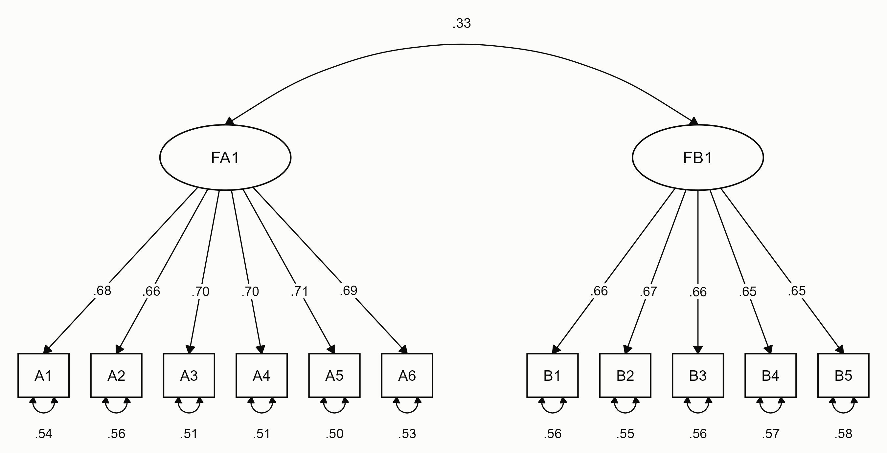



# Structural Equation Modeling (SEM)

## Before You Start

- What is SEM, and what does it include?
    - Note that SEM has two parts: the structural model and the measurement model. Many beginners run into problems with SEM because they did not understand these basic concepts thoroughly at the start.
- When should you use SEM?
- What are latent variables, exogenous variables, and endogenous variables?
- What makes a good structural equation model?
- How do you test mediation?

The procedures and indices discussed below (anything involving numbers) should be backed by the literature. Remember to cite it when you write your paper.

### Key Terms

- **Exogenous variable** (independent variable, predictor): a variable that no other variable in the model predicts. In a path diagram, no single-headed arrow points to it.
- **Endogenous variable** (dependent variable, outcome, criterion): a variable that at least one other variable predicts. A mediator is endogenous, although it also predicts other variables.
- **Observed variable** (manifest variable, indicator): a variable in your data, such as a questionnaire item or a sum score.
- **Latent variable** (factor, construct): a variable that is not measured directly and is defined by its indicators, such as depression measured by the items of a depression scale (Note 1).
- **Measurement model**: how each latent variable relates to its indicators. On its own, it is a CFA.
- **Structural model**: the regressions among the latent variables, and between them and other observed variables. A structural model with observed variables only is a path analysis.
- **Path diagram**: the model drawn as a figure. Rectangles are observed variables, ovals are latent variables, single-headed arrows are regressions or loadings, and double-headed arrows are variances or covariances (see the figure in [Report Results](#report-results)).
- **Specification**: deciding which parameters are free (estimated from the data) and which are fixed (set to a value, usually 0 or 1). Every arrow you leave out of the diagram fixes a parameter at 0. No model fits the data perfectly; the aim is a model that fits well and makes theoretical sense.
- **Identification**: whether the free parameters have a unique solution. The data must give at least as many pieces of information as there are free parameters (df ≥ 0; see [How CFA Estimates the Model](#how-cfa-estimates-the-model)), and each latent variable needs a fixed scale. df ≥ 0 is necessary but not sufficient.
- **Model fit**: how close the model-implied covariance matrix is to the observed one, summarized by fit indices such as χ², CFI, TLI, RMSEA, and SRMR ([Report Results](#report-results)).
- **Wald test and score test**: the Wald test asks whether fixing or constraining free parameters (for example, setting a path to 0, or two loadings equal) would make the fit significantly worse; in lavaan, `lavTestWald()`. The score test, also called the Lagrange multiplier (LM) test, asks whether freeing fixed parameters would make the fit significantly better; in lavaan, `lavTestScore()`. A modification index is the score test for one fixed parameter (step 7 of the Basic Procedure).
- **Size of a path**: for standardized path coefficients, the benchmarks Cohen (1988) gave for correlations are often used: about .10 is small, .30 medium, and .50 large.

### Parameters of a CFA Model

A confirmatory factor analysis (CFA) is the measurement model on its own: each latent variable (factor) is measured by several items, and the factors may correlate. The table lists its parameters, with F for a factor and x for an item.

:::: {.list-table header-rows=1}
- - Symbol
  - Parameter
  - lavaan
  - Meaning
- - λ (lambda)
  - Factor loading
  - `F =~ x`
  - The relation between the factor and the item: how much the item changes when the factor increases by one unit.
- - ψ (psi)
  - Factor variance and covariance
  - `F ~~ F`, `F1 ~~ F2`
  - How much people differ on the factor. A small ψ means the differences between people are small. The covariance between two factors is also a ψ.
- - α (alpha)
  - Factor mean
  - `F ~ 1`
  - Usually fixed at 0 (see below).
- - τ (tau)
  - Item intercept
  - `x ~ 1`
  - The expected value of the item when the factor is 0. With the factor mean at 0, it is the item's mean.
- - θ (theta)
  - Residual variance
  - `x ~~ x`
  - The part of the item that the factor does not explain: measurement error plus anything specific to that item. Residuals are uncorrelated unless you add a residual covariance (`x1 ~~ x2`).
- - R²
  - Explained variance
  - (computed)
  - The share of the item's variance that the factor explains. In the standardized solution, R² = λ² = 1 − θ for an item that loads on one factor.
::::

A factor has no scale of its own, so its mean and its unit have to be fixed before the model can be estimated (identification). In a single-group model, the factor mean α is fixed at 0. For the unit, either the first loading is fixed at 1 (fixed loading, the default in lavaan and Mplus) or the factor variance ψ is fixed at 1 (fixed variance); see step 5 of the Basic Procedure. In a multigroup model, the factor mean is fixed at 0 in one group only, so that the latent means of the other groups can be compared with it (see [Multigroup Analysis](multigroup-analysis.qmd)).

### How CFA Estimates the Model

Because the factor is not observed, the model cannot estimate λ by regressing each item on it. It starts instead from what the factor implies: items that measure the same factor correlate because they share that factor. From λ, ψ, and θ, the model computes the variances and covariances that the items should have, the model-implied covariance matrix. For items $i$ and $j$ on the same factor:

$$
\begin{aligned}
\operatorname{cov}(x_i, x_j) &= \lambda_i \lambda_j \psi \\
\operatorname{var}(x_i) &= \lambda_i^2 \psi + \theta_i
\end{aligned}
$$

For items on two different factors, the covariance is $\lambda_i \lambda_j \psi_{12}$, where $\psi_{12}$ is the covariance of the two factors. The estimator looks for the parameter values that bring the implied matrix as close as possible to the covariance matrix in the data, and the χ² test asks whether the difference that is left is larger than chance. A non-significant χ² (p > .05) therefore means that there is no evidence that the model misfits. It does not prove the model right, and in large samples even trivial differences are significant (Note 6).

The degrees of freedom (df) are the pieces of information in the data minus the number of free parameters. With $p$ items, the data give $p(p + 1)/2$ variances and covariances plus $p$ means. A factor with five items gives $15 + 5 = 20$ pieces of information. The model estimates 4 loadings (the first is fixed at 1), 1 factor variance, 5 intercepts, and 5 residual variances, 15 in all, so df = $20 - 15 = 5$. A factor with three items has df = $9 - 9 = 0$: the model reproduces the data exactly, and its fit cannot be tested on its own. [Under the Hood](#implied-covariance) checks these numbers in R, and [SEM by Hand](sem-by-hand.qmd) derives the implied covariance matrix in matrix form and estimates the model step by step in R and Python.

## Basic Procedure

1. Handle missing values and outliers. There are many ways to do this; here we recommend multiple imputation.
2. Test for common method bias and multicollinearity: if all your data come from questionnaires, you need this step, and also check whether the variables are collinear.
    1. Currently there is no "perfect" test for common method bias. The literature tends to recommend the directly measured latent variable (DMLV) approach, but it requires you to specify the source of the bias in advance and collect an extra questionnaire.
3. Test univariate and multivariate normality, because non-normal data need different estimators: MLR or MLM for non-normal continuous data (MLR also handles missing data with FIML), and WLSMV for categorical (ordinal) data.
4. Compute the correlations between the dimension (subscale) scores.
5. Test the reliability and validity of the scales; there are different indices you can report.
    1. CFA: this also counts as evidence of construct validity. There are two ways to set the scale of each latent variable, the fixed-variance method and the fixed-loading method, and both give the same model fit.
        1. Fixed variance: the variance of the latent variable is fixed to 1, and all loadings are estimated freely.
        2. Fixed loading: the loading of one item on each factor is fixed to 1, and the other loadings are estimated freely.
        3. Software usually uses fixed loading by default; if you want fixed variance, you may need to adjust the code (in lavaan, `std.lv = TRUE`; see [CFA syntax](#cfa-syntax)).
6. Path analysis: now you can fit the full model (SEM). Most online tutorials and videos only teach this step and skip the ones before it; if you go straight to the full model, the results may be poor.
    1. Report the fit indices, path coefficients, and other information from the path analysis.
7. Model modification:
    1. Look at the modification indices (MI). When an MI is above 3.84 (the critical chi-square value with 1 df at p < .05), you can add a residual correlation, usually between observed variables within the same factor. Because this is data-driven, it is best to have theoretical support. Don't follow every MI: stop once the fit indices are acceptable, otherwise the model becomes saturated. Mention these modifications in your paper. ~~Most people just don't explain why they made them (after all, they are data-driven).~~
    2. Then keep revising the model: change some paths based on your theory, and compare the new model with the original one.
8. Test mediation (details and code in [Mediation Analysis](mediation-analysis.qmd)):
    1. The Sobel test assumes the indirect effect is normally distributed, which is rarely true because the product of two coefficients is usually skewed, so bootstrapping is now the common choice. 5,000 resamples are common and 10,000 are recommended, depending on how powerful your computer is.
        1. Judge significance by the 95% CI rather than the p-value: the effect is significant when the confidence interval does not include 0.
    2. The total effect can be masked (for example, by suppression), so it may be non-significant. I don't recommend leaning heavily on terms like "full mediation" and "partial mediation". Highly recommended reading:
        1. Rucker, D. D., Preacher, K. J., Tormala, Z. L., & Petty, R. E. (2011). Mediation analysis in social psychology: Current practices and new recommendations. *Social and Personality Psychology Compass*, *5*(6), 359-371. https://doi.org/10.1111/j.1751-9004.2011.00355.x
    3. It can indeed happen that path coefficients or the indirect effect are not significant after bootstrapping; bootstrapping gives more accurate confidence intervals and a more robust significance test. There are many possible reasons, such as a small sample or a misspecified model; in short, the relationships among the variables are not robust.

## Report Results

A results section follows the order of the analysis:

1. Data screening: the univariate and multivariate normality of the items, which decides the estimator (step 3 of the Basic Procedure).
2. Methods: the software and estimator, how missing data were handled, how each factor was identified (the loading fixed at 1 and the factor means fixed at 0), that the residual covariances were fixed at 0, how the effects were tested (the type of bootstrap CI and the number of draws, and that an effect counts as significant when its 95% CI excludes 0), and the fit criteria with their source.
3. Measurement models, one per factor: fit, loadings, R², and whether the hypothesis about the factor was supported.
4. Structural model: fit, each path with its estimate, SE, 95% CI, and standardized coefficient (β), and the R² of each endogenous factor.
5. Indirect and total effects with their 95% CIs.

With several models or many items, put the numbers in tables and refer to them in the text. The [full SEM example](#example-full-sem) below goes through all five steps.

### Fit Criteria

For a CFA, or the measurement part of any SEM, report the χ² test with its df and p-value, CFI, TLI, RMSEA with its 90% CI, and SRMR. Commonly used cutoffs for a good fit:

| Index | Good fit | Source |
|---|---|---|
| χ² | p > .05 | Sensitive to sample size (Note 6) |
| χ²/df | ≤ 2 or 3 | Schreiber (2008) |
| CFI, TLI | ≥ .95 | Hu & Bentler (1999) |
| RMSEA | ≤ .06 | Hu & Bentler (1999) |
| SRMR | ≤ .08 | Hu & Bentler (1999) |
| Standardized loadings | ≥ .50, ideally ≥ .70 | Hair et al. (2009), as cited in Cheung et al. (2024) |

Hu and Bentler (1999) proposed values close to these, not hard rules. With the MLR estimator, report the scaled χ² and the robust CFI, TLI, and RMSEA: the `Scaled` column and the `Robust` lines in lavaan's output.

A standardized loading of .70 means that the factor explains 49% (.70²) of the item's variance, about half. Cheung et al. (2024) also take sampling error into account: they look at the upper limit of the 90% CI of each standardized loading. If it is below .50, the item is a major concern; from .50 to below .70, a minor concern; at .70 or above, no concern.

### A CFA

The two-factor model in [CFA syntax](#cfa-syntax) could be reported like this:

> The measurement model was estimated with robust maximum likelihood (MLR), and missing data were handled with full information maximum likelihood (FIML). The first loading of each factor was fixed at 1 and the factor means at 0. The model fit the data well (Hu & Bentler, 1999), χ²(43) = 54.15, *p* = .119, CFI = .993, TLI = .991, RMSEA = .024, 90% CI [.000, .041], SRMR = .032. All standardized loadings were significant (*p*s < .001) and ranged from .65 to .71, and the upper limit of each 90% CI was at least .70 (Cheung et al., 2024). The factors explained 42% to 50% of the variance of each item. FA1 and FB1 were correlated, *r* = .33, 95% CI [.23, .43].

[Numbers for the Tables](#numbers-for-the-tables) collects these values in R. A path diagram with the standardized estimates can go in the paper or its appendix:



If two factors are not significantly correlated, report the covariance and the correlation with its 95% CI in the same way, and say that the CI includes 0. The factor correlation is corrected for measurement error ([Latent vs. Observed Correlation](#latent-vs-observed)), so a non-significant correlation is not the result of attenuation by unreliable items, as it could be with sum scores.

A factor with three items is just-identified (df = 0; see [How CFA Estimates the Model](#how-cfa-estimates-the-model)), and its fit indices show a perfect fit by construction (χ² = 0, CFI = 1, RMSEA = 0). Write, for example, "The model was just-identified because the factor has only three items, so its fit could not be evaluated", report the loadings and R², and evaluate its fit as part of the full measurement or structural model.

### A Full SEM {#example-full-sem}

Suppose the hypotheses are that (1a to 1c) the items of FA1, FB1, and FB2 each form a well-fitting factor; (2) FA1 predicts FB1 (path *a*); (3) FB1 predicts FB2 (path *b*); (4) FA1 predicts FB2 (path *c'*); and (5) FA1 has an indirect effect on FB2 through FB1. Each measurement model is tested on its own, then the structural model. [Full SEM](#full-sem-syntax) in Syntax gives the code and the numbers.

> The measurement and structural models were estimated in R with the lavaan package. Univariate normality of the items was tested with the Shapiro-Wilk test and multivariate normality with Mardia's test. All items deviated from normality, *W*s = .914 to .917, *p*s < .001, with skewness from −0.04 to 0.15 and kurtosis from −0.93 to −0.69 (Table 1). Mardia's multivariate skewness was not significant, *p* = .999, but multivariate kurtosis was, *z* = −4.18, *p* < .001. The models were therefore estimated with robust maximum likelihood (MLR), and missing data were handled with full information maximum likelihood (FIML). The first loading of each factor was fixed at 1 and the factor means at 0, all item intercepts were estimated freely, and residual covariances were fixed at 0. The paths and the indirect and total effects were tested with 5,000 percentile bootstrap samples (ML with FIML), and an effect was considered significant when its 95% confidence interval (CI) excluded zero. Model fit was evaluated against χ²/*df* ≤ 3, CFI and TLI ≥ .95, RMSEA ≤ .06, and SRMR ≤ .08 (Hu & Bentler, 1999; Schreiber, 2008).
>
> **Hypothesis 1a.** The measurement model of FA1 fit the data well (Table 2). The χ² test was significant, χ²(9) = 17.89, *p* = .037, but the other indices met the criteria, χ²/*df* = 1.99, CFI = .990, TLI = .984, RMSEA = .046, 90% CI [.012, .077], SRMR = .020. The factor variance was significant (ψ = 0.647, *SE* = 0.073, *p* < .001), indicating individual differences in FA1. With the loading of A1 fixed at 1, the unstandardized loadings of A2 to A6 ranged from 0.960 to 1.055 (*p*s < .001), and the standardized loadings of all six items from .665 to .713 (Table 3); the upper limit of each 90% CI was at least .70 (Cheung et al., 2024). The standardized residual variances ranged from .491 to .558, so 49.1% to 55.8% of the variance of each item was unique to it, measurement error and item-specific variance rather than FA1. Correspondingly, *R*² ranged from .442 to .509: FA1 explained 44.2% to 50.9% of the variance of each item. Hypothesis 1a was supported.
>
> **Hypotheses 1b and 1c.** The models of FB1, χ²(5) = 4.37, *p* = .497, and FB2, χ²(14) = 8.15, *p* = .881, also fit the data well (Table 2). Their standardized loadings ranged from .648 to .671 and from .629 to .678 (*p*s < .001; Table 3). For FB1, the upper limit of each 90% CI was at least .70. For FB2, the upper limits for B6, B7, and B12 were between .50 and .70 (.681, .699, and .697), a minor concern (Cheung et al., 2024). FB1 explained 42.0% to 45.1%, and FB2 39.5% to 46.0%, of the variance of each item. Hypotheses 1b and 1c were supported.
>
> **Hypotheses 2 to 4.** The structural model fit the data well (Table 2), χ²(132) = 156.25, *p* = .073, χ²/*df* = 1.18, CFI = .991, TLI = .989, RMSEA = .020, 90% CI [.000, .031], SRMR = .035, with standardized loadings from .635 to .706 (*p*s < .001). FA1 positively predicted FB1 (estimate = 0.314, *SE* = 0.057, 95% CI [0.208, 0.433], β = .333, *p* < .001; Table 4), supporting Hypothesis 2. FB1 positively predicted FB2 (estimate = 0.493, *SE* = 0.069, 95% CI [0.369, 0.636], β = .496, *p* < .001), supporting Hypothesis 3. FA1 also positively predicted FB2 (estimate = 0.160, *SE* = 0.051, 95% CI [0.061, 0.262], β = .170, *p* = .002), supporting Hypothesis 4. *R*² = .111 for FB1 and .330 for FB2.
>
> **Hypothesis 5.** The indirect effect of FA1 on FB2 through FB1 was positive and significant (indirect effect = 0.155, *SE* = 0.032, 95% CI [0.099, 0.224], β = .165). The total effect was 0.315 (95% CI [0.214, 0.426], β = .335; Table 4). Hypothesis 5 was supported.

**Table 1**

*Univariate Normality of the Items*

| Item | Skewness | Kurtosis | *W* | *p* |
|---|---|---|---|---|
| A1 | −0.034 | −0.819 | .916 | < .001 |
| A2 | −0.002 | −0.879 | .915 | < .001 |
| A3 | 0.022 | −0.880 | .916 | < .001 |
| A4 | 0.060 | −0.778 | .917 | < .001 |
| A5 | 0.005 | −0.837 | .916 | < .001 |
| A6 | −0.011 | −0.933 | .915 | < .001 |
| B1 | 0.100 | −0.738 | .916 | < .001 |
| B2 | 0.017 | −0.849 | .916 | < .001 |
| B3 | 0.074 | −0.804 | .916 | < .001 |
| B4 | 0.024 | −0.812 | .917 | < .001 |
| B5 | 0.019 | −0.850 | .917 | < .001 |
| B6 | 0.050 | −0.907 | .915 | < .001 |
| B7 | 0.027 | −0.894 | .915 | < .001 |
| B8 | 0.025 | −0.693 | .917 | < .001 |
| B9 | −0.039 | −0.878 | .915 | < .001 |
| B10 | 0.152 | −0.779 | .914 | < .001 |
| B11 | −0.020 | −0.804 | .917 | < .001 |
| B12 | −0.009 | −0.825 | .916 | < .001 |

*Note.* *N* = 500; each item was tested on the 482 to 494 cases that answered it. Kurtosis is the excess kurtosis (0 for a normal distribution). *W* = Shapiro-Wilk statistic. Mardia's test (*n* = 336 complete cases): multivariate skewness *p* = .999; multivariate kurtosis *z* = −4.18, *p* < .001.

**Table 2**

*Model Fit Indices of the Measurement and Structural Models*

| Model | χ² | *df* | χ²/*df* | *p* | RMSEA | RMSEA 90% CI | SRMR | CFI | TLI |
|---|---|---|---|---|---|---|---|---|---|
| FA1 | 17.887 | 9 | 1.987 | .037 | .046 | [.012, .077] | .020 | .990 | .984 |
| FB1 | 4.371 | 5 | 0.874 | .497 | .000 | [.000, .058] | .012 | 1.000 | 1.002 |
| FB2 | 8.150 | 14 | 0.582 | .881 | .000 | [.000, .023] | .013 | 1.000 | 1.009 |
| Structural model | 156.250 | 132 | 1.184 | .073 | .020 | [.000, .031] | .035 | .991 | .989 |

*Note.* *N* = 500. Scaled χ² and robust RMSEA, CFI, and TLI (MLR). TLI can exceed 1 when χ² is smaller than its df.

**Table 3**

*Factor Loadings of the Measurement Models*

| Model | Item | Estimate | *SE* | *p* | β | *R*² |
|---|---|---|---|---|---|---|
| **FA1** | | | | | | |
| | A1 | 1.000 | – | – | .681 | .464 |
| | A2 | 0.960 | 0.073 | < .001 | .665 | .442 |
| | A3 | 1.020 | 0.071 | < .001 | .702 | .492 |
| | A4 | 0.997 | 0.071 | < .001 | .696 | .484 |
| | A5 | 1.055 | 0.074 | < .001 | .713 | .509 |
| | A6 | 1.004 | 0.074 | < .001 | .681 | .464 |
| | FA1 (ψ) | 0.647 | 0.073 | < .001 | | |
| **FB1** | | | | | | |
| | B1 | 1.000 | – | – | .651 | .424 |
| | B2 | 1.042 | 0.090 | < .001 | .671 | .451 |
| | B3 | 1.015 | 0.093 | < .001 | .671 | .451 |
| | B4 | 1.009 | 0.086 | < .001 | .648 | .420 |
| | B5 | 1.033 | 0.089 | < .001 | .652 | .425 |
| | FB1 (ψ) | 0.557 | 0.075 | < .001 | | |
| **FB2** | | | | | | |
| | B6 | 1.000 | – | – | .629 | .395 |
| | B7 | 1.031 | 0.080 | < .001 | .650 | .423 |
| | B8 | 1.001 | 0.080 | < .001 | .653 | .426 |
| | B9 | 1.063 | 0.079 | < .001 | .678 | .460 |
| | B10 | 1.032 | 0.084 | < .001 | .650 | .423 |
| | B11 | 1.028 | 0.078 | < .001 | .652 | .425 |
| | B12 | 1.019 | 0.077 | < .001 | .646 | .417 |
| | FB2 (ψ) | 0.543 | 0.068 | < .001 | | |

*Note.* Estimate = unstandardized loading or factor variance (ψ); β = standardized loading. The first loading of each factor was fixed at 1 for identification.

**Table 4**

*Paths and Effects of the Structural Model*

| Path | Estimate | *SE* | *z* | *p* | LLCI | ULCI | β |
|---|---|---|---|---|---|---|---|
| FA1 → FB1 (*a*) | 0.314 | 0.057 | 5.476 | < .001 | 0.208 | 0.433 | .333 |
| FB1 → FB2 (*b*) | 0.493 | 0.069 | 7.145 | < .001 | 0.369 | 0.636 | .496 |
| FA1 → FB2 (*c'*, direct effect) | 0.160 | 0.051 | 3.114 | .002 | 0.061 | 0.262 | .170 |
| FA1 → FB1 → FB2 (indirect effect) | 0.155 | 0.032 | 4.835 | < .001 | 0.099 | 0.224 | .165 |
| Total effect | 0.315 | 0.054 | 5.802 | < .001 | 0.214 | 0.426 | .335 |

*Note.* Estimate = unstandardized estimate; β = standardized estimate. *SE*, *z*, *p*, and the lower and upper limits of the 95% percentile CI (LLCI, ULCI) are from 5,000 bootstrap draws.

- [Joel Collier: How to present Structural Equation Modeling results in a journal (YouTube)](https://www.youtube.com/watch?v=kEuxOwTWKPA)

## Notes

1. Latent vs. observed variables: observed variables are the individual items on the questionnaire, and a latent variable is your operationalized construct, the variable you want to study. For example, if I want to study the severity of depression, that is an abstract concept; you need to make it operational, that is, measure it with a scale (or by other means).
2. Don't be purely data-driven: SEM needs strong theoretical support. If you are purely data-driven, the discussion will be hard to write.
3. Use WLSMV for categorical (ordinal or binary) variables: declare them with `ordered =`, and lavaan uses WLSMV by default.
    1. WLSMV estimates the model with diagonally weighted least squares (DWLS) and adds robust standard errors and a mean- and variance-adjusted χ². `estimator = "DWLS"` gives the same estimates and standard errors, but only the unadjusted χ², so report the WLSMV test.
    2. WLSMV and DWLS have no likelihood, so there is no AIC or BIC (see [Model comparison](#model-comparison)).
4. When the model is too complex and the fit is not acceptable:
    1. Simplify your model. A more complex model is not necessarily better; it has to make sense.
    2. Take a single dimension into the SEM instead of putting several dimensions together in a mediation model.
    3. Item parceling (explain why you used this method and how you did it):
        1. The most common way is to use the dimension scores directly; if you want to use item parceling, look up the literature.
            1. When I first started and didn't know better, I summed all the dimension scores into a total and analyzed it as a first-order latent variable. Later I learned this is not correct, although in a sense it is a kind of item parceling.
        2. However, **I strongly recommend using the raw (item-level) data rather than processed data**: if you use averages, you may ignore measurement error and introduce bias (see [Latent vs. Observed Correlation](#latent-vs-observed)).
        3. A composite of the subscales (the sum or mean of the subscale scores, or of the subscale factors) and a second-order factor are not interchangeable. A second-order factor rests on assumptions about the covariances of the first-order factors; a composite does not, and its correlations with other variables can differ a lot from those of the second-order factor. A composite also has to mean something: for a profile-type measure, such as the six interest dimensions of Holland's RIASEC model, the information is in the profile and a total says little (Rose et al., 2019, pp. 13-14).
        4. Factor scores, saved from a CFA and used as observed variables, are another option when the full model is too complex to converge. They are estimates that still contain measurement error. In simulations of hierarchical models, they estimated correlations with an outcome about as accurately as the full SEM when the indicators were continuous, but tended to underestimate them when the indicators were binary (Williams et al., 2025).
5. Scale reliability and validity should already be tested in the pilot study, and then adjusted with the large sample. Remember to handle the reverse-scored items.
6. Reporting indices: different papers report different indices. You don't need to report all of them, and they don't all need to meet the cutoffs. Some indices are affected by factors such as sample size (e.g., the p-value of the chi-square test); if one doesn't meet the cutoff, explain it in your paper.
7. Generally, only after a simple mediation model works should you move on to more complex models.
8. CFA is a must, although you don't have to report it, depending on the length of your paper. If the CFA does not fit, the model built on it cannot be used.
9. EFA and CFA must use different samples; they are different things. You can roughly think of the EFA as a pilot study.
10. If you designed the questionnaire yourself, factor loadings > 0.5 (more leniently, 0.4) are acceptable; for previously validated questionnaires, > 0.6. Look up literature support for these cutoffs. Cheung et al. (2024) review the published rules: 0.4 for interpretation, and at least 0.5, ideally 0.7 (see [Report Results](#report-results)).
11. If the CFA fit is poor, you may need to delete items or further process the sample:
    1. If you use an established questionnaire, it's better not to delete items casually (assuming you already have a large sample; otherwise your method may end up different from others'), unless your pilot study already revealed big problems (then you can redevelop the questionnaire).
    2. Problematic (very large) path coefficients may mean a problem with the model structure, or that the coefficients are not standardized.
    3. Your data quality is poor.
12. A second-order factor model and a bifactor model are two different things.
    1. A second-order factor model needs to go back to theory: you can only fit a higher-order model when the total of the subscales (dimensions) is meaningful. For example, the dimensions of a personality scale are theoretically uncorrelated, so a second-order model doesn't work and their total is meaningless; in that case, take each dimension (depending on your hypotheses) into the SEM separately.
    2. A second-order factor needs three or more first-order factors; with only two, extra constraints are needed (such as fixing loadings). The same goes for items: for a CFA, each factor should have three or more items.
13. Variables don't necessarily need to be correlated.
14. Some situations, such as a non-significant total effect or standardized path coefficients greater than 1 or less than -1, can happen, and your software won't report an error. But you need to look at them together with R² and the 95% CI.
    1. A non-significant total effect does not rule out an indirect effect (Hayes, 2009); see [Mediation Analysis](mediation-analysis.qmd#when-the-total-effect-is-not-significant).
    2. A standardized coefficient beyond ±1 is not an error. It occurs most readily when the predictors are highly correlated (multicollinearity), and it is not by itself a reason to change the model, although its square can then no longer be read as the share of variance that the predictor explains (Deegan, 1978, pp. 886-887). Suppression among the predictors, or a model that is too complex for the sample size, can also produce one. Check the correlations among the predictors.

See also: De Stavola, B. L., Daniel, R. M., Ploubidis, G. B., & Micali, N. (2015). Mediation analysis with intermediate confounding: Structural equation modeling viewed through the causal inference lens. *American Journal of Epidemiology*, *181*(1), 64-80. https://doi.org/10.1093/aje/kwu239

## Summary and Practice

### Confirmatory factor analysis (CFA)

- **Variable types:** Any (continuous and categorical variables)
- **When to use:** How do you define and measure your operational variables?
- **Functions:** lavaan package, `cfa()`; see [CFA syntax](#cfa-syntax), which also gives the Mplus version
- **Comment:** lavaan is by far the most widely used SEM package in R. The official documentation and forum cover a lot of tutorials and answer the questions you may have. I recommend making good use of the official forum.
- **Resources:** [lavaan tutorial](https://lavaan.ugent.be/tutorial/), [UCLA OARC: Confirmatory Factor Analysis (CFA) in R with lavaan](https://stats.oarc.ucla.edu/r/seminars/rcfa/)

### Second-order CFA

### Path analysis

- **Functions:** lavaan, `sem()`, with regressions written as `y ~ x` (see the [quick reference](#lavaan-syntax)).
- **Comment:** With a binary exogenous predictor such as gender, report `standardizedSolution(fit, type = "std.nox")`. It standardizes every variable except the exogenous observed ones, so the coefficient is the difference between the two groups in standard deviations of the outcome. A fully standardized coefficient (`Std.all`) would be per standard deviation of a 0/1 variable, which has no clear meaning; for indirect effects, see Hayes (2009, p. 417).

### Multiple outcomes

- **Variable types:** Any
- **When to use:** The same predictors are expected to affect several outcomes, for example X → M → Y1 and X → M → Y2.
- **Comment:**
  - Put the outcomes in one model rather than fitting one model per outcome. `sem()` then frees the residual covariance of outcomes that predict nothing else, so the model estimates how strongly the outcomes are related after the predictors are taken into account (their partial correlation).
  - In one model you can test several parameters at once, such as all paths to both outcomes (`lavTestWald()`), instead of running a separate test per outcome, which limits the number of tests. You can also compare a predictor's effect on the two outcomes by labeling both paths and defining their difference with `:=`; compare raw coefficients only when the outcomes are on the same scale.
  - If the outcomes are unrelated and answer separate questions, separate models are fine.
- **Resources:** [Cross Validated: Does adding more than 1 dependent variable to SEM have purpose other than to control for correlation between dependent variables?](https://stats.stackexchange.com/questions/403723/does-adding-more-than-1-dependent-variable-to-sem-have-purpose-other-than-to-con), [Cross Validated: Testing simple mediation model with two separate outcome variables](https://stats.stackexchange.com/questions/192004/testing-simple-mediation-model-with-two-separate-outcome-variables)

### Mediation analysis

- **Variable types:** Continuous mediator and outcome; for categorical ones, see the chapter.
- **When to use:** Your theory says X affects Y through M.
- **Functions:** lavaan, `sem()`, with the indirect effect defined by `:=` and a bootstrap confidence interval (`se = "bootstrap"`).
- **Comment:** See [Mediation Analysis](mediation-analysis.qmd). For curved (nonlinear) paths, see [Nonlinear Mediation](nonlinear-mediation.qmd).

### Control variables (covariates)

- **Variable types:** Any
- **When to use:** My theory is that demographic variables (e.g., gender and age) affect (or predict) suicidal behavior, so to make the results more robust, I control for the effect of the demographic variables on suicidal behavior.
- **Comment:**
  - All the x's are independent variables: the one you focus on is the explanatory variable, and the ones you don't focus on are control variables. "Control" means you don't care about it, but because it affects y, it would affect the estimate for the explanatory variable you care about, so you add it to the model to control for it.
  - Paths in SEM stand for hypothesized causal effects, and the independent variable X is where the chain starts. A control variable C is there to remove confounding, not to explain X, so X stays exogenous. X and C may still correlate; the model then estimates the effect of X with C held constant.
  - How to specify it depends entirely on your theory (or previous studies). If you think a control variable affects the dependent variable, the mediator, or both, regress those variables on the control variable. If you think it only affects the dependent variable, regress only the dependent variable on it. In fact, regression works the same way: the control variables and the independent variable are allowed to correlate by default. But note: don't regress the independent variable on the control variables.
  - Treat control variables like independent variables. In Becker's (2005) review, about 63% of the studies that used control variables gave no clear reason for at least one of them (Bernerth & Aguinis, 2016). Bernerth and Aguinis (2016) recommend including a control only when theory explains how and why it relates to the focal variables; adding controls does not make a test more conservative. Measure the controls reliably, report their descriptive statistics and correlations, and report the results with and without them. Controls that are unrelated to the focal variables can be left out, which keeps statistical power. A categorical control with more than two categories has one effect per dummy variable.
- **Resources:** [lavaan Google Group: Add control variable in SEM](https://groups.google.com/g/lavaan/c/xdCnpHHTh6s), [lavaan Google Group: lavaan syntax for control variables in mediation](https://groups.google.com/g/lavaan/c/03gq8K324k8), [Cross Validated: How do you control for a variable in SEM with mediation?](https://stats.stackexchange.com/questions/550048/how-do-you-control-for-a-variable-in-sem-with-mediation-what-do-i-regress-onto), [Quora: What are control variables and how do I use them in regression analysis?](https://www.quora.com/What-are-control-variables-and-how-do-I-use-them-in-regression-analysis), [UCLA OARC: Covariate Selection in Regression: A Crash Course on Good and Bad Controls](https://stats.oarc.ucla.edu/r/seminars/good-bad-controls/)

### Moderation

- **Variable types:** Usually categorical (compared with a multigroup model), but continuous variables also work: use them directly in an interaction term rather than splitting them into groups, which loses information.
- **When to use:** Your theory says that the effect of X on Y depends on a third variable W, for example that the effect of study time on exam scores depends on prior knowledge.
- **Functions:** For observed variables, center X and W and regress Y on X, W, and their product: Y = b0 + b1X + b2W + b3(X × W) + e. In lavaan, write `y ~ b1*x + b2*w + b3*x:w`. b3 is the interaction; the effect of X at a value w of W (a simple slope) is b1 + b3w, which you can define with `:=`. For latent variables, the product is harder to model: product indicators (`semTools::indProd()`), or latent moderated structural equations in Mplus (`XWITH`).
- **Comment:** After centering, b1 is the effect of X at the mean of W, and b2 the effect of W at the mean of X.
- **Resources:** [EPSY 579 R Cookbook for SEM, Lab 3: Moderation and conditional effects](https://gabriellajg.github.io/EPSY-579-R-Cookbook-for-SEM/lavaan-lab-3-moderation-and-conditional-effects.html)

### Multigroup comparisons

- **Comment:** Measurement invariance and comparing paths across groups: see [Multigroup Analysis](multigroup-analysis.qmd).

### Model comparison

- **When to use:** You compare competing models, such as a model with and without a path, or two theories about the same variables.
- **Comment:**
  - Nested models (one model is the other with some parameters fixed or constrained): χ² difference test, `lavTestLRT(fit1, fit2)`. With MLR it uses the scaled difference test (Satorra & Bentler, 2001), and with WLSMV a scaled and shifted one. Don't subtract the robust χ² values by hand: the scaled difference is not the difference of the scaled values.
  - Non-nested models: compare AIC and BIC; smaller is better. They need a likelihood, so they exist for ML and MLR but not for WLSMV or DWLS.
  - Two paths in the same model: label them and define the difference, `diff := b1 - b2`, or constrain them to be equal (give them the same label) and compare with the free model in `lavTestLRT()`. Equality constraints apply to the unstandardized paths, so the variables should be on comparable scales.
  - Paths across groups: see [Multigroup Analysis](multigroup-analysis.qmd#compare-path-coefficients).
- **Resources:** [Regorz: Path comparison in lavaan](https://www.regorz-statistik.de/blog/lavaan_path_comparison.html), [lavaan Google Group: Comparing path coefficients in SEM using lavTestLRT - can I compare standardized or unstandardized values?](https://groups.google.com/g/lavaan/c/I2Svn1gfTTU)

### Export results

- **Functions:** lavaan, bruceR
- **Resources:** [bruceR](https://psychbruce.github.io/bruceR/)

### Figures

- **Comment:** So far there is no best package for drawing SEM figures; you could use Word or PowerPoint.

## Syntax

The code in this section runs in your browser and prints its output when the page loads. The first visit downloads lavaan, so the first results take a while to appear. You can edit any cell and run it again.

The examples use the scored version of the simulated dataset described in [Example Data](example-data.qmd), in which A4 and A11 are already reverse-scored. Some items are missing, so every model uses `missing = "fiml"` with the MLR estimator (step 3 of the Basic Procedure).

### lavaan Syntax Quick Reference {#lavaan-syntax}

The operators used in the models on this page, with their Mplus equivalents. [UCLA OARC: Quick reference of lavaan syntax](https://stats.oarc.ucla.edu/r/seminars/rsem/#s1d) gives the same list with short examples.

| | lavaan | Mplus |
|---|---|---|
| Factor measured by items | `F =~ x1 + x2 + x3` | `F BY x1-x3;` |
| Regression | `y ~ x` | `y ON x;` |
| Covariance | `x1 ~~ x2` | `x1 WITH x2;` |
| Variance | `x ~~ x` | `x;` |
| Mean or intercept | `x ~ 1` | `[x];` |
| Fix a parameter at a value | `F =~ 1*x1` | `F BY x1@1;` |
| Free a parameter that is fixed by default | `F =~ NA*x1` | `F BY x1*;` |
| Label a parameter | `y ~ a*x` | `y ON x (a);` |
| New parameter from labels | `ab := a*b` | `MODEL CONSTRAINT: NEW(ab); ab = a*b;` |
| Robust ML estimator | `estimator = "MLR"` | `ANALYSIS: ESTIMATOR = MLR;` |

### Confirmatory Factor Analysis (CFA) {#cfa-syntax}

#### One Factor

```{webr}
#| autorun: true
library(lavaan)
mydata <- read.csv("data/mydata_scored.csv")
```

```{webr}
#| autorun: true
model_b <- 'FB1 =~ B1 + B2 + B3 + B4 + B5'
fit_b <- cfa(model_b, data = mydata,
             estimator = "MLR", missing = "fiml")
summary(fit_b, fit.measures = TRUE, standardized = TRUE,
        rsquare = TRUE)
```

How to read the output:

- `Estimate` is the unstandardized estimate. The first loading is 1 and has no SE because it is fixed.
- `Std.Err` is its standard error, `z-value` is `Estimate` divided by `Std.Err`, and `P(>|z|)` is the p-value of z: |z| > 1.96 means p < .05.
- `Std.lv` standardizes only the latent variables (factor variance 1), so the loadings stay in the units of the items; they are the estimates you get with `std.lv = TRUE`.
- `Std.all` is the standardized solution, with the items standardized too: the standardized loadings under Latent Variables, and the standardized residual variances θ under Variances (the dot before an item name marks a residual).
- The `Std` columns have no SEs or p-values; `standardizedSolution(fit_b)` gives them, with CIs.
- `R-Square` is 1 − θ for each item.
- With MLR, read the `Scaled` column of the χ² test and the `Robust` lines for CFI, TLI, and RMSEA. Here χ²(5) = 4.37, p = .497.

#### What `cfa()` Adds for You

The one-line model hides most of the parameters. `cfa()` adds them by default: it fixes the first loading at 1 and the factor mean at 0, and frees the factor variance, the item intercepts, and the residual variances. `lavaan()` adds nothing by itself, so the model below writes every parameter out. It gives the same χ², df, and number of parameters as the one-line model, and so does the fixed-variance version (`std.lv = TRUE`):

```{webr}
#| autorun: true
model_b_full <- '
# loadings (lambda); 1* fixes a parameter at 1
FB1 =~ 1*B1 + B2 + B3 + B4 + B5

# factor mean (alpha); ~ 1 is a mean or intercept, 0* fixes it at 0
FB1 ~ 0*1

# factor variance (psi); ~~ with the same variable on both sides
FB1 ~~ FB1

# item intercepts (tau)
B1 ~ 1
B2 ~ 1
B3 ~ 1
B4 ~ 1
B5 ~ 1

# residual variances (theta); no residual covariances are written,
# so they are fixed at 0
B1 ~~ B1
B2 ~~ B2
B3 ~~ B3
B4 ~~ B4
B5 ~~ B5
'
fit_b_full <- lavaan(model_b_full, data = mydata,
                     estimator = "MLR", missing = "fiml")
fit_b_std <- cfa(model_b, data = mydata, std.lv = TRUE,
                 estimator = "MLR", missing = "fiml")

fits <- list(short = fit_b, full = fit_b_full, std_lv = fit_b_std)
sapply(fits, fitMeasures, c("chisq.scaled", "df", "npar"))
```

All three columns are identical. `parTable(fit_b)` lists every parameter with a `free` column (0 means fixed), the same check as `TECH1` in Mplus.

#### Under the Hood: the Implied Covariance Matrix {#implied-covariance}

```{webr}
#| autorun: true
# model-implied and observed covariance matrices
fitted(fit_b)$cov
lavInspect(fit_b, "sampstat")$cov

# covariance of B2 and B3 by hand: lambda2 * lambda3 * psi
est <- lavInspect(fit_b, "est")
est$lambda["B2", 1] * est$lambda["B3", 1] * est$psi[1, 1]

# df: pieces of information minus free parameters
p <- 5
p * (p + 1) / 2 + p - unname(fitMeasures(fit_b, "npar"))
```

With missing data, `sampstat` is the FIML estimate of the item covariances: the "observed" matrix that the model is compared with. The covariance of B2 and B3 computed by hand is 0.589, the value in the implied matrix; the data give 0.599. The χ² sums up such differences over the whole matrix. The last line is the df from [How CFA Estimates the Model](#how-cfa-estimates-the-model): 20 pieces of information minus 15 free parameters.

#### Two Factors

```{webr}
#| autorun: true
model_ab <- '
FA1 =~ A1 + A2 + A3 + A4 + A5 + A6
FB1 =~ B1 + B2 + B3 + B4 + B5
'
fit_ab <- cfa(model_ab, data = mydata,
              estimator = "MLR", missing = "fiml")
summary(fit_ab, fit.measures = TRUE, standardized = TRUE,
        rsquare = TRUE)
```

`cfa()` lets the factors correlate by default; writing `FA1 ~~ FB1` gives the same model, and `FA1 ~~ 0*FB1` makes them uncorrelated. With 11 items, the data give 66 + 11 = 77 pieces of information, and the model has 34 free parameters (9 loadings, 2 factor variances, 1 covariance, 11 intercepts, and 11 residual variances), so df = 43. These are the numbers in the write-up in [Report Results](#report-results), and the figure there shows the standardized solution.

#### Numbers for the Tables

```{webr}
#| autorun: true
# fit indices (robust versions for MLR)
fitMeasures(fit_ab, c("chisq.scaled", "df", "pvalue.scaled",
                      "cfi.robust", "tli.robust", "rmsea.robust",
                      "rmsea.ci.lower.robust",
                      "rmsea.ci.upper.robust", "srmr"))

# loadings: unstandardized with SE, standardized with the
# upper limit of its 90% CI, and R-squared
est_ab <- parameterEstimates(fit_ab)
std_ab <- standardizedSolution(fit_ab, level = 0.90)
est_ab <- est_ab[est_ab$op == "=~", ]
std_ab <- std_ab[std_ab$op == "=~", ]
loadings <- data.frame(
  factor = est_ab$lhs, item = est_ab$rhs,
  b = est_ab$est, se = est_ab$se,
  beta = std_ab$est.std, beta_ci_upper = std_ab$ci.upper,
  r2 = lavInspect(fit_ab, "rsquare")[est_ab$rhs],
  row.names = NULL
)
loadings[, 3:7] <- round(loadings[, 3:7], 3)
loadings
```

The SE of A1 and B1 is 0 because their loadings are fixed: write a dash in the table. `beta_ci_upper` is the upper limit of the 90% CI that Cheung et al. (2024) use. Here every upper limit is at least .70 (the lowest, B5, is .701), so no item is a concern.

#### Latent vs. Observed Correlation {#latent-vs-observed}

The correlation between two factors is free of measurement error. The correlation between sum scores is not: a sum score treats every item as error-free, so measurement error lowers (attenuates) its correlations. In the simulated data, the true correlation between the two constructs is 0.4 (see [Example Data](example-data.qmd)).

```{webr}
#| autorun: true
# correlation of the sum scores
cor(mydata$A_s1, mydata$B_s1, use = "pairwise.complete.obs")

# correlation of the factors, with its 95% CI
std_cor <- standardizedSolution(fit_ab)
std_cor[std_cor$lhs == "FA1" & std_cor$op == "~~" &
          std_cor$rhs == "FB1", ]
```

The sum scores correlate .27, the factors .33, 95% CI [.23, .43], which includes the true value. This is why the Notes recommend item-level data over averages (Note 4).

#### Syntax in Mplus

Many SEM papers use Mplus. This part runs in Mplus on your computer, not in the browser. Mplus reads a data file without column names, with missing values coded as a symbol. `prepareMplusData()` from the MplusAutomation package writes the items in that format (missing values as `.`) and returns the matching `DATA` and `VARIABLE` lines, including `MISSING=.;`.

```r
library(MplusAutomation)
items <- mydata[, c(paste0("A", 1:6), paste0("B", 1:5))]
mplus_syntax <- prepareMplusData(items, "mydata.dat")
mplus_syntax
```

The two-factor model with Mplus defaults:

```text
TITLE: Two-factor CFA;
DATA: FILE = mydata.dat;
VARIABLE: NAMES = A1-A6 B1-B5;
  MISSING = .;
ANALYSIS: ESTIMATOR = MLR;
MODEL:
  FA1 BY A1-A6;
  FB1 BY B1-B5;
  FA1 WITH FB1;
OUTPUT: SAMPSTAT STANDARDIZED TECH1 CINTERVAL;
```

The same model with every parameter written out, as in the lavaan version above:

```text
MODEL:
  FA1 BY A1@1 A2-A6;  ! loadings; the first is fixed at 1
  FB1 BY B1@1 B2-B5;
  [FA1@0 FB1@0];      ! factor means fixed at 0
  FA1 FB1;            ! factor variances
  FA1 WITH FB1;       ! factor covariance
  [A1-A6 B1-B5];      ! item intercepts
  A1-A6 B1-B5;        ! residual variances
```

With missing data, Mplus uses FIML by default. `STANDARDIZED` prints the STDYX solution, which matches lavaan's `Std.all`, and R-SQUARE; `TECH1` numbers every free parameter, so you can check what Mplus estimated. If you need lavaan's results to match Mplus output as closely as possible, add `mimic = "Mplus"` to `cfa()`.

For the lavaan and Mplus operators side by side, see the [quick reference](#lavaan-syntax) at the start of this section.

### Full SEM {#full-sem-syntax}

The code for the [full SEM example](#example-full-sem) in Report Results. FA1 predicts FB1 (path *a*), and FB1 and FA1 predict FB2 (paths *b* and *c'*), so FB1 mediates the effect of FA1 on FB2. In the simulated data the factors are only correlated, without causal paths, which is enough for an example. [SEM by Hand](sem-by-hand.qmd) estimates this model step by step.

#### Normality of the Items

```{webr}
#| autorun: true
library(psych)
items <- mydata[, c(paste0("A", 1:6), paste0("B", 1:12))]
# skewness, kurtosis, and Shapiro-Wilk test of each item
normality <- data.frame(
  skew = sapply(items, skew),
  kurtosis = sapply(items, kurtosi),
  W = sapply(items, function(x) shapiro.test(x)$statistic),
  p = sapply(items, function(x) shapiro.test(x)$p.value)
)
round(normality, 3)
# Mardia's multivariate skewness and kurtosis, on complete cases
mardia(items, na.rm = TRUE, plot = FALSE)
```

`kurtosi()` gives the excess kurtosis, which is 0 for a normal distribution. Each item is tested on the cases that answered it; `mardia()` keeps only the cases that answered all 18 items. These are the numbers in Table 1.

#### Measurement Models

```{webr}
#| autorun: true
models <- list(
  FA1 = 'FA1 =~ A1 + A2 + A3 + A4 + A5 + A6',
  FB1 = 'FB1 =~ B1 + B2 + B3 + B4 + B5',
  FB2 = 'FB2 =~ B6 + B7 + B8 + B9 + B10 + B11 + B12'
)
fits <- lapply(models, cfa, data = mydata,
               estimator = "MLR", missing = "fiml")

loading_table <- function(fit) {
  est <- parameterEstimates(fit)
  std <- standardizedSolution(fit, level = 0.90)
  # loadings, then the factor variance (psi)
  rows <- est$op == "=~" | (est$op == "~~" & est$lhs %in% lavNames(fit, "lv"))
  out <- data.frame(
    item = est$rhs[rows], b = est$est[rows], se = est$se[rows],
    p = est$pvalue[rows], beta = std$est.std[rows],
    beta_ci_upper = std$ci.upper[rows],
    r2 = lavInspect(fit, "rsquare")[est$rhs[rows]],
    row.names = NULL
  )
  out[, -1] <- round(out[, -1], 3)
  out
}
lapply(fits, loading_table)
```

These are the numbers in Table 3. The last row of each table is the factor variance ψ. The standardized residual variance θ of each item is 1 − R².

#### Structural Model

```{webr}
#| autorun: true
model_sem <- '
FA1 =~ A1 + A2 + A3 + A4 + A5 + A6
FB1 =~ B1 + B2 + B3 + B4 + B5
FB2 =~ B6 + B7 + B8 + B9 + B10 + B11 + B12
FB1 ~ a*FA1
FB2 ~ b*FB1 + cp*FA1
ind := a*b
total := cp + a*b
'
fit_sem <- sem(model_sem, data = mydata,
               estimator = "MLR", missing = "fiml")
summary(fit_sem, fit.measures = TRUE, standardized = TRUE,
        rsquare = TRUE)
```

```{webr}
#| autorun: true
# fit of each measurement model and of the structural model
fit_cols <- c("chisq.scaled", "df", "pvalue.scaled", "rmsea.robust",
              "rmsea.ci.lower.robust", "rmsea.ci.upper.robust",
              "srmr", "cfi.robust", "tli.robust")
round(t(sapply(c(fits, structural = fit_sem), fitMeasures, fit_cols)), 3)

# standardized paths and effects, and R-squared of FB1 and FB2
std_sem <- standardizedSolution(fit_sem)
std_sem[std_sem$op %in% c("~", ":="), c("label", "est.std")]
lavInspect(fit_sem, "rsquare")[c("FB1", "FB2")]
```

The first table gives Table 2, and the standardized values give the β column of Table 4.

#### Bootstrap Confidence Intervals

The 95% CIs of the paths and effects come from a percentile bootstrap (see [Mediation Analysis](mediation-analysis.qmd#testing-the-indirect-effect)). lavaan does not bootstrap with MLR, so this fit uses ML with FIML; ML and MLR give the same estimates. With 1,000 draws it takes about 2 minutes, so this part does not run in the browser; run it in R on your computer:

```r
set.seed(2024)
# 5,000 to 10,000 draws are recommended; 1,000 keeps the example fast
fit_boot <- sem(model_sem, data = mydata, missing = "fiml",
                se = "bootstrap", bootstrap = 1000)
# estimates, bootstrap SEs, and percentile CIs
est_boot <- parameterEstimates(fit_boot, boot.ci.type = "perc")
est_boot[est_boot$op %in% c("~", ":="), ]
```

These are the estimates, *SE*, *z*, *p*, and CI columns of Table 4. Table 4 comes from the same code with 5,000 draws, so its SEs and CIs differ slightly from a run with 1,000; the estimates are the same.

## Resources & References

- [Newsom: Categorical Data Analysis class](https://web.pdx.edu/~newsomj/cdaclass/)
- [lavaan tutorial: Confirmatory factor analysis](https://lavaan.ugent.be/tutorial/cfa.html)
- [UCLA OARC: Introduction to Structural Equation Modeling (SEM) in R with lavaan](https://stats.oarc.ucla.edu/r/seminars/rsem/)
- [UCLA OARC: Confirmatory Factor Analysis (CFA) in R with lavaan](https://stats.oarc.ucla.edu/r/seminars/rcfa/)
- [MplusAutomation (CRAN)](https://CRAN.R-project.org/package=MplusAutomation)
- [PSY 597: Structural Equation Modeling (Penn State)](https://psu-psychology.github.io/psy-597-sem-sp2019/)
- [EPSY 579: R Cookbook for Structural Equation Modeling](https://gabriellajg.github.io/EPSY-579-R-Cookbook-for-SEM/)

Becker, T. E. (2005). Potential problems in the statistical control of variables in organizational research: A qualitative analysis with recommendations. *Organizational Research Methods*, *8*(3), 274-289. https://doi.org/10.1177/1094428105278021

Bernerth, J. B., & Aguinis, H. (2016). A critical review and best-practice recommendations for control variable usage. *Personnel Psychology*, *69*(1), 229-283. https://doi.org/10.1111/peps.12103

Cheung, G. W., Cooper-Thomas, H. D., Lau, R. S., & Wang, L. C. (2024). Reporting reliability, convergent and discriminant validity with structural equation modeling: A review and best-practice recommendations. *Asia Pacific Journal of Management*, *41*(2), 745-783. https://doi.org/10.1007/s10490-023-09871-y

Cohen, J. (1988). *Statistical power analysis for the behavioral sciences* (2nd ed.). Lawrence Erlbaum Associates.

Deegan, J. (1978). On the occurrence of standardized regression coefficients greater than one. *Educational and Psychological Measurement*, *38*(4), 873-888. https://doi.org/10.1177/001316447803800404

Hayes, A. F. (2009). Beyond Baron and Kenny: Statistical mediation analysis in the new millennium. *Communication Monographs*, *76*(4), 408-420. https://doi.org/10.1080/03637750903310360

Hu, L., & Bentler, P. M. (1999). Cutoff criteria for fit indexes in covariance structure analysis: Conventional criteria versus new alternatives. *Structural Equation Modeling: A Multidisciplinary Journal*, *6*(1), 1-55. https://doi.org/10.1080/10705519909540118

Rose, N., Wagner, W., Mayer, A., & Nagengast, B. (2019). Model-based manifest and latent composite scores in structural equation models. *Collabra: Psychology*, *5*(1), Article 9. https://doi.org/10.1525/collabra.143

Satorra, A., & Bentler, P. M. (2001). A scaled difference chi-square test statistic for moment structure analysis. *Psychometrika*, *66*(4), 507-514. https://doi.org/10.1007/BF02296192

Schreiber, J. B. (2008). Core reporting practices in structural equation modeling. *Research in Social and Administrative Pharmacy*, *4*(2), 83-97. https://doi.org/10.1016/j.sapharm.2007.04.003

Williams, A. L., Conway, C. C., Olino, T. M., Revelle, W., Zinbarg, R. E., & HiTOP Utility Workgroup. (2025). Testing criterion validity in hierarchical models of psychopathology: Comparison of latent-variable and factor-score approaches. *Clinical Psychological Science*, *13*(1), 128-145. https://doi.org/10.1177/21677026231225414

### Further Study

#### Categorical Variables

- [lavaan: Categorical data](https://lavaan.ugent.be/tutorial/cat.html)
- [lavaan Google Group: How to enter binary observed outcome variable + scaling of latent variable?](https://groups.google.com/g/lavaan/c/FMkMUaj3FA8)
- [lavaan Google Group: WLSMV or DWLS? Lavaan and SEM with categorical variables](https://groups.google.com/g/lavaan/c/Nymu7jmVUk8)
- [CRMDA SEM Example 07: Comparing ML and WLSMV estimators for ordinal, Likert-type items](https://pj.freefaculty.org/guides/crmda_workshops/semexample/R/Ex-07-Ordinal/ordinal-01-hbsc.html)
- Park, C. G. (2023). Implementing alternative estimation methods to test the construct validity of Likert-scale instruments. *Korean Journal of Women Health Nursing*, *29*(2), 85-90. https://doi.org/10.4069/kjwhn.2023.06.14.2

#### Composite Scores and Item Parceling

- Yang, C., Nay, S., & Hoyle, R. H. (2010). Three approaches to using lengthy ordinal scales in structural equation models. *Applied Psychological Measurement*, *34*(2), 122-142. https://doi.org/10.1177/0146621609338592
- [Cross Validated: Using total score from multi-scale instrument in structural equation modeling](https://stats.stackexchange.com/questions/27903/using-total-score-from-multi-scale-instrument-in-structural-equation-modeling)
- [Cross Validated: Can we use "subscale scores" as "observed variables" in SEM?](https://stats.stackexchange.com/questions/617645/can-we-use-subscale-scores-as-observed-variables-in-sem-dividing-a-model)
