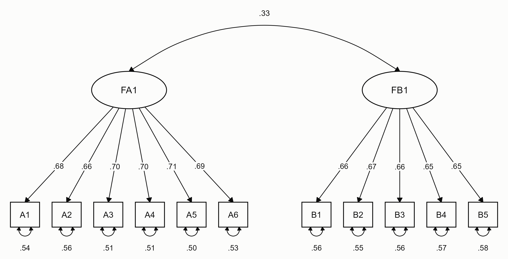



# Structural Equation Modeling (SEM)

## Before You Start

- What is SEM, and what does it include?
    - Note that SEM has two parts: the structural model and the measurement model. Many beginners run into problems with SEM because they did not understand these basic concepts thoroughly at the start. Honestly, I'm too lazy to pin down every academic term myself; as long as you understand them, that's fine.
- When should you use SEM?
- What are latent variables, exogenous variables, and endogenous variables?
- What makes a good structural equation model?
- How do you test mediation?

The procedures and indices discussed below (anything involving numbers) should be backed by the literature. Remember to cite it when you write your paper.

### Parameters of a CFA Model

A confirmatory factor analysis (CFA) is the measurement model on its own: each latent variable (factor) is measured by several items, and the factors may correlate. The table lists its parameters, with F for a factor and x for an item.

:::: {.list-table header-rows=1}
- - Symbol
  - Parameter
  - lavaan
  - Meaning
- - λ (lambda)
  - Factor loading
  - `F =~ x`
  - The relation between the factor and the item: how much the item changes when the factor increases by one unit.
- - ψ (psi)
  - Factor variance and covariance
  - `F ~~ F`, `F1 ~~ F2`
  - How much people differ on the factor. A small ψ means the differences between people are small. The covariance between two factors is also a ψ.
- - α (alpha)
  - Factor mean
  - `F ~ 1`
  - Usually fixed at 0 (see below).
- - τ (tau)
  - Item intercept
  - `x ~ 1`
  - The expected value of the item when the factor is 0. With the factor mean at 0, it is the item's mean.
- - θ (theta)
  - Residual variance
  - `x ~~ x`
  - The part of the item that the factor does not explain: measurement error plus anything specific to that item. Residuals are uncorrelated unless you add a residual covariance (`x1 ~~ x2`).
- - R²
  - Explained variance
  - (computed)
  - The share of the item's variance that the factor explains. In the standardized solution, R² = λ² = 1 − θ for an item that loads on one factor.
::::

A factor has no scale of its own, so its mean and its unit have to be fixed before the model can be estimated (identification). In a single-group model, the factor mean α is fixed at 0. For the unit, either the first loading is fixed at 1 (fixed loading, the default in lavaan and Mplus) or the factor variance ψ is fixed at 1 (fixed variance); see step 5 of the Basic Procedure. In a multigroup model, the factor mean is fixed at 0 in one group only, so that the latent means of the other groups can be compared with it (see [Multigroup Analysis](multigroup-analysis.qmd)).

### How CFA Estimates the Model

Because the factor is not observed, the model cannot estimate λ by regressing each item on it. It starts instead from what the factor implies: items that measure the same factor correlate because they share that factor. From λ, ψ, and θ, the model computes the variances and covariances that the items should have, the model-implied covariance matrix. For items $i$ and $j$ on the same factor:

$$
\begin{aligned}
\operatorname{cov}(x_i, x_j) &= \lambda_i \lambda_j \psi \\
\operatorname{var}(x_i) &= \lambda_i^2 \psi + \theta_i
\end{aligned}
$$

For items on two different factors, the covariance is $\lambda_i \lambda_j \psi_{12}$, where $\psi_{12}$ is the covariance of the two factors. The estimator looks for the parameter values that bring the implied matrix as close as possible to the covariance matrix in the data, and the χ² test asks whether the difference that is left is larger than chance. A non-significant χ² (p > .05) therefore means that there is no evidence that the model misfits. It does not prove the model right, and in large samples even trivial differences are significant (Note 6).

The degrees of freedom (df) are the pieces of information in the data minus the number of free parameters. With $p$ items, the data give $p(p + 1)/2$ variances and covariances plus $p$ means. A factor with five items gives $15 + 5 = 20$ pieces of information. The model estimates 4 loadings (the first is fixed at 1), 1 factor variance, 5 intercepts, and 5 residual variances, 15 in all, so df = $20 - 15 = 5$. A factor with three items has df = $9 - 9 = 0$: the model reproduces the data exactly, and its fit cannot be tested on its own. [Under the Hood](#implied-covariance) checks these numbers in R.

## Basic Procedure

1. Handle missing values and outliers. There are many ways to do this; here we recommend multiple imputation.
2. Test for common method bias and multicollinearity: if all your data come from questionnaires, you need this step, and also check whether the variables are collinear.
    1. Currently there is no "perfect" test for common method bias. The literature tends to recommend the directly measured latent variable (DMLV) approach, but it requires you to specify the source of the bias in advance and collect an extra questionnaire.
3. Test univariate and multivariate normality, because non-normal data need different estimators: MLR or MLM for non-normal continuous data (MLR also handles missing data with FIML), and WLSMV for categorical (ordinal) data.
4. Compute the correlations between the dimension (subscale) scores.
5. Test the reliability and validity of the scales; there are different indices you can report.
    1. CFA: this also counts as evidence of construct validity. There are two ways to set the scale of each latent variable, the fixed-variance method and the fixed-loading method, and both give the same model fit.
        1. Fixed variance: the variance of the latent variable is fixed to 1, and all loadings are estimated freely.
        2. Fixed loading: the loading of one item on each factor is fixed to 1, and the other loadings are estimated freely.
        3. Software usually uses fixed loading by default; if you want fixed variance, you may need to adjust the code (in lavaan, `std.lv = TRUE`; see [CFA syntax](#cfa-syntax)).
6. Path analysis: now you can fit the full model (SEM). Most online tutorials and videos only teach this step and skip the ones before it; if you go straight to the full model, the results may be poor.
    1. Report the fit indices, path coefficients, and other information from the path analysis.
7. Model modification:
    1. Look at the modification indices (MI). When an MI is above 3.84 (the critical chi-square value with 1 df at p < .05), you can add a residual correlation, usually between observed variables within the same factor. Because this is data-driven, it is best to have theoretical support. Don't follow every MI: stop once the fit indices are acceptable, otherwise the model becomes saturated. Mention these modifications in your paper. ~~Most people just don't explain why they made them (after all, they are data-driven).~~
    2. Then keep revising the model: change some paths based on your theory, and compare the new model with the original one.
8. Test mediation:
    1. The Sobel test assumes the indirect effect is normally distributed, which is rarely true because the product of two coefficients is usually skewed, so bootstrapping is now the common choice. 5,000 resamples are common and 10,000 are recommended, depending on how powerful your computer is.
        1. Judge significance by the 95% CI rather than the p-value: the effect is significant when the confidence interval does not include 0.
    2. The total effect can be masked (for example, by suppression), so it may be non-significant. I don't recommend leaning heavily on terms like "full mediation" and "partial mediation". Highly recommended reading:
        1. Rucker, D. D., Preacher, K. J., Tormala, Z. L., & Petty, R. E. (2011). Mediation analysis in social psychology: Current practices and new recommendations. *Social and Personality Psychology Compass*, *5*(6), 359-371. https://doi.org/10.1111/j.1751-9004.2011.00355.x
    3. It can indeed happen that path coefficients or the indirect effect are not significant after bootstrapping; bootstrapping gives more accurate confidence intervals and a more robust significance test. There are many possible reasons, such as a small sample or a misspecified model; in short, the relationships among the variables are not robust.

## Report Results

For a CFA, or the measurement part of any SEM, report the χ² test with its df and p-value, CFI, TLI, RMSEA with its 90% CI, and SRMR. Commonly used cutoffs for a good fit:

| Index | Good fit | Source |
|---|---|---|
| χ² | p > .05 | Sensitive to sample size (Note 6) |
| χ²/df | ≤ 2 or 3 | Schreiber (2008) |
| CFI, TLI | ≥ .95 | Hu & Bentler (1999) |
| RMSEA | ≤ .06 | Hu & Bentler (1999) |
| SRMR | ≤ .08 | Hu & Bentler (1999) |
| Standardized loadings | ≥ .50, ideally ≥ .70 | Hair et al. (2009), as cited in Cheung et al. (2024) |

Hu and Bentler (1999) proposed values close to these, not hard rules. With the MLR estimator, report the scaled χ² and the robust CFI, TLI, and RMSEA: the `Scaled` column and the `Robust` lines in lavaan's output.

A standardized loading of .70 means that the factor explains 49% (.70²) of the item's variance, about half. Cheung et al. (2024) also take sampling error into account: they look at the upper limit of the 90% CI of each standardized loading. If it is below .50, the item is a major concern; from .50 to below .70, a minor concern; at .70 or above, no concern.

The two-factor model in [CFA syntax](#cfa-syntax) could be reported like this:

> The measurement model was estimated with robust maximum likelihood (MLR), and missing data were handled with full information maximum likelihood (FIML). The first loading of each factor was fixed at 1 and the factor means at 0. The model fit the data well (Hu & Bentler, 1999), χ²(43) = 54.15, *p* = .119, CFI = .993, TLI = .991, RMSEA = .024, 90% CI [.000, .041], SRMR = .032. All standardized loadings were significant (*p*s < .001) and ranged from .65 to .71, and the upper limit of each 90% CI was at least .70 (Cheung et al., 2024). The factors explained 42% to 50% of the variance of each item. FA1 and FB1 were correlated, *r* = .33, 95% CI [.23, .43].

When you have several models or many items, put the numbers in tables rather than in the text:

- Fit table: one row per model (for example, each factor on its own, then the full measurement model), with χ², df, χ²/df, p, RMSEA and its 90% CI, SRMR, CFI, and TLI.
- Loading table: for each item, the unstandardized loading with its SE, the standardized loading, and R². Mark the loadings fixed at 1 for identification with a dash in the SE column, and give the factor variances and covariances at the bottom.

[Numbers for the Tables](#numbers-for-the-tables) collects these values in R. A path diagram with the standardized estimates can go in the paper or its appendix:



- [Joel Collier: How to present Structural Equation Modeling results in a journal (YouTube)](https://www.youtube.com/watch?v=kEuxOwTWKPA)

## Notes

1. Latent vs. observed variables: observed variables are the individual items on the questionnaire, and a latent variable is your operationalized construct, the variable you want to study. For example, if I want to study the severity of depression, that is an abstract concept; you need to make it operational, that is, measure it with a scale (or by other means).
2. Don't be purely data-driven: SEM needs strong theoretical support. If you are purely data-driven, the discussion will be hard to write.
3. Use WLSMV for categorical variables.
4. When the model is too complex and the fit is not acceptable:
    1. Simplify your model. A more complex model is not necessarily better; it has to make sense.
    2. Take a single dimension into the SEM instead of putting several dimensions together in a mediation model.
    3. Item parceling (explain why you used this method and how you did it):
        1. The most common way is to use the dimension scores directly; if you want to use item parceling, look up the literature.
            1. When I first started and didn't know better, I summed all the dimension scores into a total and analyzed it as a first-order latent variable. Later I found out you can't do that, haha. But in a sense, this is also a kind of item parceling.
        2. However, **I strongly recommend using the raw (item-level) data rather than processed data**: if you use averages, you may ignore measurement error and introduce bias (see [Latent vs. Observed Correlation](#latent-vs-observed)).
5. Scale reliability and validity should already be tested in the pilot study, and then adjusted with the large sample. Remember to handle the reverse-scored items.
6. Reporting indices: different papers report different indices. You don't need to report all of them, and they don't all need to meet the cutoffs. Some indices are affected by factors such as sample size (e.g., the p-value of the chi-square test); if one doesn't meet the cutoff, explain it in your paper.
7. Generally, only after a simple mediation model works should you move on to more complex models.
8. CFA is a must, although you don't have to report it, depending on the length of your paper. If the CFA fails, the model is pretty much unusable...
9. EFA and CFA must use different samples; they are different things. You can roughly think of the EFA as a pilot study.
10. If you designed the questionnaire yourself, factor loadings > 0.5 (more leniently, 0.4) are acceptable; for previously validated questionnaires, > 0.6. Look up literature support for these cutoffs. Cheung et al. (2024) review the published rules: 0.4 for interpretation, and at least 0.5, ideally 0.7 (see [Report Results](#report-results)).
11. If the CFA fit is poor, you may need to delete items or further process the sample:
    1. If you use an established questionnaire, it's better not to delete items casually (assuming you already have a large sample; otherwise your method may end up different from others'), unless your pilot study already revealed big problems (then you can redevelop the questionnaire).
    2. Problematic (very large) path coefficients may mean a problem with the model structure, or that the coefficients are not standardized.
    3. Your data quality is poor.
12. A second-order factor model and a bifactor model are two different things.
    1. A second-order factor model needs to go back to theory: you can only fit a higher-order model when the total of the subscales (dimensions) is meaningful. For example, the dimensions of a personality scale are theoretically uncorrelated, so a second-order model doesn't work and their total is meaningless; in that case, take each dimension (depending on your hypotheses) into the SEM separately.
    2. A second-order factor needs three or more first-order factors; with only two, extra constraints are needed (such as fixing loadings). The same goes for items: for a CFA, each factor should have three or more items.
13. Variables don't necessarily need to be correlated.
14. Some situations, such as a non-significant total effect or path coefficients greater than 1 or less than -1, are normal, and your software won't report an error. But you need to look at them together with R² and the 95% CI.
    1. Hayes, A. F. (2009). Beyond Baron and Kenny: Statistical mediation analysis in the new millennium. *Communication Monographs*, *76*(4), 408-420. https://doi.org/10.1080/03637750903310360

See also: De Stavola, B. L., Daniel, R. M., Ploubidis, G. B., & Micali, N. (2015). Mediation analysis with intermediate confounding: Structural equation modeling viewed through the causal inference lens. *American Journal of Epidemiology*, *181*(1), 64-80. https://doi.org/10.1093/aje/kwu239

## Summary and Practice

### Confirmatory factor analysis (CFA)

- **Variable types:** Any (continuous and categorical variables)
- **When to use:** How do you define and measure your operational variables?
- **Functions:** lavaan package, `cfa()`; see [CFA syntax](#cfa-syntax), which also gives the Mplus version
- **Comment:** lavaan is by far the most widely used SEM package in R. The official documentation and forum cover a lot of tutorials and answer the questions you may have. I recommend making good use of the official forum.
- **Resources:** [lavaan tutorial](https://lavaan.ugent.be/tutorial/)

### Second-order CFA

### Path analysis

### Mediation analysis

- **Comment:** For curved (nonlinear) paths, see [Nonlinear Mediation](nonlinear-mediation.qmd).

### Control variables (covariates)

- **Variable types:** Any
- **When to use:** My theory is that demographic variables (e.g., gender and age) affect (or predict) suicidal behavior, so to make the results more robust, I control for the effect of the demographic variables on suicidal behavior.
- **Comment:**
  - All the x's are independent variables: the one you focus on is the explanatory variable, and the ones you don't focus on are control variables. "Control" means you don't care about it, but because it affects y, it would affect the estimate for the explanatory variable you care about, so you add it to the model to control for it.
  - The main purpose of control variables is to control potential confounders, so that the relationship between the independent and dependent variables is not distorted by them. By controlling these variables, we can estimate the direct and indirect effects of the independent variable on the dependent variable more accurately. Paths in SEM represent hypothesized causal relationships: the independent variable is the starting point of the causal chain, and the dependent variable is the outcome. If you regress the independent variable on a control variable, which one is the independent variable? The independent variable is generally considered independent. We usually treat X as exogenous; although X and C are correlated, the model is designed to make the causal paths and explanations explicit.
  - The model aims to estimate the direct and indirect effects of X on Y and M. Although X and C are correlated, we care about the unique effect of X after controlling for C. C is added to control confounding, not to redefine X. When we say X and C are correlated, we only mean that they share some variance in the data; this does not mean that C fully determines X.
  - How to specify it depends entirely on your theory (or previous studies). If you think a control variable affects the dependent variable, the mediator, or both, regress those variables on the control variable. If you think it only affects the dependent variable, regress only the dependent variable on it. In fact, regression works the same way: the control variables and the independent variable are allowed to correlate by default. But note: don't regress the independent variable on the control variables.
- **Resources:** [lavaan Google Group: Add control variable in SEM](https://groups.google.com/g/lavaan/c/xdCnpHHTh6s), [lavaan Google Group: lavaan syntax for control variables in mediation](https://groups.google.com/g/lavaan/c/03gq8K324k8), [Cross Validated: How do you control for a variable in SEM with mediation?](https://stats.stackexchange.com/questions/550048/how-do-you-control-for-a-variable-in-sem-with-mediation-what-do-i-regress-onto), [Quora: What are control variables and how do I use them in regression analysis?](https://www.quora.com/What-are-control-variables-and-how-do-I-use-them-in-regression-analysis)

### Moderation

- **Variable types:** Usually categorical (compared with a multigroup model), but continuous variables also work: use them directly in an interaction term rather than splitting them into groups, which loses information.

### Multigroup comparisons

- **Comment:** Measurement invariance and comparing paths across groups: see [Multigroup Analysis](multigroup-analysis.qmd).

### Export results

- **Functions:** lavaan, bruceR
- **Resources:** [bruceR](https://psychbruce.github.io/bruceR/)

### Figures

- **Comment:** So far there is no best package for drawing SEM figures; you could use Word or PowerPoint.

## Syntax

The code in this section runs in your browser and prints its output when the page loads. The first visit downloads lavaan, so the first results take a while to appear. You can edit any cell and run it again.

The examples use the scored version of the simulated dataset described in [Example Data](example-data.qmd), in which A4 and A11 are already reverse-scored. Some items are missing, so every model uses `missing = "fiml"` with the MLR estimator (step 3 of the Basic Procedure).

### Confirmatory Factor Analysis (CFA) {#cfa-syntax}

#### One Factor

```{webr}
#| autorun: true
library(lavaan)
mydata <- read.csv("data/mydata_scored.csv")
```

```{webr}
#| autorun: true
model_b <- 'FB1 =~ B1 + B2 + B3 + B4 + B5'
fit_b <- cfa(model_b, data = mydata,
             estimator = "MLR", missing = "fiml")
summary(fit_b, fit.measures = TRUE, standardized = TRUE,
        rsquare = TRUE)
```

How to read the output:

- `Estimate` is the unstandardized estimate. The first loading is 1 and has no SE because it is fixed.
- `Std.all` is the standardized solution: the standardized loadings under Latent Variables, and the standardized residual variances θ under Variances (the dot before an item name marks a residual).
- `R-Square` is 1 − θ for each item.
- With MLR, read the `Scaled` column of the χ² test and the `Robust` lines for CFI, TLI, and RMSEA. Here χ²(5) = 4.37, p = .497.

#### What `cfa()` Adds for You

The one-line model hides most of the parameters. `cfa()` adds them by default: it fixes the first loading at 1 and the factor mean at 0, and frees the factor variance, the item intercepts, and the residual variances. `lavaan()` adds nothing by itself, so the model below writes every parameter out. It gives the same χ², df, and number of parameters as the one-line model, and so does the fixed-variance version (`std.lv = TRUE`):

```{webr}
#| autorun: true
model_b_full <- '
# loadings (lambda); 1* fixes a parameter at 1
FB1 =~ 1*B1 + B2 + B3 + B4 + B5

# factor mean (alpha); ~ 1 is a mean or intercept, 0* fixes it at 0
FB1 ~ 0*1

# factor variance (psi); ~~ with the same variable on both sides
FB1 ~~ FB1

# item intercepts (tau)
B1 ~ 1
B2 ~ 1
B3 ~ 1
B4 ~ 1
B5 ~ 1

# residual variances (theta); no residual covariances are written,
# so they are fixed at 0
B1 ~~ B1
B2 ~~ B2
B3 ~~ B3
B4 ~~ B4
B5 ~~ B5
'
fit_b_full <- lavaan(model_b_full, data = mydata,
                     estimator = "MLR", missing = "fiml")
fit_b_std <- cfa(model_b, data = mydata, std.lv = TRUE,
                 estimator = "MLR", missing = "fiml")

fits <- list(short = fit_b, full = fit_b_full, std_lv = fit_b_std)
sapply(fits, fitMeasures, c("chisq.scaled", "df", "npar"))
```

All three columns are identical. `parTable(fit_b)` lists every parameter with a `free` column (0 means fixed), the same check as `TECH1` in Mplus.

#### Under the Hood: the Implied Covariance Matrix {#implied-covariance}

```{webr}
#| autorun: true
# model-implied and observed covariance matrices
fitted(fit_b)$cov
lavInspect(fit_b, "sampstat")$cov

# covariance of B2 and B3 by hand: lambda2 * lambda3 * psi
est <- lavInspect(fit_b, "est")
est$lambda["B2", 1] * est$lambda["B3", 1] * est$psi[1, 1]

# df: pieces of information minus free parameters
p <- 5
p * (p + 1) / 2 + p - unname(fitMeasures(fit_b, "npar"))
```

With missing data, `sampstat` is the FIML estimate of the item covariances: the "observed" matrix that the model is compared with. The covariance of B2 and B3 computed by hand is 0.589, the value in the implied matrix; the data give 0.599. The χ² sums up such differences over the whole matrix. The last line is the df from [How CFA Estimates the Model](#how-cfa-estimates-the-model): 20 pieces of information minus 15 free parameters.

#### Two Factors

```{webr}
#| autorun: true
model_ab <- '
FA1 =~ A1 + A2 + A3 + A4 + A5 + A6
FB1 =~ B1 + B2 + B3 + B4 + B5
'
fit_ab <- cfa(model_ab, data = mydata,
              estimator = "MLR", missing = "fiml")
summary(fit_ab, fit.measures = TRUE, standardized = TRUE,
        rsquare = TRUE)
```

`cfa()` lets the factors correlate by default; writing `FA1 ~~ FB1` gives the same model, and `FA1 ~~ 0*FB1` makes them uncorrelated. With 11 items, the data give 66 + 11 = 77 pieces of information, and the model has 34 free parameters (9 loadings, 2 factor variances, 1 covariance, 11 intercepts, and 11 residual variances), so df = 43. These are the numbers in the write-up in [Report Results](#report-results), and the figure there shows the standardized solution.

#### Numbers for the Tables

```{webr}
#| autorun: true
# fit indices (robust versions for MLR)
fitMeasures(fit_ab, c("chisq.scaled", "df", "pvalue.scaled",
                      "cfi.robust", "tli.robust", "rmsea.robust",
                      "rmsea.ci.lower.robust",
                      "rmsea.ci.upper.robust", "srmr"))

# loadings: unstandardized with SE, standardized with the
# upper limit of its 90% CI, and R-squared
est_ab <- parameterEstimates(fit_ab)
std_ab <- standardizedSolution(fit_ab, level = 0.90)
est_ab <- est_ab[est_ab$op == "=~", ]
std_ab <- std_ab[std_ab$op == "=~", ]
loadings <- data.frame(
  factor = est_ab$lhs, item = est_ab$rhs,
  b = est_ab$est, se = est_ab$se,
  beta = std_ab$est.std, beta_ci_upper = std_ab$ci.upper,
  r2 = lavInspect(fit_ab, "rsquare")[est_ab$rhs],
  row.names = NULL
)
loadings[, 3:7] <- round(loadings[, 3:7], 3)
loadings
```

The SE of A1 and B1 is 0 because their loadings are fixed: write a dash in the table. `beta_ci_upper` is the upper limit of the 90% CI that Cheung et al. (2024) use. Here every upper limit is at least .70 (the lowest, B5, is .701), so no item is a concern.

#### Latent vs. Observed Correlation {#latent-vs-observed}

The correlation between two factors is free of measurement error. The correlation between sum scores is not: a sum score treats every item as error-free, so measurement error lowers (attenuates) its correlations. In the simulated data, the true correlation between the two constructs is 0.4 (see [Example Data](example-data.qmd)).

```{webr}
#| autorun: true
# correlation of the sum scores
cor(mydata$A_s1, mydata$B_s1, use = "pairwise.complete.obs")

# correlation of the factors, with its 95% CI
std_cor <- standardizedSolution(fit_ab)
std_cor[std_cor$lhs == "FA1" & std_cor$op == "~~" &
          std_cor$rhs == "FB1", ]
```

The sum scores correlate .27, the factors .33, 95% CI [.23, .43], which includes the true value. This is why the Notes recommend item-level data over averages (Note 4).

#### Syntax in Mplus

Many SEM papers use Mplus. This part runs in Mplus on your computer, not in the browser. Mplus reads a data file without column names, with missing values coded as a symbol. `prepareMplusData()` from the MplusAutomation package writes the items in that format (missing values as `.`) and returns the matching `DATA` and `VARIABLE` lines, including `MISSING=.;`.

```r
library(MplusAutomation)
items <- mydata[, c(paste0("A", 1:6), paste0("B", 1:5))]
mplus_syntax <- prepareMplusData(items, "mydata.dat")
mplus_syntax
```

The two-factor model with Mplus defaults:

```text
TITLE: Two-factor CFA;
DATA: FILE = mydata.dat;
VARIABLE: NAMES = A1-A6 B1-B5;
  MISSING = .;
ANALYSIS: ESTIMATOR = MLR;
MODEL:
  FA1 BY A1-A6;
  FB1 BY B1-B5;
  FA1 WITH FB1;
OUTPUT: SAMPSTAT STANDARDIZED TECH1 CINTERVAL;
```

The same model with every parameter written out, as in the lavaan version above:

```text
MODEL:
  FA1 BY A1@1 A2-A6;  ! loadings; the first is fixed at 1
  FB1 BY B1@1 B2-B5;
  [FA1@0 FB1@0];      ! factor means fixed at 0
  FA1 FB1;            ! factor variances
  FA1 WITH FB1;       ! factor covariance
  [A1-A6 B1-B5];      ! item intercepts
  A1-A6 B1-B5;        ! residual variances
```

With missing data, Mplus uses FIML by default. `STANDARDIZED` prints the STDYX solution, which matches lavaan's `Std.all`, and R-SQUARE; `TECH1` numbers every free parameter, so you can check what Mplus estimated. If you need lavaan's results to match Mplus output as closely as possible, add `mimic = "Mplus"` to `cfa()`.

lavaan and Mplus syntax side by side:

| | lavaan | Mplus |
|---|---|---|
| Factor measured by items | `F =~ x1 + x2 + x3` | `F BY x1-x3;` |
| Regression | `y ~ x` | `y ON x;` |
| Covariance | `x1 ~~ x2` | `x1 WITH x2;` |
| Variance | `x ~~ x` | `x;` |
| Mean or intercept | `x ~ 1` | `[x];` |
| Fix a parameter at a value | `F =~ 1*x1` | `F BY x1@1;` |
| Free a parameter that is fixed by default | `F =~ NA*x1` | `F BY x1*;` |
| Label a parameter | `y ~ a*x` | `y ON x (a);` |
| New parameter from labels | `ab := a*b` | `MODEL CONSTRAINT: NEW(ab); ab = a*b;` |
| Robust ML estimator | `estimator = "MLR"` | `ANALYSIS: ESTIMATOR = MLR;` |

## Resources & References

- [Newsom: Categorical Data Analysis class](https://web.pdx.edu/~newsomj/cdaclass/)
- [lavaan tutorial: Confirmatory factor analysis](https://lavaan.ugent.be/tutorial/cfa.html)
- [MplusAutomation (CRAN)](https://CRAN.R-project.org/package=MplusAutomation)

Cheung, G. W., Cooper-Thomas, H. D., Lau, R. S., & Wang, L. C. (2024). Reporting reliability, convergent and discriminant validity with structural equation modeling: A review and best-practice recommendations. *Asia Pacific Journal of Management*, *41*(2), 745-783. https://doi.org/10.1007/s10490-023-09871-y

Hu, L., & Bentler, P. M. (1999). Cutoff criteria for fit indexes in covariance structure analysis: Conventional criteria versus new alternatives. *Structural Equation Modeling: A Multidisciplinary Journal*, *6*(1), 1-55. https://doi.org/10.1080/10705519909540118

Schreiber, J. B. (2008). Core reporting practices in structural equation modeling. *Research in Social and Administrative Pharmacy*, *4*(2), 83-97. https://doi.org/10.1016/j.sapharm.2007.04.003

### Further Study

#### Categorical Variables

- [lavaan: Categorical data](https://lavaan.ugent.be/tutorial/cat.html)
- [lavaan Google Group: How to enter binary observed outcome variable + scaling of latent variable?](https://groups.google.com/g/lavaan/c/FMkMUaj3FA8)
